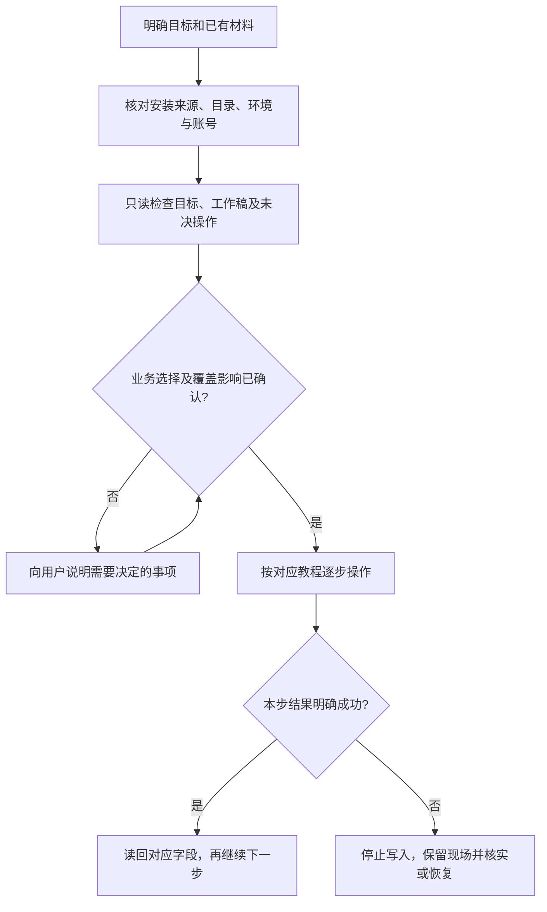

# 安装来源与 AI 代办

::: info CLI 同步文档
本页自动同步自 CLI 仓库使用手册。先核对已安装版本与本页适用范围；Node.js 22.14+ 是 CLI 自身要求，不是运行时对子应用的要求。来源、发布状态及已知限制见[版本说明](/about)。
:::


本页解决两件事：安装可用于本次任务的CLI，以及把任务交给AI时该提供什么。具体业务从[手册首页](./index.md#从任务开始)选择教程。

## 1. 安装正式包还是候选包

先检查Node，最低 **22.14.0**，使用受支持的Node22或24 LTS：

```sh
node --version
```

`@freelog/cli` 公开发布后，从 npm 安装：

```sh
npm install --global @freelog/cli
freelog-cli --cli-version
freelog-cli --help
```

`--help`会显示安装包内的手册路径。已安装且满足本次任务时不必重装；维护者为本机连接了本地开发版时，保留链接，不重复全局安装覆盖它。

只有维护者要求试用未发布能力并提供固定候选 `.tgz` 时，才改用以下安装方式。先取得实际文件及对应说明，把占位符换成真实绝对路径：

```sh
npm install --global "<候选包绝对路径.tgz>"
freelog-cli --cli-version
freelog-cli --help
```

在线手册可能领先于已安装包。用包内手册及相应命令的 `--help`核对入口；帮助存在不等于某项修复已包含。候选包还需核对维护者指定的文件和说明，同版本号不能证明是同一份包。没有满足任务的包时，停止相应CLI操作，改用Console或向维护者确认，不猜下载地址和命令。

### 从旧包迁移

先用 `npm ls --global --depth=0` 查看本机安装来源。确认新包可从 npm 安装或已拿到候选包后，卸载实际已安装的旧包 `@freelog-cli/cli2` 或 `@freelog-cli/cli`，再安装新包，避免两个包同时提供 `freelog-cli`。例如旧包是 `@freelog-cli/cli2` 时，执行 `npm uninstall --global @freelog-cli/cli2`。迁移后运行 `freelog-cli --cli-version` 和 `freelog-cli --help`，核对版本及手册路径。原工程、本地登录和工作稿可继续使用。

## 2. 你负责决定什么，AI 可以代办什么

| 你提供或确认 | AI负责 |
|---|---|
| 要完成的目标、已有文件/项目、是否已有线上对象 | 选择对应教程，检查安装来源、环境、登录和当前状态 |
| 本次资源、合集、节点或展品 | 查找并核对精确ID、所属账号和操作对象 |
| 标题、标识、内容、授权范围、收费和策略选择 | 查询合法选项、解释影响，按确认内容填写，不猜商业规则 |
| 必须保留的未提交内容，是否允许覆盖 | 先读工作稿、解释覆盖影响，再按决定操作 |
| 必要登录、安全验证及支付 | 给出准确入口并等待本人完成，不把未完成步骤记成成功 |

可直接这样交代：

> 请把这张图片首次发行到dev。文件路径是……，线上是否已有资源是……，希望填写的资料和授权要求是……，需要保留的本地修改是……。请从手册选择流程，先核对账号、环境、目标和工作稿，再分步操作并读回结果；不明确的商业选择先问我，失败或结果未知时不要重复提交。

其他任务补充这些材料即可，不必自己编写完整命令：

| 任务 | 补充材料 |
|---|---|
| 已有资源发新版 | 资源ID、本次文件/构建目录、更新内容 |
| 管理作者合集 | 合集ID、准备收录的本人线上单资源ID |
| 从存储发行 | 存储对象ID、首次发行还是已有资源换源 |
| 管理节点或展品 | 本人节点ID、来源资源/展品ID、具体操作 |
| 开发主题或插件 | 工程目录、交互目标、演示节点 |

密码、验证码和token不要发到聊天或写入文件。验证码登录由本人在同一交互终端输入；AI按[登录教程](./02-环境与凭据.md#手机验证码登录)展示图片。当前新支付到浏览器，由本人确认，详见[授权与支付](./授权与支付/index.md)。

## 3. AI 动手前的初步检查



1. 使用对应安装包的手册和实际命令，不把在线说明当作本机已支持的证明。
2. 确认工程目录和 `--env dev`或test；已有正确登录不重复登录，账号与环境规则见[02](./02-环境与凭据.md)。
3. 作者资源先查 `resource list`；已知ID再查 `status --resource id:<资源ID> --env dev`。显示有稿时读 `version show --local`，决定保留还是放弃后才拉稿。合集和节点展品使用各自教程，不套作者绑定流程。
4. 只查询公开市场不能找到所有本人资源；标题不唯一。使用精确ID，查询不到先核实范围，不直接创建替代对象。
5. 一步成功并读回后再继续。上架状态、交易状态、授权和运行时访问是不同结果，不能互相代替。

结果未知时按[故障恢复](./09-常见情况与报错.md)核实，不删未决记录强行继续。需要解析JSON、转义参数或批量编排时再读[自动化与结果处理](./12-自动化与结果处理.md)，不把整页示例直接拼成脚本。
