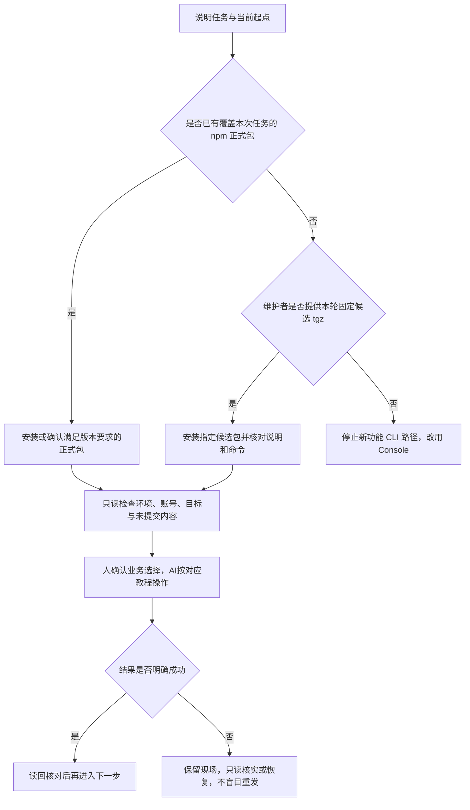

# 先选版本，再让人或 AI 完成任务

::: info CLI 同步文档
本页自动同步自 CLI 仓库使用手册。先核对已安装版本与本页适用范围；Node.js 22.14+ 是 CLI 自身要求，不是运行时对子应用的要求。来源、发布状态及已知限制见[版本说明](/about)。
:::


本页帮助你选择安装包、交代任务并检查起点。手册面向 **0.6.0 及后续兼容版本**，说明适用范围和安装方式，不代表 npm 已有该正式包；是否已发布以维护者发布说明和实际包为准。旧 npm 0.5.9 不包含新增依赖签约、市场与节点展品、存储管理及发行导入、展品展示版本与自动更新能力。



## 1. 安装正式包还是候选包

两种安装路径选择一种即可。已安装且满足本次任务时，不必重复安装。

| 任务 | 使用路径 |
|---|---|
| 普通单资源创建、首版、作者策略和上架等已有能力 | 可使用支持本次任务的 npm 正式包；从[快速上手](./01-快速上手.md)继续 |
| 依赖签约、市场与节点展品、存储管理和发行导入、展品版本管理 | 需要 0.6.0+。正式包可用后通过 npm 安装；发布前使用维护者提供的本轮固定候选包，旧 npm 0.5.9 不支持 |
| 尚无满足要求的正式包，也未取得对应候选包 | 停止相应 CLI 路径，改用 Console；不要猜包下载地址、命令或版本 |

先检查 Node，最低 **22.14.0**，使用受支持的 Node 22 或 24 LTS：

```sh
node --version
```

0.6.0 正式包可用后，可明确安装该版本；后续版本请按维护者的发布说明选择。尚未发布时走下面的候选包路径，不把安装失败解释为登录或业务数据问题：

```sh
npm install --global @freelog-cli/cli2@0.6.0
freelog-cli --cli-version
freelog-cli --help
```

尚未取得满足任务的正式包时，向维护者取得本轮固定 `.tgz` 及对应说明，核对指定文件后安装；不要自行编造下载地址，也不要用工作区构建目录代替指定包。把占位符替换成文件的真实绝对路径：

```sh
npm install --global "<候选包绝对路径.tgz>"
freelog-cli --cli-version
freelog-cli --help
```

例如需要依赖签约、展品或存储流程时，再检查对应命令是否存在（查看帮助只核对入口，不能代替实际操作结果）：

```sh
freelog-cli version dep add --help
freelog-cli exhibit add --help
freelog-cli storage --help
```

正式包核对安装来源、`--cli-version` 和实际子命令；候选包还要核对维护者指定的文件和说明，不能只凭版本元数据认定是同一份包。若装到旧 npm 0.5.9，不要继续本页的 0.6.0+ 新流程；也不能因为手册写了命令就认定当前包已经支持。

## 2. 你负责决定什么，AI 可以代办什么

不懂代码也能让 AI 操作，但先说明目标，不需要自行编写全部参数。

| 人确认 | AI 代办 |
|---|---|
| 要发行什么、标题和授权标识、已有还是新资源 | 核对起点，选择 create、bind、首版或更新教程 |
| 收费、期限、授权范围、依赖来源及要使用的策略 | 查询可用模板和完整参数，解释选项，按确认内容填写；不替你决定商业规则 |
| 哪些未提交内容必须保留，是否放弃或覆盖旧稿 | 只读检查稿和未决操作，说明覆盖影响，保留需要的内容 |
| 资源、合集、节点和展品中本次要操作的对象 | 查找精确 ID，核对账号、环境和所属主体，执行并读回 |
| 必要的网页登录、支付或安全验证 | 说明当前阻塞与去哪里处理；不把未完成的人工步骤记成成功 |

当前 CLI 暂不支持支付。需要支付才能获得授权时，未完成支付就无法获得授权；有待支付合同不代表内容可访问。与 Console 对齐完整能力是后续目标，不是当前完成情况。

你可以这样交代任务：

> 我要把这个工程的主题首次发行到 dev，工程路径是……；线上是否已创建资源是……；要保留的本地修改是……；授权要求是……。请先核对安装包和当前状态，说明要操作的对象及步骤，再完成操作；不明确的商业规则先说明，不要猜。失败或结果未知时先查明，不重复提交。

已有资源发新版时，补充资源 ID、本次产物路径和更新意图；管理合集时补充合集 ID 与准备加入的线上单资源 ID；接入节点时补充本人节点 ID 与来源资源。只知道标题时先查询确认，标题不能直接作为精确写入目标。

## 3. AI 动手前的初步检查

按任务检查需要的项目，不要求用户逐条手工执行：

1. 检查 Node、CLI 包来源、版本及实际子命令，选择[按场景入口](./03-按场景操作.md)。不要用旧 npm 0.5.9 执行 0.6.0+ 新流程；发布前按维护者说明使用固定候选包。
2. 确认工程目录与环境；示例使用 `--env dev`，不能省略后误用默认环境。核对最近账号选择器；已有可用登录不重复登录，未登录按[凭据教程](./02-环境与凭据.md)处理，秘密不进命令行或报告。
3. 作者发行先检查本地身份、产物、工作稿和未决记录：`resource list` 只读诊断；已知目标用 `status --resource id:<资源ID> --env dev`，已有稿用 `version show --local --resource id:<资源ID> --env dev` 查看。没有稿时报错不能当成丢稿；有稿先保留再决定是否拉取。
4. 节点展品任务按[专用教程](./节点与展品/index.md)核对节点与来源，不套用作者 init/bind；合集目录稿、表单稿和线上快照按[合集教程](./合集/index.md)分别检查。
5. 先把任务和人工需确认的选择说清，再分步执行；每步检查退出结果与实际读回。只读列表证明其展示的字段，不证明已上架、已支付或运行时可访问。

失败或结果未知时转[故障恢复](./09-常见情况与报错.md)。查不到结果不能直接当作失败重发，也不要删除本地未决记录来强行继续。
