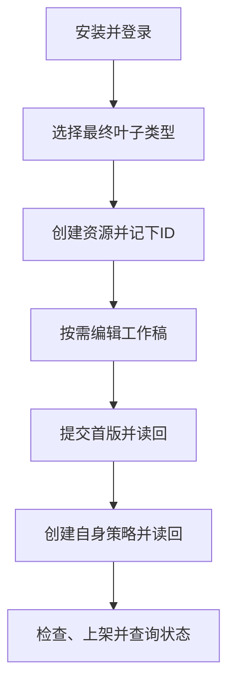

# 从安装到普通文件首次上架

::: info CLI 同步文档
本页自动同步自 CLI 仓库使用手册。先核对已安装版本与本页适用范围；Node.js 22.14+ 是 CLI 自身要求，不是运行时对子应用的要求。来源、发布状态及已知限制见[版本说明](/about)。
:::


目标：把工程中已有的 `cover.png` 发成一份普通单资源，发行首版、添加自身授权策略并上架。已有线上资源应走[绑定后更新](./04-日常路径.md#接入已有资源并发布新版本)；主题与插件走[专用教程](./05-主题与插件.md)。

准备一个文件夹，把要发行的图片放进去，并在这个文件夹打开终端。本页把它称为“工程目录”，用其中的 `cover.png` 举例，不需要先运行init。前置条件是 **Node.js 22.14.0或更高版本**（受支持的Node22或24 LTS）和可用的开发环境账号。

本页主线适合人工在交互终端操作；使用自己的文件名、标题和标识。AI可代办查询和命令，但要在标出的选择、编辑和确认处停下，不能把所有代码块连续执行。



## 1. 安装与登录

先按[安装来源与AI代办](./00-版本选择与AI代办.md)核对 CLI 和对应版本的手册。已有满足任务的安装包不必重装，维护者提供的本地开发链接保留。

尚未安装且选择正式包时执行：

```powershell
node --version
npm install --global @freelog/cli
freelog-cli --cli-version
```

命令找不到时先重新打开终端，再检查 npm 全局可执行目录是否在 PATH 中。未登录该工程时执行：

```powershell
freelog-cli login
```

停下来完成账号、星号密码输入，确认登录成功。也可用`freelog-cli login --method code`，由本人查看图形验证码并输入手机/邮箱收到的六位验证码。已有可用登录则跳过，不重复 login。账号切换、验证码登录、父目录继承和 CI 登录见[环境与凭据](./02-环境与凭据.md)。

## 2. 选择资源类型

查询当前平台的图片类型：

```powershell
freelog-cli type search 图片
```

从结果的“根 / … / 叶子”完整路径中选定符合文件用途的**最终叶子 code**。交互终端每页 50 条，可以翻页；不要填父节点或类型名称。查询能力、确认选择：

```powershell
freelog-cli type info <选定的最终叶子code>
```

若当前类型支持可选配置，后面可以填写；不是每种图片类型都支持。没有合适结果时停止，改用 `type list` 查看类型树，不猜 code。

## 3. 创建线上资源

在交互终端创建：

```powershell
freelog-cli create --artifact cover.png --type <选定的最终叶子code>
```

填写标题和短标识，核对摘要后确认“立即创建”。短标识可回车采用标题生成的建议；确认前取消不会创建。这一步只创建资源，不上传图片、不发行版本、不上架。**记下返回的资源ID**，后面所有 `<资源ID>`都替换成它。标识创建后不能修改，标题以后可以改。

AI或脚本已取得全部信息时，**改用**完整参数，不重复创建：

```powershell
freelog-cli create --title "我的图片" --name my-image --type <选定的最终叶子code> --artifact cover.png --yes
```

## 4. 发行首版

如果只需要最小首版，直接执行下方“提交首版”。如果要填写属性、可选配置或依赖，先准备工作稿：

```powershell
freelog-cli create-version --prepare --resource id:<资源ID>
freelog-cli version show --local --resource id:<资源ID>
```

**可选停顿：现在填写、检查工作稿，再提交。**准备命令会准备或上传文件、校验字段定义并保存稿，不等待只读系统属性解析完成，也不提交版本；[版本工作稿教程](./06-版本工作稿.md)说明各字段怎么填。不要等首版已经发行后才尝试给首版补属性、配置或依赖。

提交首版：

```powershell
freelog-cli create-version --resource id:<资源ID> --yes
freelog-cli version show --resource id:<资源ID>
```

确认线上出现 `1.0.0`。首版号固定，首版说明为空；若要补该已发版本的说明，用工作稿教程中的“已发版本说明”操作。提交失败或结果未知时先查[故障恢复](./09-常见情况与报错.md)，不要直接重复提交。

## 5. 添加自身授权策略

在交互终端执行：

```powershell
freelog-cli policy template list --resource id:<资源ID>
```

**在这里停下来完成交互**：模板每页 20 条，可以翻页；选择符合自己授权意图的模板 → 核对完整说明和参数标记 → 填写参数、修改策略名称 → 预览译文 → 确认创建。默认值也需要核对。退出或取消并不会创建策略。

确认创建成功后再查询：

```powershell
freelog-cli policy list --resource id:<资源ID>
```

必须看到至少一条符合预期且启用的**自身策略**，才继续上架。依赖签约不能替代自身策略。非交互运行列表只查询，不会添加；AI/脚本改用[完整参数提交路径](./07-单资源授权策略.md#ai-或脚本添加策略)，创建并读回确认后再回来继续。

## 6. 检查并上架

```powershell
freelog-cli validate --for online --resource id:<资源ID>
```

检查成功后才执行上架；失败先补缺失项：

```powershell
freelog-cli online --resource id:<资源ID> --yes
freelog-cli resource show --resource id:<资源ID>
```

查询核对同一资源ID与 `status=1`（已上架）。成功终点是：线上已有首版、至少一条符合预期的启用策略、资源已上架；只看到“创建成功”不是整个任务成功。`status`用于本地身份、工作稿和latest诊断，上下架核验用上面的 `resource show`。

接下来修改资料看[资源管理](./08-资源管理.md)，发新版看[日常路径](./04-日常路径.md#接入已有资源并发布新版本)。一个目录有多份资源时继续使用明确资源 ID，不通过标题定位。
