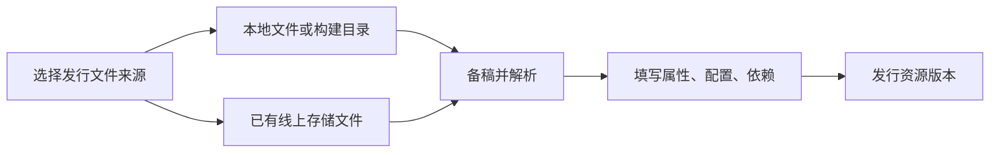

# 从线上存储导入文件并发行资源

::: info CLI 同步文档
本页自动同步自 CLI 仓库使用手册。先核对已安装版本与本页适用范围；Node.js 22.14+ 是 CLI 自身要求，不是运行时对子应用的要求。来源、发布状态及已知限制见[版本说明](/about)。
:::


本页适用于 **0.6.0+**，旧 npm 0.5.9 不包含存储管理与发行导入能力。0.6.0 正式包可用后通过 npm 安装；发布准备阶段使用维护者提供的固定候选包，具体见[版本选择](../00-版本选择与AI代办.md)。示例显式使用dev，同一环境先完成登录。

存储空间及其中的文件都在线上。CLI通过接口读取或管理线上数据，不在本地创建空间副本、同步文件目录或维护空间清单。发行只需选择其中一个文件，无须下载后再上传，也不要求先用CLI创建空间。

本地保存的是资源身份、所选文件来源和待发行工作稿。对象元数据须显式导入；编辑稿或发行资源不会反向修改存储对象。创建、上传、删除是后面的可选线上管理能力。



## 1. 使用已有存储文件发行资源

先取得要使用的线上对象ID。可以在Console查看，也可以只读查询已有空间及文件：

```sh
freelog-cli storage bucket list --env dev
freelog-cli storage list --bucket my-space --json --env dev
```

已有文件就直接导入，不必先创建空间或重新上传。在专用工程目录执行：

```sh
freelog-cli init . --storage-object <对象ID> --type <类型码> --yes --env dev
freelog-cli create --name my-photo --title "我的图片" --yes --env dev
freelog-cli create-version --prepare --env dev
freelog-cli version show --local --json --env dev
```

用实际资源类型替换示例类型码。CLI读取对象当前SHA1，按资源类型解析。确认文件及工作稿信息后继续现有[版本表单](../06-版本工作稿.md)操作，填属性、该类型支持的可选配置和依赖，再执行create-version --yes。首版描述按现行规则为空；更新稿需要版本说明时使用`version draft description --description "说明"`。文件来源本身不会自动导入存储对象的元数据。

已有资源绑定到本地工程时，可显式指定来源：

```sh
freelog-cli bind <资源ID> --storage-object <对象ID> --yes --env dev
freelog-cli version draft pull --yes --env dev
freelog-cli version set --storage-object <新对象ID> --yes --env dev
freelog-cli update-version --bump patch --yes --env dev
```

本地来源用artifact，远端来源用storage-object，两者互斥。pull只拉工作稿，不自动改来源。存储对象后来换了内容或已删除，发版会停止，需明确重新选择；只改了对象元数据不会自动追改已保存稿。切回本地文件可用version set --artifact现存工程内文件。

## 2. 明确导入对象的元数据

先查看对象与当前工作稿，再选择要复制的组：

```sh
freelog-cli storage show <对象ID> --json --env dev
freelog-cli version show --local --json --env dev
freelog-cli version draft import-storage <对象ID> --groups attributes,options --yes --env dev
```

attributes包括系统附加值和只读自定义属性，options是可选配置，dependencies是资源依赖；可以逗号组合。0.6.1修正（npm0.6.0不包含）：依赖按资源ID追加，同ID更新为导入的原版本范围，空列表不清空原依赖；属性按当前类型转换后替换选定属性组，可选配置替换选定配置组，未选组保留。属性/配置空组会明确清空该组的手填项，确认前请查看删除预览。

不会顺带更改文件来源，不会发版。依赖保留原版本范围；缺合同的全新依赖先用version dep add完成明确签约与声明，再重试导入。已有声明可用dep sign补签；支付仍在网页完成。对象依赖必须先发行成资源，再选资源引用，不自动批量发行。

导入attributes前先prepare或pull，让稿中有明确文件。当前类型仍需要的手录字段会校验后保留，不再需要的手录字段可转补充属性；补充属性若成为当前类型标准手录字段则转为标准。当前文件解析出的值始终为准，不沿用对象旧解析结果。预览列出转换、覆盖和删除；缺必要名称、值不符合当前格式、字段重名冲突、无法表达的配置类型、select默认值非第一项或确认期间数据变化时，整次拒绝并保留原稿，不猜值或改选项顺序。

## 3. 可选：查看或创建线上空间

```sh
freelog-cli storage usage --env dev
freelog-cli storage bucket list --env dev
freelog-cli storage bucket show my-space --env dev
```

免费容量说明为2GB，实际容量和用量以接口返回的storageLimit/totalFileSize为准；bucketCount是空间数量。当前最多5个自建空间，系统空间不作为普通空间管理。

创建前选好名称，创建后不能修改。名称为1至63位小写字母、数字或短横线，首尾不能短横线：

```sh
freelog-cli storage bucket create my-space --yes --env dev
```

名称已占用时请明确选择新名称，CLI不会随机改名。已有合适空间就直接使用，不必每个工程新建一个。

## 4. 可选：上传及管理线上文件

下面200MiB提前拦截、文件名规范化及最终名长度校验需要0.6.1或后续兼容版本；npm0.6.0不包含。最终对象名为1–60字符（含扩展名），超长拒绝，不静默截断；需要时通过--name明确取较短名字。名称改变时stderr提示原名和最终名（--yes/--json同样显示），stdout对象JSON仍保持独立。

```sh
freelog-cli storage upload ./photo.png --bucket my-space --yes --env dev
freelog-cli storage list --bucket my-space --search photo --json --env dev
freelog-cli storage list --bucket my-space --page 2 --json --env dev
freelog-cli storage show <对象ID> --json --env dev
```

上传接收单个文件；主题/插件构建目录仍通过作者发行流程压缩，不能把目录直接交给storage upload。列表每页50，人工终端可翻页，JSON调用自行选择页码。保存返回的objectId，标题和文件名不代替精确身份。

单文件最大200MiB（209715200字节），超限会在上传前拒绝。对象名（包括显式--name）会按Console规则将空白、部分标点和emoji连续段替换为下划线，例如`my photo?.png`变为`my_photo_.png`；预览会显示原名与最终名，本地文件不改名。空名、点路径、路径分隔符及控制字符直接拒绝。以最终名查重，因此两个不同原名也可能产生同名冲突，仍需明确选择是否覆盖。旧线上对象不自动改名，后续选择请以查询返回的实际名称/ID为准。

同名默认拒绝。确实要替换时，检查预览后显式选择覆盖：

```sh
freelog-cli storage upload ./new-photo.png --bucket my-space --name photo.png --replace --yes --env dev
```

同名覆盖可能保留objectId而改变内容，所以不能以“ID没变”判断文件没变。未知结果时先恢复核验，不直接重复覆盖。存储对象配置、作者版本配置和节点展品覆盖是不同层次；本页管理命令不编辑对象元数据。

平台同名写入会覆盖，尚无原子“仅不存在时创建”接口。CLI会查重及写前复核；请避免在多个客户端同时操作同一空间的同名文件。

## 5. 可选：删除与未知结果恢复

```sh
freelog-cli storage remove <对象ID> --yes --env dev
freelog-cli storage bucket remove my-space --yes --env dev
freelog-cli storage recover --env dev
freelog-cli storage recover <操作ID> --env dev
freelog-cli storage recover <操作ID> --apply --yes --env dev
```

删除对象前显示已发行使用情况，仅删除存储对象，不删除资源。删除空间要求先为空，且没有未完成上传任务，不自动清空文件。CLI会阻止本账号同空间的未决操作；其他客户端尚有上传任务时，平台仍可能拒绝删除，不会自动取消其任务。平台上的版本访问仍受对应授权规则约束，不能把存储删除提示当作所有内容永远可访问的承诺。

recover默认只读，apply+yes仅收尾可确认的记录，从不重发请求。若报告“物理文件存在、对象未创建”，说明上传字节阶段已核实，尚没有完成空间对象建立；先显式收尾，再重新执行上传命令，已有物理内容会复用。发送对象请求后仍未知时保留记录，不能靠再次同名上传掩盖它。

存储命令不接受作者resource选择器；只有作者发行及版本命令使用resource选择具体N.json。多资源工程优先传resource id或file:N.json，远端来源不用artifact路径选择器。
