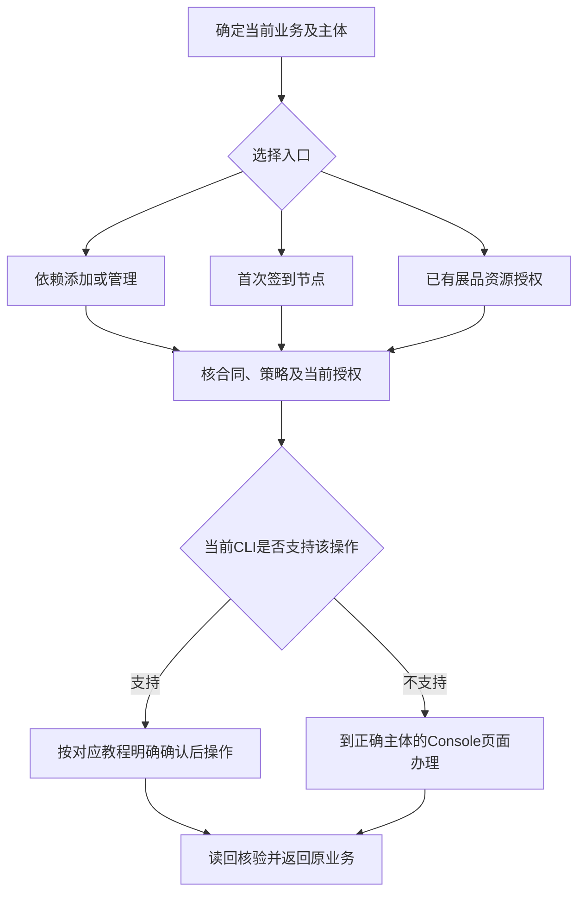

# 授权与支付

::: info CLI 同步文档
本页自动同步自 CLI 仓库使用手册。先核对已安装版本与本页适用范围；Node.js 22.14+ 是 CLI 自身要求，不是运行时对子应用的要求。来源、发布状态及已知限制见[版本说明](/about)。
:::

这里集中说明使用资源时的签约、合同、支付及授权核验。作者给自己的资源或展品添加销售策略，仍看[单资源策略](../07-单资源授权策略.md)、[合集策略](../合集/03-合集授权策略.md)或[节点展品手册](../节点与展品/index.md)。

| 当前任务 | 从这里继续 | 完成后返回 |
|---|---|---|
| 添加依赖或管理已有依赖，发现缺合同/未授权 | [依赖授权](./依赖授权.md) | 当前资源或合集的依赖工作稿 |
| 将资源或合集首次签到节点 | [签到节点](./签到节点.md) | 新展品的资料、策略及上架流程 |
| 已有展品详情中的“资源授权” | [展品资源授权](./展品资源授权.md) | 当前展品及所属节点 |

当前新展品签到节点在已支持范围内由CLI处理；依赖新签、已有对象补签和所有新支付暂到浏览器，不因手册分章而新增CLI能力。适用版本见[版本选择](../00-版本选择与AI代办.md)。

三个入口共用[支付与恢复](./支付与恢复.md)。有合同、已付款、当前有授权、已创建展品和已上架分别核对；其中一步成功不证明其他步骤成功。结果未知时保留原操作、合同或订单ID，不重签、重建、重付或删除现场。
