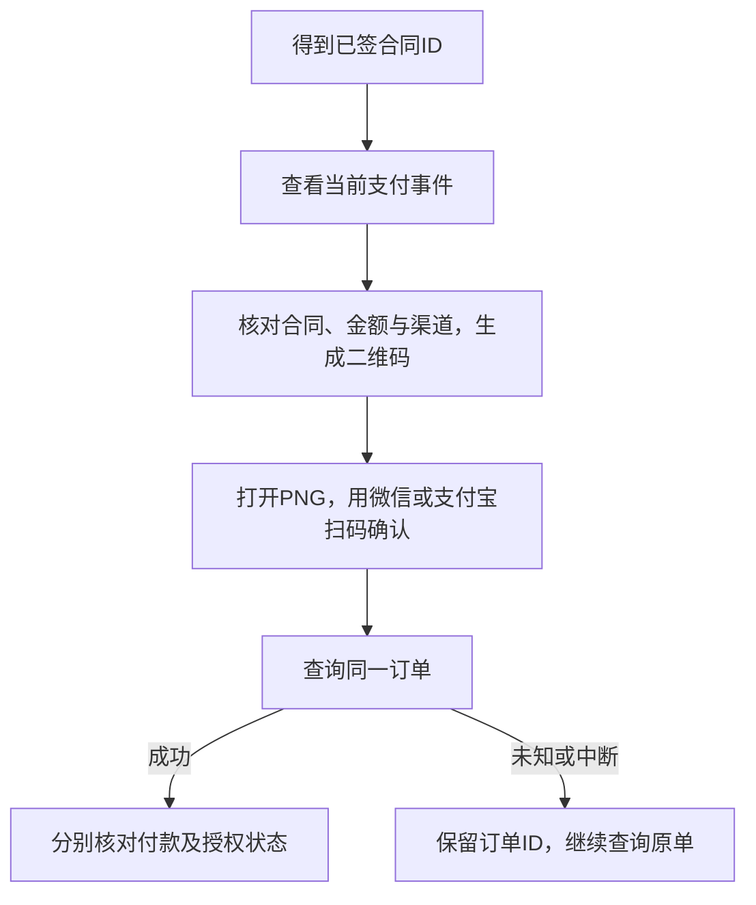

# 微信与支付宝扫码支付

::: info CLI 同步文档
本页自动同步自 CLI 仓库使用手册。先核对已安装版本与本页适用范围；Node.js 22.14+ 是 CLI 自身要求，不是运行时对子应用的要求。来源、发布状态及已知限制见[版本说明](/about)。
:::


适用：**0.7.0**。npm0.6.1及更早版本没有这些命令；0.7.0发布前使用维护者提供的固定候选包。先运行`freelog-cli payment --help`确认安装包支持，再使用本页。当前仅dev/test环境，正式生产环境尚未开放。

支付针对已签合同。单资源、合集或节点先签约得到合同ID，再显式进入支付；添加依赖或创建展品不会自动付款。付款由你在手机端确认，AI可以准备二维码和查询结果。



## 1. 查看合同和当前支付事件

```sh
freelog-cli payment show <合同ID> --env dev --json
```

返回当前合同、`events`及可用`methods`。合同必须属于当前账号管理的资源、合集或节点；不要改用个人合同。取`events`里的明确事件ID和金额，不从策略文字推算价格。没有可用支付事件时先核对合同状态，不重复签约。

## 2. 生成二维码

微信：

```sh
freelog-cli payment start <合同ID> --event <事件ID> --method wechat --env dev --open
```

支付宝命令分支使用`--method alipay`，但当前dev后端预支付路由不存在，暂不能据此完成付款；请先阅读下方环境限制。终端显示确认摘要，请先核对目标、原价和渠道再确认；需要脚本/AI调用时明确这些参数并使用`--yes --json`，这个确认只允许准备支付信息，实际付款仍由用户扫码完成。

默认生成PNG并输出绝对路径`qrPath`；`--open`是可选自动打开。也可以让AI工具展示该图片，或自己点击路径打开，用相应手机App扫码。图片存放在用户目录的`.freelog/payments/<env>/<userId>/`中，不写入工程或Git。不要把二维码/支付链接公开转发给无关人员。

输出的`orderId`需要保存。微信二维码生成成功只表示扫码入口已准备，不表示已付款或后台已经建立交易。支付宝预支付成功也不等于扣款成功。若有平台补贴，最终优惠与收费以手机支付确认页为准，CLI不自行减价或保证折后金额。

## 3. 查询付款和授权结果

```sh
freelog-cli payment status <订单ID> --env dev --json
freelog-cli payment status <订单ID> --env dev --wait --json
```

`--wait`最多等待五分钟，仅查询原订单和合同，不创建新订单。`paymentStatus`区分`succeeded`（已确认交易成功）、`failed`（已确认交易失败）、`pending`（仍待处理）和`unknown`（查询或身份数据不足，结果未知）。`authStatus`是独立的合同授权状态，不能用已授权倒推已付款，也不能保证付款成功后所有依赖链都已满足。

status读出这些状态时退出码为0，脚本必须检查paymentStatus，不能把退出0当付款成功。start/qr若没有成功生成图片会保留订单结果并退出1；不要因为该退出码就换单重付。

等待超时、关闭终端或Ctrl+C都不能证明付款失败。重新运行同一条status查询即可；不要再次start或删除缓存来绕过保护。

## 4. 图片打不开或需要重新展示

```sh
freelog-cli payment qr <订单ID> --env dev --open --json
```

只由记录中的原支付链接重建PNG，不重新预支付、不换订单。自动打开失败时仍会保留订单和图片路径，手动打开即可。没有已确认链接的未知预支付不能重建；继续status查询，不重发start。

二维码过期后，PNG重建不会延长平台有效期。当前不提供重新开单、取消、退款、余额、羽币或支付密码功能；需要后续处理时保留订单ID并联系平台。相同合同支付事件已有记录会阻止重复start，避免断网或中断后重复收款。

## 当前dev环境限制

2026-11-03已验证微信资源依赖合同和节点合同各一笔0.1元付款及授权。支付宝预支付接口当前返回“Cannot POST …/events/prePayment”（errCode=2），属于后端路由阻塞；尚不能使用支付宝完成付款。遇到这种拒绝保留订单并联系平台，不删除记录重试、自动换渠道或把准备失败当付款成功。

## 给AI的操作边界

先show，向用户解释合同、事件和金额，得到针对该次交易的明确意图后再start；展示二维码让用户扫码。禁止读取/询问微信或支付宝密码、验证码，禁止替用户点击付款确认。不能根据用户口头“付过了”直接记成功，必须查询平台结果。

本页描述命令用法，不代表已完成真实扣款或浏览器验收。实际验证与发布状态见包的发行说明。
