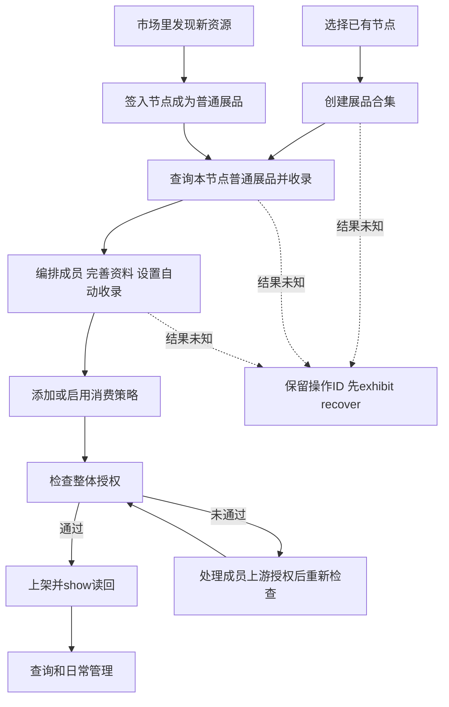

# 在节点中组织展品合集

::: info CLI 同步文档
本页自动同步自 CLI 仓库使用手册。先核对已安装版本与本页适用范围；Node.js 22.14+ 是 CLI 自身要求，不是运行时对子应用的要求。来源、发布状态及已知限制见[版本说明](/about)。
:::


本章使用`exhibit collection`管理节点自建展品合集。先按[版本选择](../00-版本选择与AI代办.md)确认实际CLI来源。

展品合集由节点运营者创建，收录本节点已有的普通展品。它可以组合不同作者的内容。作者发布的资源合集及其签入节点后的合集展品，是另一条流程；作者发行使用根`collection`命令，本章使用`exhibit collection`。



## 1. 创建合集

先登录并选择你自己的已有节点，不需要重新创建节点：

```sh
freelog-cli node list --json
freelog-cli exhibit collection type list --json
freelog-cli exhibit collection create --node <节点ID> --title "精选内容" --name "featured" --type <合集类型编号> --yes --json
```

先从type list返回的data树查看完整path及code，选择children为空的叶子；创建时还会核验其启用状态。人工交互时可省略标题、标识或类型，由终端引导填写；AI应明确传入参数。合集类型必须是后台启用的展品合集最终叶子，不能拿普通资源类型或作者合集类型代替。交互类型选择会提供完整层级和直接输入等入口。

标题1–100字符；授权标识规范化后1–60字符，必须在当前节点唯一，创建后不能修改。预览会显示规范化的最终标识。创建只生成展品合集，不上传文件、不发行资源版本、不替用户签约或付款。

```sh
freelog-cli exhibit collection list --node <节点ID> --page 1 --json
freelog-cli exhibit collection show <合集展品ID> --json
```

记录返回的合集展品ID。后面的命令都使用它。创建后用 `exhibit update` 设置封面、简介和标签，再用 `exhibit collection show <合集展品ID> --json` 读取 `coverImages`、`presentableIntro` 和 `tags`。空字符串或空数组表示已知为空，`null` 表示平台未提供该项。完整命令见本章的资料维护步骤。

## 2. 收录普通展品

先查询本节点已有展品：

```sh
freelog-cli exhibit list --node <节点ID> --status all --json
freelog-cli exhibit collection item add <合集展品ID> --exhibit <普通展品ID1> --exhibit <普通展品ID2> --yes --json
freelog-cli exhibit collection item list <合集展品ID> --page 1 --json
```

每次最多100个，总共最多3000个；只支持本节点普通单资源展品，不能收录主题、来源合集展品或另一展品合集。重复传入相同ID会被拒绝；已在合集中的成员不会重复添加。

如果资源还没有成为本节点展品，先通过[签约到节点](../授权与支付/签到节点.md)完成签入，拿到展品ID后再收录。合同、应用、签约与履约由授权模块办理；不能直接把市场资源ID作为成员ID。

未上架、暂未获授权的普通展品也可以收录，收录成功不代表消费者可访问。成员查询展示当前节点侧授权观察，不能用登录用户个人授权代替。授权查询失败会明确报错，不把缺失结果显示为已授权。

批量添加可能只有部分成功。检查`failedIds`，非空时命令退出非零；成功成员不会回滚，也不会自动补发失败成员。先查询实际目录，再处理具体失败原因。

成员列表每页50条，`hasNext:true`时增加`--page`。可用`--keywords "关键字"`搜索标题或授权标识。输出中的`itemId`是合集条目ID，`exhibitId`是普通展品ID，不能互换。

## 3. 移除和排序

先查询当前成员，使用其中的itemId。下面是独立操作，按需要选择，不要从上到下连续执行。

移除不再需要的成员：

```sh
freelog-cli exhibit collection item remove <合集展品ID> --item <itemId> --yes --json
```

移动仍在目录中的成员到指定位置：

```sh
freelog-cli exhibit collection sort move <合集展品ID> --item <itemId> --position 1 --yes --json
```

按字段快捷排序：

```sh
freelog-cli exhibit collection sort quick <合集展品ID> --by title --yes --json
```

只切换目录展示方向：

```sh
freelog-cli exhibit collection sort direction <合集展品ID> --descending --yes --json
```

移除只解除本合集的成员关系，不删除展品、资源、合同或其他合集里的同一成员。移动支持重复`--item`，所选成员作为一块移动，块内保留原目录顺序；目标位置从1开始且不超过当前成员数。

快捷排序支持`added`添加时间、`title`标题、`released`资源首发时间；默认标题升序，时间降序，`--descending`明确要求倒序。中文及同值顺序由平台处理，结果返回实际序列。`direction`只改变目录正/倒序展示，不重新排列成员。主题或插件仍需使用这些编排信息才能按它展示。

## 4. 自动收录未来新展品

先查询现有规则：

```sh
freelog-cli exhibit collection auto show <合集展品ID> --json
```

没有配置过时会明确返回未配置。让AI创建一个UTF-8 JSON文件，例如`collect-rule.json`：

```json
{
  "conditionType": 1,
  "filterConditions": [
    {
      "key": "presentableTitle",
      "limitOperatorType": "INCLUDES",
      "value": "精选"
    }
  ]
}
```

`conditionType:1`表示全部条件满足，`2`表示任意条件满足。标题`presentableTitle`及授权标识`authIdentity`支持`INCLUDES`、`NOT_INCLUDES`、`STARTS_WITH`、`ENDS_WITH`；值非空，标题最多100字符，标识最多60字符。`resourceTypeCode`只支持`EQUAL`，值必须是有效普通资源最终叶子编号。

保存完整条件并开启自动收录：

```sh
freelog-cli exhibit collection auto set <合集展品ID> --file collect-rule.json --yes --json
```

以后需要暂停时单独执行，条件和已有成员仍保留：

```sh
freelog-cli exhibit collection auto off <合集展品ID> --yes --json
```

已经配置且需要重新启用时执行：

```sh
freelog-cli exhibit collection auto on <合集展品ID> --yes --json
```

这三条不是连续步骤。首次未配置时先set，不能直接on。规则针对未来新签入节点的普通展品，不回扫已有展品；修改规则也不会自动移除已经收录的成员。达到3000成员后不再继续自动收录。

## 5. 完善资料并上架

合集资料、自定义信息、消费策略及上下架继续使用通用展品命令。先按需要完善资料：

```sh
freelog-cli exhibit update <合集展品ID> --intro "本站精选内容" --tag "精选" --yes --json
freelog-cli exhibit properties show <合集展品ID> --json
```

人工在交互终端选择模板、填写参数、预览并确认添加消费策略，再读回启用状态：

```sh
freelog-cli exhibit policy template list <合集展品ID>
freelog-cli exhibit policy list <合集展品ID>
```

**AI或脚本替代路径：**先用`exhibit policy template list <合集展品ID> --json`查询模板；它只读，不会创建策略。按[消费策略步骤](./index.md#_3-添加消费策略并上架)明确选择模板、填全参数并执行apply，随后用policy list确认策略已启用。收费、期限等选择仍由人确定。

完成策略后，先检查整体授权：

```sh
freelog-cli exhibit authorization check <合集展品ID> --json
```

读取`isAuth`，只有整体授权通过才继续；退出0但`isAuth:false`不代表通过。缺授权先处理成员的上游授权，再重新检查。确认策略已启用且整体授权通过后，上架并读回实际状态：

```sh
freelog-cli exhibit online <合集展品ID> --yes --json
freelog-cli exhibit show <合集展品ID> --json
```

需要停止展示时，才单独下架；这不是上架后的下一步：

```sh
freelog-cli exhibit offline <合集展品ID> --yes --json
```

自建合集没有来源可选配置，但支持自定义信息；不能切换来源资源版本。

成员上游授权沿用普通展品，处理时使用该成员展品ID进入[授权与支付](../授权与支付/index.md)。合集的消费策略与成员的上游资源授权是两件事，不能相互替代。

## 6. 请求结果未知怎么办

遇到超时、断网或提示“待核验”，保留操作ID：

```sh
freelog-cli exhibit recover <操作ID> --json
freelog-cli exhibit recover <操作ID> --apply --yes --json
```

先只读查询，仅在`confirmed:true`时显式apply收尾；它不重新创建、添加成员或排序。不确认时保留记录，不能删日志重发。同节点的未决操作会阻止该节点其他写入，只读查询仍可用。

添加成员的恢复还会返回`businessResult`：查看status、failedIds和state实际成员。confirmed/closed只说明核验和清记录结果，不能据此认为全部添加成功；partial/failed仍会非零退出并保留这份JSON。即使closed为true，也要处理其中失败成员，但不要重复apply。unknown且failedIds为null表示尚无完整失败分区，不能当作零失败。

当前没有删除整个展品合集的命令，需要停止展示时先下架。移除成员不等于删除合集。
