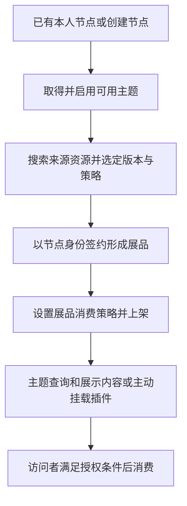

# 节点、展品与内容使用

节点是运营者组织和提供内容的入口。展品是在节点中使用来源资源的对象，具有自己的展示与消费授权上下文；它不是把作者资源复制一份重新发行。

## 1. 创建节点与准备主题

已有可用节点先检查，不重复创建。没有节点时通过Console或已核对的CLI构建完成创建，填写标题、标识及地址；每人最多3个，先提醒并取得具体创建确认。没有主题时选择可用基础主题并激活。字段、操作与成功结果见[节点准备](/runtime/node-setup)。

CLI提供节点资料/访问设置、独立删除、主题激活/切换及展品资料/配置管理。主题切换和展品上架仍分别核对策略、授权与结果，不因命令存在就认为实际环境已验。创建命令的专用确认与恢复见[CLI教程](/cli/节点与展品/#需要新节点时)。

## 2. 从市场签约成展品

先确定本人节点、来源资源ID、具体版本与授权策略，再按[节点展品教程](/cli/节点与展品/)执行。CLI提供市场搜索、来源详情、本人节点列表及展品添加；新展品由内联auth-cli完成签约创建。先核对实际构建，或在Console完成，版本分流见[安装说明](/cli/00-版本选择与AI代办)。

签约主体是节点，不是个人账号或本地主题资源。CLI本期只支持来源自身策略；必要上抛、已有节点合同复用及已有展品补签转Console办理，不重复签约或遗漏上游，也不用个人合同代替节点合同。

创建展品不会自动付款。所有新支付到Console所属节点的展品编辑页由用户本人办理，CLI不生成订单或二维码。须核乙方为该节点，其他乙方合同的付款不能替代节点授权；历史原单可按CLI手册只读查询。创建展品成功也不能据此宣称文件可访问，见[支付边界](./authorization.md)。

## 3. 配置与对外使用

- **来源策略**：节点从作者取得权利时选择的策略。
- **展品策略**：节点面向访问者提供内容时的消费策略；不能用来源签约代替创建展品策略。
- **展品信息和配置**：节点侧使用数据，可能覆盖资源版本的资料或配置；不是回写作者版本。
- **展品上架**：改变该展品的发布状态；不等同上架作者资源，也不自动支付、启用节点主题或在页面挂载插件。

策略添加、启停、展品上下架、资料和配置编辑的CLI步骤见[节点展品教程](/cli/节点与展品/)。主题展品不开放标题、简介等资料编辑，仅按真实定义管理配置；CLI尚未覆盖的操作通过对应Console对象页面完成，不为缺少命令伪造API。

## 4. 让主题和插件实际呈现内容

运行时加载当前主题，主题根据业务逻辑查询展品、合集和内容。插件作为展品时用展品挂载入口；作为依赖时用真实依赖路径挂载，二者的ID不能混用。

“已添加插件展品”不表示页面已经调用它；“已添加主题依赖”也不表示节点已使用新版本。接入、挂载和文件读取见[运行时结构](/runtime/architecture)及[运行时 API](/runtime/api/)。

## 5. 更新与恢复

作者发新版本后，节点可能仍展示旧版本；需要核对节点选择的版本、有效配置和依赖树，再验收页面。节点换版不替作者发行新版本，也不自动重签所有合同。

CLI创建、策略或状态操作结果未知时，按[展品恢复](/cli/节点与展品/#_4-日常管理与异常恢复)只读核实。已经确认线上成功但页面异常，按[运行时排查](/runtime/troubleshooting)检查，不为解决页面缓存而反复签约或发行。

下架不等于解除合同。暂停、冻结、授权条件未满足与普通上下架也不是同一种状态，不能混为“没有内容”。
