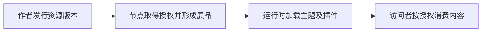

# 平台对象与业务主线

本站讲解平台业务及其完整操作路径，CLI、Console和运行时SDK是不同阶段的执行入口。人和AI不需要先阅读另一套官方帮助才能继续。先看本页建立模型，再按[平台任务目录](./tasks.md)完成操作。

作者发行可授权的资源，节点商将资源组织成展品，访问者在节点页面消费内容。运行时加载主题和插件，让它们使用平台 API。

图中的创作、发行、节点使用和消费是不同流程。已有资源只发新版本时，不必重复创建资源；主题版本发行也不自动改变节点正在使用的版本。

## 对象与身份

| 对象 | 负责什么 | 不能代替什么 |
|---|---|---|
| 资源 | 作者的长期授权对象，有不可变 ID 和授权标识 | 节点展品 |
| 资源版本 | 文件、属性、可选配置定义、依赖和说明 | 展品实际配置及选定版本 |
| 资源合集 | 作者组织自己的已发行单资源 | 节点自建展品合集 |
| 节点 | 运营入口、域名、主题和展品的载体 | 作者个人或源资源 |
| 展品 | 节点选用来源资源后形成的展示、配置和对外授权对象 | 来源资源本身 |
| 依赖节点 | 某棵依赖树中的一个位置，以 nid 等字段定位 | resourceId 或独立展品 |
| 浏览器实例 | 某主题/插件的一次挂载，具有生命周期 | 新的平台资源或合同主体 |

主题是节点激活的主题展品对应的应用；插件可以作为资源依赖，也可以成为独立展品，由宿主显式加载。图片、视频依赖则按内容访问，不把所有依赖都当插件。

## 三层授权分别处理

- 源资源使用他人资源作依赖：以源资源为主体处理依赖签约。
- 节点引入资源：以节点为主体处理来源及上游授权。
- 用户消费展品：根据访问者、展品策略和访问上下文判断授权。

个人签过约不能直接证明某资源、节点或访问者已获授权。签约成功不等于付款、满足其他条件或内容可读取；列表可见也不代表文件可读。

当前CLI暂不执行支付。策略要求支付后才授权时，未支付无法取得相应授权；需要在对应网页履约，再验证实际授权。完整正式能力以Console为对齐目标，详见[签约、支付与授权](./authorization.md)。

## 信息如何进入运行时

资源版本提供基础数据，节点展品和对应依赖节点可能有覆盖配置。运行时得到的是使用上下文中的有效数据，不一定等于作者原始字段。

资源 ID、版本号、展品 ID、nid 和挂载实例名称分别使用；标题可改且可重复，不作为这些身份的替代。

接下来读[主子应用结构](/runtime/architecture)，再选[开发](/runtime/quickstart)或[CLI 发行](/cli/)。

## 按业务继续

| 业务 | 本站入口 |
|---|---|
| 账号、环境、角色与工具准备 | [账号与环境](./accounts.md) |
| 单资源/作者合集创作、发行和管理 | [资源生命周期](./resources.md) |
| 节点创建、主题启用、签约来源形成展品及运营 | [节点与展品](./nodes-and-exhibits.md) |
| 签约、支付条件和实际访问授权 | [授权边界](./authorization.md) |
| 每项任务的起点、执行方式和完成条件 | [平台任务目录](./tasks.md) |

CLI覆盖增加时，更新本站对应业务的执行方式，而不是再写一套互不相干的业务解释。暂未支持的命令不虚构；当前需通过网页完成的步骤，也在本站交代。
