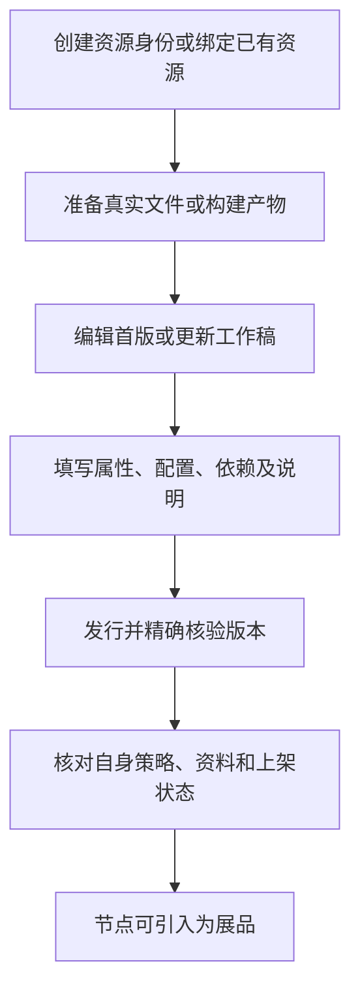

# 资源创作、发行与后续管理

资源是作者的长期授权对象；资源版本保存一次发行的文件及版本数据。创建资源、上传文件、发行版本、添加策略和上架分别完成，不能用其中一步的成功代替整个任务完成。

## 单资源包含哪些类型

- 图片、视频、音频、普通文件：每份单资源的产物是一个真实文件。
- 主题、插件：仍是单资源，产物通常是前端构建目录；CLI把目录内容临时压缩后上传，也支持适用的预制文件。
- 前端库：按库产物、命名空间和meta.json约定构建，再按资源发行流程使用。

类型能力由平台配置决定。可选配置不是所有类型都支持，也不能仅因是图片或主题就推断支持与否。读取当前类型能力再编辑。

## 第一次发行与更新的区别

| 起点 | 路径 | 要保留什么 |
|---|---|---|
| 只有本地文件，没有线上资源 | [首次发行](/cli/01-快速上手) | 创建后记录资源ID，后续步骤使用同一身份 |
| 想从模板开发主题或插件 | [模板到发行](/cli/05-主题与插件) | 工程、构建产物与资源身份分别管理 |
| 线上已有本人资源，本地没有接入 | [绑定后更新](/cli/04-日常路径) | 已有版本、身份及本地未提交工作 |
| 已绑定、有更新工作稿 | 查看并继续编辑；确认后发新版本 | 不为“重新开始教程”覆盖当前稿 |
| 线上只有资源壳，没有版本 | 绑定后走首版 | 不误用已有版本的更新入口 |

创建的授权标识不可改，标题可改且可重复。资源ID、授权标识、npm工程名称及版本号用途不同。

## 哪些信息在哪里维护

| 信息 | 维护方式 | 生效边界 |
|---|---|---|
| 文件、版本属性、可选配置定义、依赖与下一版说明 | [版本工作稿](/cli/06-版本工作稿) | 正常发行版本后形成对应线上版本 |
| 标题、简介、封面、标签 | [资源管理](/cli/08-资源管理) | 相应操作成功并读回后生效，不等于发新版本 |
| 作者对外授权策略 | [策略模板与参数](/cli/07-单资源授权策略) | 创建/启停后核对自身策略状态 |
| 上下架 | [资源管理](/cli/08-资源管理) | 不等同删除内容或撤销合同 |

已有版本文件和版本表单不能原地改成另一个版本。已发版本说明的独立编辑入口按CLI手册使用，不能混为下一版工作稿说明。

## 依赖与作者合集

依赖声明说明源资源使用什么、允许哪些版本；签约处理该主体的权利条件。CLI 0.6.0+会先核验合同或按明确策略签约再声明，依赖操作不会自动付款。0.7.0另有[支付命令](./authorization.md)，为当前资源或合集合同准备微信二维码并核交易/授权；付款由用户确认，个人合同不能替代。

作者合集组织本人线上已上架的单资源，不从本地目录自动导入文件或包装批量发行。合集自身有目录、表单、策略和资料；它不是主题依赖列表，也不是节点展品集合。完整流程见[合集手册](/cli/合集/)。

## 何时算完成

确认线上版本与预期文件/字段一致，必要策略已启用，上架状态已核验。若用于节点，还要继续[节点与展品](./nodes-and-exhibits.md)；资源发行成功不自动激活节点主题或更新展品。

远端写入失败或结果未知，先按[恢复说明](/cli/09-常见情况与报错)查明，保留稿与未决记录，不盲目重复创建或发行。
