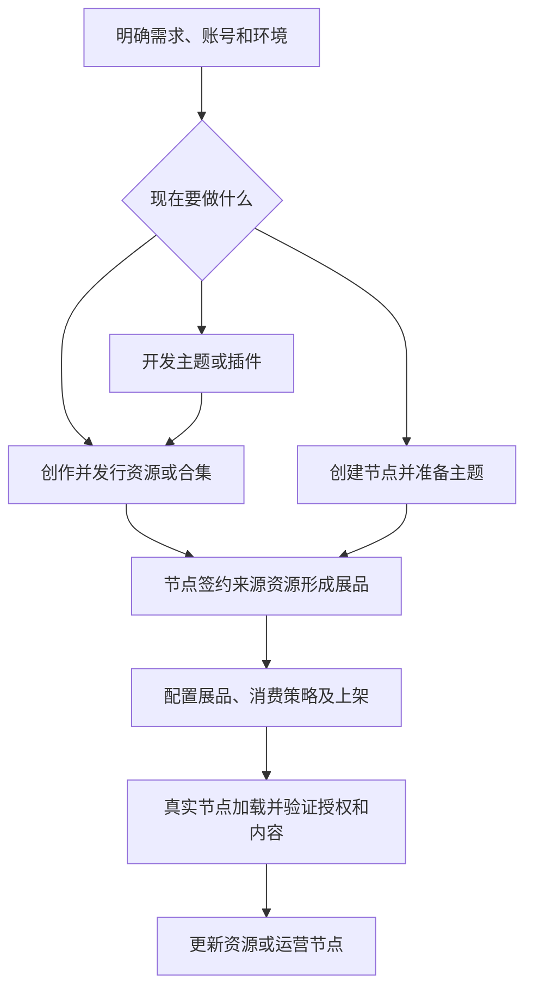

# 按平台业务完成任务

本站是人和 AI 使用 Freelog 的独立入口。先确定业务目标，再选择 CLI、节点页面中的运行时 SDK，或目前仍需使用的 Console；关键步骤不以阅读另一套帮助文档为前提。

## 从创作到使用的主线

它不是必须从头执行的向导。已有资源直接接入更新；已有节点可继续引入展品；本地代码调试仍使用节点的真实版本及授权链。

## 操作目录

每一行都给出起点、操作说明、完成结果。用户可以直接把目标与已有信息交给 Agent，不必自行拼出全部命令。

| 任务 | 开始时需要什么 | 完整操作入口 | 如何确认完成 |
|---|---|---|---|
| 让AI从需求开始做应用 | 目标、已有素材/工程、允许操作的范围 | [人与AI协作](/start) | 有分阶段方案、可访问演示和明确未完成项 |
| 准备账号、环境与工具 | 本人账号、dev/test环境 | [账号与环境](./accounts.md) | 正确账号/环境，工具能力匹配本次任务 |
| 创建并发行图片、视频等单文件资源 | 工程内真实文件 | [普通资源首次发行](/cli/01-快速上手) | 首版、启用策略及上架状态均已核验 |
| 从模板发行主题或插件 | 工程位置、主题/插件选择 | [主题插件教程](/cli/05-主题与插件) | 构建产物与线上版本正确；不是只下载模板 |
| 把已有线上资源接到本地 | 本人资源ID与真实产物 | [绑定与发新版](/cli/04-日常路径) | 绑定正确，新版本已精确读回 |
| 管理存储文件或从存储导入发行 | 本人存储空间、对象ID与明确修改范围 | [存储与发行导入](/cli/存储空间/) | 线上对象或版本来源读回正确；不建立本地存储副本 |
| 填属性、可选配置与说明 | 首版或更新工作稿 | [版本内容](/cli/06-版本工作稿) | 字段符合类型能力，待提交及已发值分清 |
| 搜索市场资源并作为依赖 | 当前源资源、目标资源与版本范围 | [直接依赖](/cli/06-版本工作稿#_4-声明依赖) | 稿内声明与签约主体正确；真实授权另核验 |
| 添加或启停作者策略 | 目标资源及明确授权意图 | [单资源策略](/cli/07-单资源授权策略) | 模板参数正确，创建或启停结果已读回 |
| 修改资料或资源上下架 | 本人资源ID | [资源管理](/cli/08-资源管理) | 对应资料/状态已变，未误改版本内容 |
| 发行作者合集 | 本人已上架单资源 | [合集首次发行](/cli/合集/01-首次发行与发布) | 目录、表单、策略及上架结果正确 |
| 更新合集目录或表单 | 本人合集及明确修改范围 | [合集管理](/cli/合集/02-发行后管理与边界) | 分清目录稿、操作稿与线上即时资料，发布后核验 |
| 创建节点并启用基础主题 | 账号、节点标题/标识/地址 | [节点准备](/runtime/node-setup) | 真实节点存在、主题启用、节点地址可访问 |
| 把市场资源签约成节点展品 | 本人节点、来源资源、版本及策略选择 | [节点与展品](/cli/节点与展品/) | 展品归属、来源与签约结果正确 |
| 给展品加消费策略并上下架 | 展品ID与消费授权意图 | [展品管理](/cli/节点与展品/#_3-添加消费策略并上架) | 展品策略及状态已读回；不等同内容已授权 |
| 开发和调试本地主题 | 可访问节点与本地工程 | [主题接入](/runtime/quickstart) | 真实节点页面加载本地入口 |
| 首次开发插件或替换已有插件 | 本地业务组件或实际挂载位置 | [插件与依赖调试](/runtime/development) | 先有真实挂载，再通过replace调试本地代码 |
| 在应用中获取展品、合集及内容 | 正确展品/单品/依赖上下文 | [SDK参考](/runtime/api/) | 正确解包响应，真实文件访问与授权通过 |
| 处理签约后的支付与授权 | 正确主体和所选策略 | [授权与支付](./authorization.md) | 所需支付/其他条件满足后，真实访问获准 |
| 操作失败或结果未知后继续 | 操作ID、环境、目标及错误信息 | [CLI恢复](/cli/09-常见情况与报错) / [页面排查](/runtime/troubleshooting) | 明确结果或保留未决，不能重发猜测成功 |

CLI命令的获取与版本边界先看[版本选择](/cli/00-版本选择与AI代办)。节点创建、存储和节点展品等新增路径使用已发布的0.6.0+；主题激活/切换、展品简介/标签/自定义信息编辑及当前支付仍使用Console，不能凭全局帮助猜测存在对应CLI命令。

## 本站怎样维护完整性

- 平台业务先讲目标、对象和状态，再链接本地的操作正文；CLI与SDK不是两套互不相干的业务。
- 业务事实在本站维护一个解释入口；操作步骤可重复必要的前提和风险，避免用户来回猜。
- 每新增CLI能力，更新对应任务的执行入口和能力状态，不让读者猜旧网页步骤是否仍然必需。
- 平台尚未提供或本站尚未核清的操作明确标注，不用一条官方帮助链接冒充步骤完整，也不虚构命令。

上表覆盖当前核心创作、发行、存储、节点、展品、开发和消费主线。平台还有收藏、收入结算等业务域，本文没有穷举其全部细则。新增这些操作时同样需要本站内的输入、步骤、完成信号及恢复说明，不能把未来覆盖写成现在全部完成。
