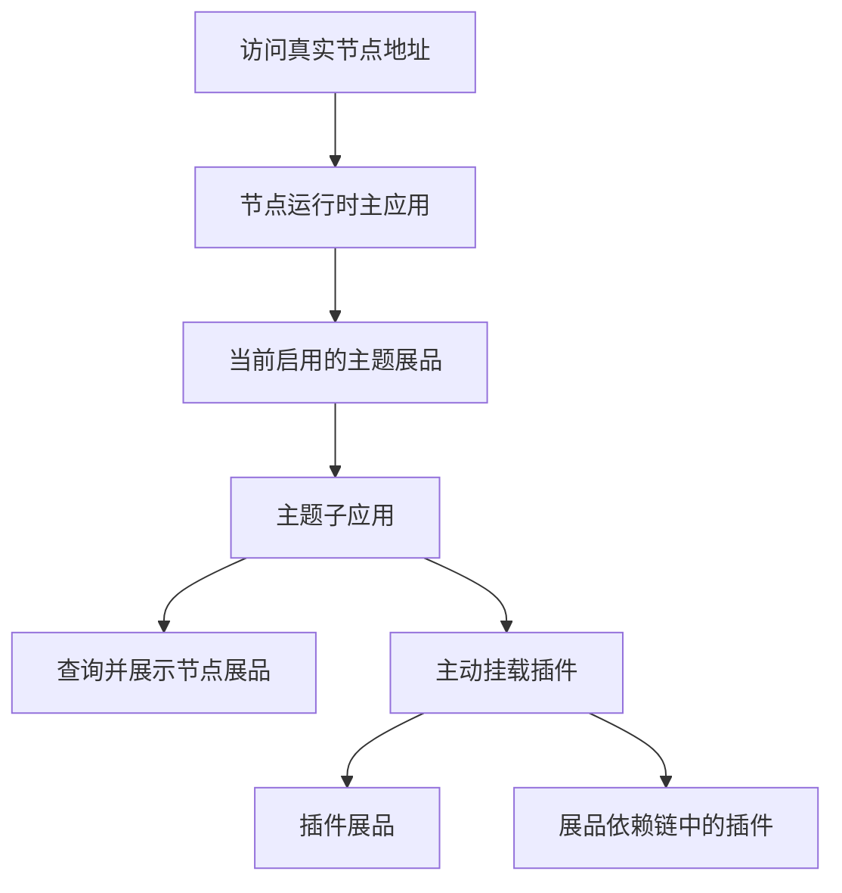

# 运行时架构与对象

Freelog 节点运行时是浏览器中的主应用。主题和插件是由主应用挂载的子应用；开发主题不等于开发、启动整个节点运行时。

运行时负责建立节点和展品上下文、加载子应用、提供 SDK 能力。主题组织页面和展品展示；插件只在主题或父插件发起挂载后运行。节点添加插件展品，不会自动让页面出现插件。

## 先分清身份

| 对象 | 含义 | 不能替代什么 |
| --- | --- | --- |
| 资源 | 作者发行和对外授权的对象 | 节点展品 |
| 资源版本 | 已发行的文件、属性、可选配置定义和依赖声明 | 节点当前选择的展示版本 |
| 节点 | 运营者管理的发布和授权主体 | 运营者个人账号 |
| 展品 | 节点使用资源并面向访问者展示的对象 | 原始资源版本 |
| 依赖节点 `nid` | 某条展品依赖链中的位置 | 资源 ID |
| 挂载实例 | 页面中的一次子应用挂载 | 展品或依赖节点身份 |

同一个插件资源可以作为展品，也可以作为主题或其他插件的依赖。前者通过 `mountExhibitWidget` 挂载；后者通过 `mountArticleWidget` 挂载，需要真实依赖上下文。

## 数据从哪里来

作者发行版本时定义属性、可选配置和依赖。节点使用该版本并配置展品；运行时读取的是展品及其依赖链上的有效数据，不应把它理解成作者版本表单的直接副本。

- `getSelfProperty()`：异步读取当前子应用的属性响应。
- `getSelfDep()`：异步读取当前子应用的依赖响应。
- `getSelfPropertyForTheme()`、`getSelfDepForTheme()`：主题可直接读取运行时已提供的数据；不代表每次重新请求服务端。
- 父应用传入的业务数据与平台属性是两类数据，分别维护。

具体参数和响应结构以 [API 参考](/runtime/api/widget)为准。不要沿用旧教程中的 `getSelfDependencyTree()`。

## 授权与运行边界

源资源对上游依赖的授权、节点对资源的授权、访问者对展品的授权，是不同主体之间的关系。个人账号有合约不代表节点或源资源已获授权；声明依赖不代表完成授权；签约也不必然表示所有生效条件已经满足。

本地替换改变代码入口，仍在真实节点上下文内运行。它不会创建资源版本、展品、依赖链或授权关系。平台对象的完整业务关系见[平台概览](/platform/overview)，开发方式见[本地开发](/runtime/development)。
