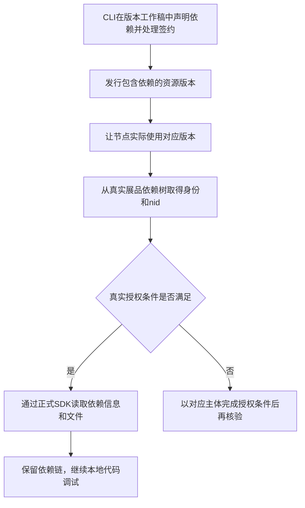

# 本地开发：主题与插件代码调试

本地开发在真实节点中替换代码入口。运行时继续使用节点已有的展品、依赖路径及授权上下文，不会把本地工程变成一个新增展品。

## 调试主题

先确保节点已启用可用主题，再启动本地 HTTPS 服务，从节点地址进入：

```text
https://你的节点域名/?dev=https://localhost:7101
```

成功信号是主题代码来自本地服务，页面运行在节点地址下。具体初始化步骤见[快速开始](/runtime/quickstart)。修改代码不等于修改线上资源版本；不带 `dev` 打开节点，应仍使用正式主题。

## 调试已经有挂载位置的插件

插件需要主题或父插件主动挂载。先确认正式页面能够挂载目标插件，再替换该挂载实例的代码。

1. 进入包含插件的节点页面，让插件实际挂载。
2. 在该插件上下文中调用 `freelogApp.getSelfWidgetRenderName()`，取得实际渲染名称。
3. 启动插件本地 HTTPS 服务。
4. 设置 `dev=replace` 和 `<渲染名称>-freelog=<本地地址>`。

例如，实际渲染名称为 `w123456`：

```text
https://你的节点域名/?dev=replace&w123456-freelog=https://localhost:8800
```

保留原页面已有的路由参数；用 `URL.searchParams.set` 添加参数，避免覆盖路由。渲染名称来自运行结果，不是资源 ID、展品 ID 或开发者随意命名的字符串。

示例按便于阅读的地址展示；程序生成的URL可能含百分号编码，运行时会正常解析。本地地址本身含`&`或`#`时必须通过`URL.searchParams.set`设置，避免这些字符被误认成节点地址的参数或片段。

成功信号：原来的插件位置显示本地修改，Network 出现本地插件入口请求。替换多个实例时，为各实际渲染名称分别设置参数。`replace` 本身不会调用挂载 API，也不会为尚未声明的依赖生成 `nid`。

## 正式挂载有两条路径

| 插件来源 | 挂载方式 | 所需上下文 |
| --- | --- | --- |
| 节点已有插件展品 | `mountExhibitWidget` | 展品 ID、页面容器 |
| 主题或父插件的已发行依赖 | `mountArticleWidget` | 顶层展品、资源和依赖节点身份、页面容器 |

依赖插件的身份应从实际依赖响应取得；当前 API 是 `getSelfDep()`。不要把本地依赖声明中的资源 ID 填进所有身份字段，具体参数见 [API 参考](/runtime/api/widget)。挂载前应准备已存在的容器；组件销毁时卸载插件并清理应用自己的事件监听。

## 一个全新插件从哪里开始

尚未发行且没有真实挂载位置时，先开发界面和业务组件；使用平台SDK读取信息或文件之前，需要建立正式上下文：

1. 构建插件并[发行首个资源版本](/runtime/release)，核对资源身份、版本和授权策略。
2. 选择使用方式：作为依赖时，由宿主主题或父插件声明依赖并发行相应版本，让节点使用该版本；作为独立展品时，将插件添加到节点。两条路径都需要处理对应主体的授权。
3. 宿主代码通过相应的真实挂载接口加载插件，确认页面出现插件。依赖插件不必额外创建独立展品。
4. 取得实际渲染名称，再按上面的`dev=replace`路径调试本地代码。

## 新增或修改依赖后如何调试

CLI版本工作稿用于准备下一次发行，不是运行时数据源。



添加及检查稿内依赖的命令见[CLI依赖教程](/cli/06-版本工作稿#_4-声明依赖)。版本范围以平台实际解析结果为准，不能自行当成最新版本。

**未发行的新增依赖，不能通过当前运行时访问其真实文件或插件包。** 单独拿到资源ID或签约成功不足以建立展品依赖路径；不要用资源ID替代`nid`，也不要将CLI凭据交给前端。当前不提供未发行依赖的模拟或直接下载方案。

已有正式依赖链时，纯代码修改可持续通过`dev`或`replace`调试；修改依赖声明或版本数据则需要重新发行并更新节点使用版本。展品配置可能覆盖作者默认值，实际效果以节点有效数据为准。

当前CLI暂不执行支付。需要支付或其他履约才能获得授权时，应以对应主体在Console完成，再验证真实访问。

## 开发完成的判断

本地页面跑通只完成代码调试。正式验收时移除URL中的开发替换参数，按[发行与上线](/runtime/release)检查真实版本、属性、配置、依赖文件和插件挂载。
