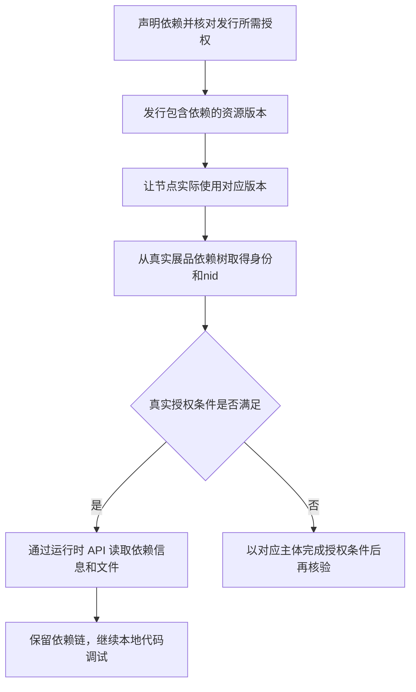

# 本地开发：主题与插件代码调试

本地开发在真实节点中替换代码入口，并沿用该节点的展品、依赖路径及授权上下文。

## 调试主题

先确保节点已启用可用主题，再启动本地 HTTPS 服务，从节点地址进入：

```text
https://你的节点域名/?dev=https://localhost:7101
```

成功信号是节点页面显示本地主题，Network 中可见本地入口。按[快速开始](/runtime/quickstart)配置生命周期、HTTPS 和构建。去掉 `dev` 打开节点即可回到当前启用主题的正常入口。

## 一个全新插件从哪里开始

先开发界面和交互，再建立真实的挂载位置。可沿用[主题示例](/runtime/quickstart)的浏览器构建、HTML 容器和 `window.mount` / `window.unmount` 生命周期。在插件自己的 `mount` 中调用 `initFreelogApp()` 获取当前插件的运行时上下文。

```js
import { initFreelogApp } from 'freelog-runtime';

window.mount = () => {
  const { freelogApp } = initFreelogApp();
  document.querySelector('#app').textContent = '插件已挂载';
  console.log('插件渲染名称', freelogApp.getSelfWidgetRenderName());
};

window.unmount = () => {
  document.querySelector('#app').replaceChildren();
};
```

1. 构建插件并[发行首个资源版本](/runtime/release)，读回文件和版本字段。
2. 选择下面的正式挂载路径。作为插件展品时，将插件添加到节点并取得展品 ID。作为资源依赖时，由宿主主题或父插件声明依赖并发行对应版本，让节点使用解析到该插件的版本。
3. 按真实链路处理授权，在宿主页面创建容器并调用对应挂载接口。用正常节点地址打开该页面，确认「插件已挂载」出现在预期位置。
4. 从插件的 Console 日志取得实际渲染名称，按下文替换本地代码。

## 正式挂载有两条路径

| 插件来源 | 挂载方式 | 所需上下文 |
| --- | --- | --- |
| 节点已有插件展品 | `mountExhibitWidget` | 插件展品 ID、页面容器 |
| 主题或父插件的已发行依赖 | `mountArticleWidget` | 顶层展品 ID、插件作品 ID `articleId`、`nid`、`parentNid`、页面容器 |

作为展品使用时，宿主可在容器就绪后按下面的方式加载本页示例的 Vite 插件。这里的 `freelogApp` 来自宿主自己的 `initFreelogApp()`。

```js
const widget = await freelogApp.mountExhibitWidget({
  exhibitId: '<插件展品ID>',
  container: document.querySelector('#plugin-slot'),
  renderWidgetOptions: { iframe: true },
});
// 宿主页面或容器销毁前，调用 await widget.unmount()。
```

确保宿主 HTML 中已有 `#plugin-slot`，并替换示例 ID。作为依赖挂载时，从宿主的实际依赖响应取得 `articleId`、`nid` 和 `parentNid`，从当前上下文取得顶层展品 ID。可用 `getSelfDep()` 读取直接依赖。详见[挂载及依赖 API](/runtime/api/widget)。

## 调试已经有挂载位置的插件

1. 从正常入口打开已有插件的节点页面，让目标插件挂载。
2. 在插件自己的代码或调试上下文中调用 `freelogApp.getSelfWidgetRenderName()`，取得实际渲染名称。
3. 启动插件本地 HTTPS 服务，验证证书和跨域读取。
4. 在节点地址设置 `dev=replace` 和 `<渲染名称>-freelog=<本地地址>`。这条入口和主题入口使用同一个 `dev` 参数，按本次要调试的对象选择。

例如，实际渲染名称为 `w123456`：

```text
https://你的节点域名/?dev=replace&w123456-freelog=https://localhost:8800
```

如果节点页面已有路由参数，用实际页面地址构造 URL。下面的 `w123456` 应换成运行时返回的渲染名称。

```js
const url = new URL(window.location.href);
url.searchParams.set('dev', 'replace');
url.searchParams.set('w123456-freelog', 'https://localhost:8800');
console.log(url.href);
```

在节点页面的顶层 Console 执行这段代码，打开输出地址。原插件位置应显示本地修改，Network 可见本地插件入口。替换多个实例时，为各实际渲染名称分别设置参数。正式挂载仍由宿主发起，插件沿用宿主所选展品或依赖的授权上下文。若宿主在开发模式中已显式传入 `widget_entry`，挂载会优先使用该入口。

## 新增或修改依赖后如何调试

新增或变更依赖后，先发行宿主版本，再按真实依赖链调试。



按[CLI 依赖教程](/cli/06-版本工作稿#_4-声明依赖)在稿内声明依赖。发行前核对实际主体的适用合同，缺合同时到对应 Console 页面处理。节点采用新版本后，从实际依赖树取得 `nid` 并核对平台解析到的版本，然后验证文件读取或插件挂载。

**尚未发行到节点所用宿主版本的新增依赖，只有工作稿声明。** 运行时通过已发行的展品依赖路径访问文件和插件包。

已有正式依赖链时，可通过 `dev` 或 `replace` 继续调试代码。展品配置可能覆盖作者默认值，实际效果以节点有效数据为准。

需要支付或其他履约时，由用户在对应主体的 Console 页面处理，之后验证真实访问。见[签约、支付与授权](/platform/authorization)。

## 开发完成的判断

本地代码能在真实节点挂载后，按[发行与上线](/runtime/release)发行并核验。用正常节点入口检查真实版本、属性、配置、依赖文件和插件生命周期。
