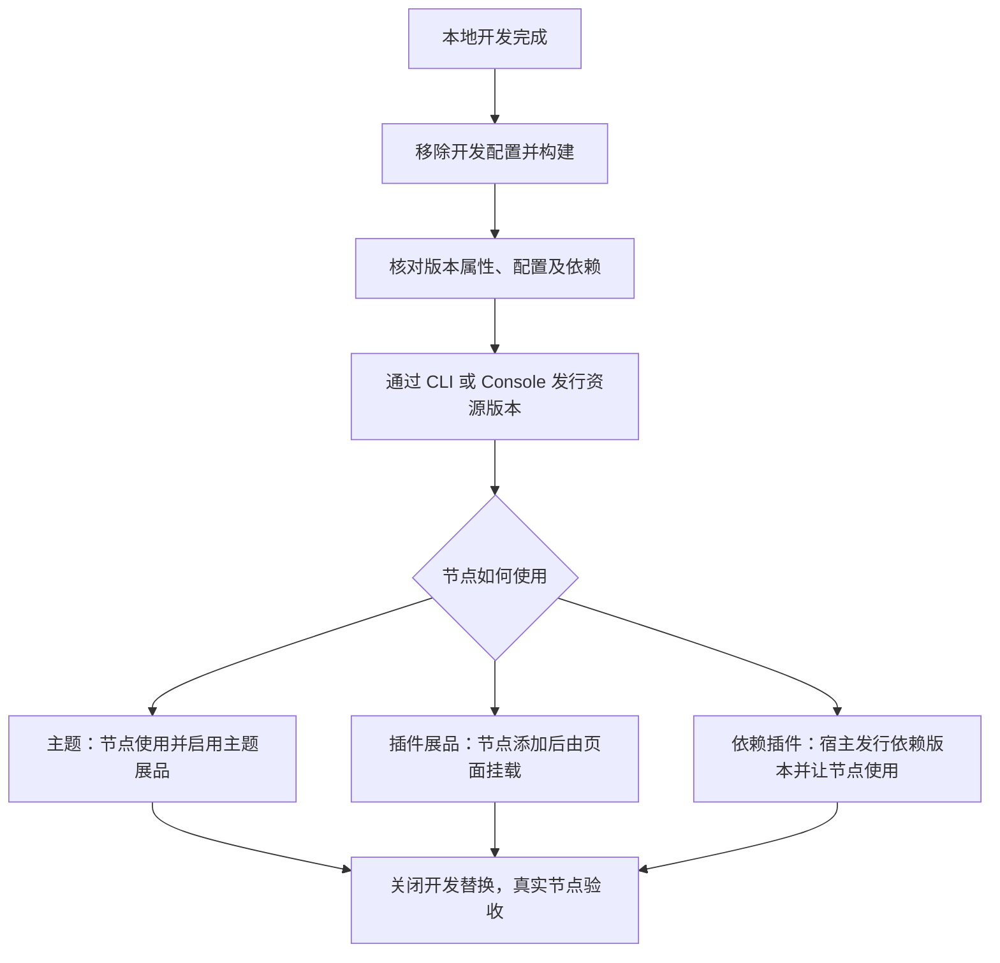

# 发行主题或插件并验证上线

本页描述从前端产物到真实节点运行的闭环。资源发行命令、登录、工作稿和恢复操作统一以 [CLI 使用文档](/cli/)为准；运行时 SDK 不负责发行资源或管理节点。

发行资源、让节点使用资源，以及访问者能否访问，是不同步骤。上传成功不表示全部链路完成。

## 1. 准备可发行产物

1. 移除生产路径中的开发入口和本地 URL。
2. 执行工程实际的构建脚本，检查入口文件和静态资源相对路径。
3. 通过 CLI 指定主题或插件的构建产物目录，按 CLI 当前流程压缩上传。手动上传时，ZIP 根应直接包含入口及构建文件，不再套一层项目目录。
4. 检查产物不包含源代码密钥、本地状态或开发凭据。

成功信号：构建成功，产物有实际入口；压缩包解开后目录结构正确。只运行开发服务器不能替代构建检查。

## 2. 核对待发行版本

通过 CLI 或 Console 检查：

- 资源身份、首版或更新版本号、实际提交的文件。
- 系统附加字段：运行时目标和构建工具与产物一致，见[兼容性与版本](/runtime/compatibility)。
- 自定义属性、可选配置定义及默认值。
- 依赖资源身份、版本范围和循环依赖检查结果。
- 版本说明，以及资源标题、简介、封面、标签和对外发行状态。

版本数据与资源资料分开维护。已有版本的文件及版本表单不能原地修改，需要发行新版本。依赖声明也不等于授权，按当前平台流程处理相关授权。

策略使用现有模板选择、填写参数、提交路径；不要从旧教程复制手写 DSL 操作。CLI 当前能力见其文档。

## 3. 让节点使用对应版本

**主题**：在 Console 将资源添加为节点主题展品，处理所需授权，选择展示版本并启用。资源新版本发行后，要核对节点是否仍在使用旧版本。

**插件展品**：在节点添加插件展品并配置，主题或父插件还需显式调用挂载入口。

**依赖插件**：先发行插件；宿主主题或插件声明依赖并发行相应版本，再让节点使用宿主对应版本。插件不必仅因作为依赖就额外创建一个展品。

尚未创建节点或未启用基础主题时，先完成[节点准备](/runtime/node-setup)。需要付款时，先核对资源、合集或节点合同；CLI 0.7.0可准备微信二维码并查询原订单，用户本人扫码确认，支付宝当前dev阻塞。未付款或尚有其他条件时不算已有对应授权，见[支付范围](/platform/authorization)。登录及必要认证由用户本人操作，Agent可代办已授权的二维码准备、查询、构建和检查。

CLI 0.6.0+已提供独立的[节点展品功能](/cli/节点与展品/)。主题激活及更广的节点设置仍按 Console 流程处理；不能把作者发行命令当节点管理。节点配置和作者可选配置定义也不是同一份表单。

## 4. 在真实节点验收

移除 URL 中的 `dev` 和代码替换参数，使用正式入口逐项检查：

1. 主题能加载，刷新和页面导航正常。
2. 展示版本正确，属性和可选配置的实际值正确。
3. 图片、视频等真实依赖内容能访问，所需插件能挂载、卸载和再次打开。
4. 区分已授权、未授权等预期访问情形，检查真实文件请求结果。
5. 更新版本后复查配置、依赖范围和展示行为，确认没有继续请求旧产物。

记录资源 ID、版本、节点地址、验证时间和结果。

## 失败后先确认停在哪一步

- **CLI 创建、发行或其他远端写入失败，或提交后没有明确结果**：保留操作 ID 和命令输出，先按 [CLI 故障恢复](/cli/09-常见情况与报错)查看和核对线上结果；未确认前不要重复创建或发行。不同命令的恢复入口以该页及命令提示为准。
- **已经确认线上版本存在，但节点页面、依赖或插件运行异常**：先核对节点展示版本、主题启用状态和授权，再按[运行时问题排查](/runtime/troubleshooting)定位。页面没更新不意味着发行失败，不要直接重新发行版本。
- **支付或其他授权条件未满足**：按[支付范围](/platform/authorization)核原订单，或在对应授权页面完成其他履约后重新查询；不能靠重付、重发版本或反复声明依赖消除未知结果与授权条件。
