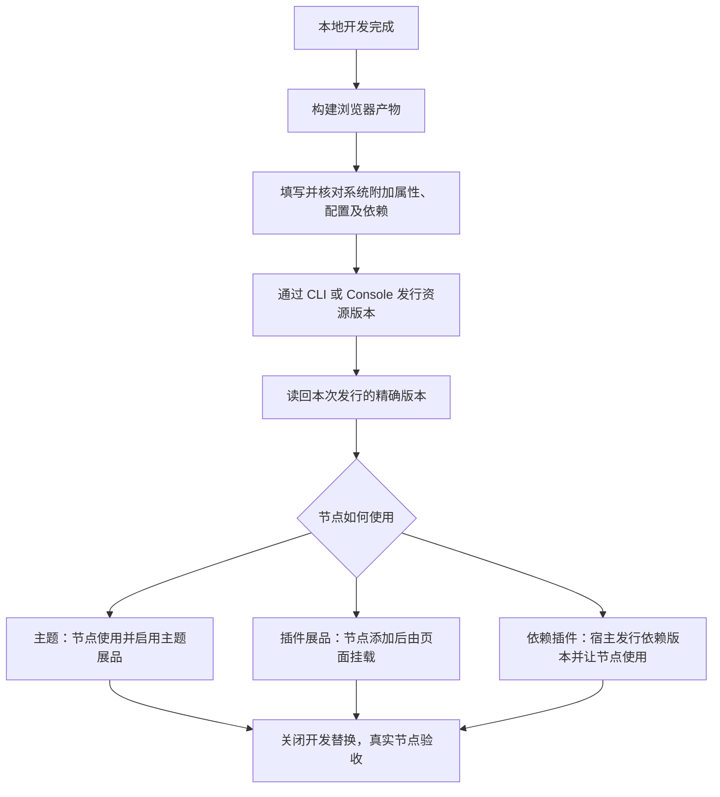

# 发行主题或插件并验证上线

用浏览器端构建产物发行主题或插件，读回精确资源版本，再让节点采用该版本并验证访问。命令和首次发行流程见 [CLI 主题与插件手册](/cli/05-主题与插件)。

## 1. 准备可发行产物

1. 移除生产路径中的开发入口和本地 URL。
2. 执行工程构建脚本，检查产物根目录的 `index.html` 及其引用的相对资源路径。
3. 通过 CLI 指定构建产物目录，由 CLI 打包。手动上传时，ZIP 根应直接包含入口 HTML 和构建文件。
4. 检查产物不包含源代码密钥、本地状态或开发凭据。

构建完成后，解开压缩包核对入口和文件结构。使用运行时 API 的应用可按[快速开始](/runtime/quickstart)先在真实节点验证挂载。

## 2. 核对待发行版本

填写[系统附加字段](/runtime/compatibility#发行时确认系统附加字段)。`noderuntime_target_version` 选择应用实际兼容的目标，本指南示例为 `0.5`。实际使用 Vite 构建时将 `bundleTool` 填为 `vite`。提交前还需检查以下内容。

- 资源身份、首版或更新版本号、实际提交的文件。
- 自定义属性、可选配置定义及默认值。
- 依赖资源身份、版本范围和循环依赖检查结果。
- 版本说明，以及资源标题、简介、封面、标签和对外发行状态。

更新构建文件或依赖时，用新资源版本提交。版本元数据和资源资料分别读回，依赖发版前按实际主体处理授权。

按实际目标选择授权策略模板并填写参数。发行后按[精确版本读回步骤](/runtime/compatibility#用-cli-填写并读回)核对回执中的资源版本号、文件摘要 `fileSha1` 和系统附加属性。通过 Console 操作时打开该资源的对应版本详情核对。

## 3. 让节点使用对应版本

**主题**在 Console 添加为节点主题展品，按实际链路处理授权并启用。已有主题展品时，在展品管理的「展示版本」选择本次资源版本，再回到「主题管理」核对正启用的是该主题。

**插件展品**在节点添加并设置展示版本，主题或父插件通过 `mountExhibitWidget` 挂载它。

**依赖插件**先发行插件，再由宿主主题或父插件声明依赖并发行相应版本。让节点使用宿主的新版并核对实际解析结果，宿主用 `mountArticleWidget` 挂载插件。

尚未创建节点或未启用主题时，先完成[节点准备](/runtime/node-setup)。节点和展品操作见 [CLI 节点与展品手册](/cli/节点与展品/)。需要支付或其他履约时，核对合同主体，再由用户本人到对应 Console 页面处理。见[签约、支付与授权](/platform/authorization)。

## 4. 在真实节点验收

移除 URL 中的 `dev` 和代码替换参数，使用正式入口逐项检查：

1. 确认已启用主题的展示版本，查看正常节点文档中的宿主脚本和样式路径。按[运行时核验步骤](/runtime/compatibility#核验节点实际加载的运行时)检查本指南目标 `0.5` 对应的 `/v0.5/assets/…` 请求。
2. 检查主题能显示预期内容，刷新与页面导航正常，节点的有效属性和可选配置符合预期。
3. 核对实际依赖版本，打开所需的图片、视频及插件。检查已授权和未授权两类预期访问结果，并验证插件可卸载和再次打开。

记录资源 ID、发行版本、节点及展品展示版本、正常入口加载的运行时路径、验证时间和结果。

## 失败后先确认停在哪一步

- **CLI 创建、发行或其他远端写入失败，或提交后没有明确结果**：保留操作 ID 和命令输出，先按 [CLI 故障恢复](/cli/09-常见情况与报错)查看和核对线上结果；未确认前不要重复创建或发行。不同命令的恢复入口以该页及命令提示为准。
- **已经确认线上版本存在，但节点页面、依赖或插件运行异常**：先核对节点展示版本、主题启用状态和授权，再按[运行时问题排查](/runtime/troubleshooting)定位。页面没更新不意味着发行失败，不要直接重新发行版本。
- **支付或其他授权条件未满足**：按[支付范围](/platform/authorization)核原订单，或在对应授权页面完成其他履约后重新查询；不能靠重付、重发版本或反复声明依赖消除未知结果与授权条件。
