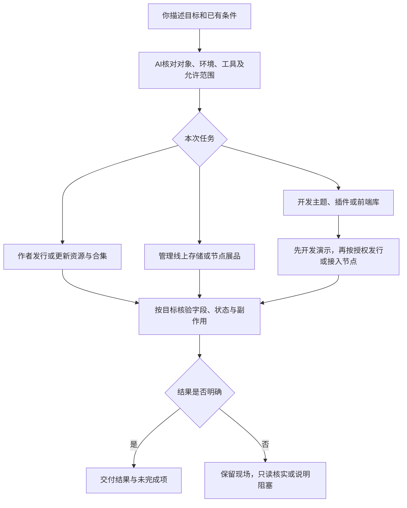

# 不熟悉操作，也可以让 AI 帮你完成任务

你可以让AI发行图片或视频、更新资源、管理合集和存储、运营节点展品，也可以开发主题插件。你负责目标、业务选择和结果确认，AI负责查文档、检查条件、操作与核验。不懂代码也不需要先学命令或框架。



## 1. 可以直接交给 Agent 的任务

把方括号内容换成自己的情况。不清楚的项目写“不确定”，让 Agent 先检查或解释，不必猜技术答案。

```text
我要完成：[发行一张图片 / 更新资源 / 管理合集或存储 / 添加节点展品 / 开发应用等]。
期望结果：[需要的版本、资料、状态，或页面与操作效果]。
已有条件：[文件或工程路径；已有的资源、合集、存储对象、节点或展品ID；不需要的留空]。
使用环境：[dev 或 test]。
允许修改的范围：[本地准备 / 指定对象的具体操作；不确定时先只读检查]。
授权和费用要求：[例如先使用免费资源；策略或收费选择先说明再由我决定]。

请先阅读Agent入口与平台任务目录，只加载本次任务需要的CLI或运行时文档。
检查已安装版本、目标身份、已有稿和未决操作，说明步骤、缺少的条件及验证办法。
仅操作我明确授权的对象和范围；不额外创建资源或节点，不自行选择商业策略。
需要我登录、验证或处理支付时，打开对应入口并说明目标，由我本人完成。
如果遇到未支持功能或远端操作结果未知，停止该写入分支，先查询，不重复操作。
最终交给我目标ID、实际结果、核验方式及未完成项；开发任务再补工程位置和演示地址。
```

没有填写明确写入范围时，先做只读检查并提出方案；你已明确要求的具体操作由AI按范围完成。文档本身不代替操作授权。密码、Cookie、令牌或验证码不要粘贴进任务。

## 2. 谁来做哪一步

| 阶段 | AI 可以完成 | 你需要提供或判断 | 完成信号 |
|---|---|---|---|
| 明确目标 | 区分作者发行、存储管理、节点运营、应用开发及内容使用 | 目标对象、修改范围、费用与策略选择 | 起点、步骤和结果明确 |
| 准备条件 | 检查版本、账号/环境、精确身份、当前稿及未决操作 | 本人认证及需要保留的内容 | 本次所需条件具备；普通文件发行不要求先有节点 |
| 执行任务 | 按教程处理文件、表单、合集、存储或展品操作 | 具体创建节点、商业条款等必要确认 | 对应线上字段与状态已读回 |
| 应用开发（按需） | 搭建、写代码、构建并演示真实节点中的效果 | 需求与体验判断 | 区分本地替换代码与线上资源，效果可演示 |
| 核验交付 | 核对目标字段、状态、副作用及恢复情况 | 确认是否达到目标；本人处理所需支付 | 成功有依据，限制和未完成项明确 |

技术性的报错先由 AI 定位，不要求你阅读源码兜底。AI 应说明已确认的原因、影响和下一步；只有本人认证、支付或业务取舍等环节需要你参与。

## 3. 条件不同，走不同入口

| 你的情况 | 下一步 |
|---|---|
| 有一个普通文件，要首次发行 | [普通资源快速上手](/cli/01-快速上手)；先发行资源，不必创建节点或开发主题 |
| 已有线上资源，只想发新版或改资料 | [绑定与更新](/cli/04-日常路径)、[资源管理](/cli/08-资源管理)，先保留已有稿 |
| 要把自己的线上单资源组织成合集 | [合集教程](/cli/合集/)，合集单品不是本地文件 |
| 要管理存储文件或使用已有存储文件发行 | [存储教程](/cli/存储空间/)，空间和对象在线上 |
| 已有节点，要从市场添加或管理展品 | [节点与展品教程](/cli/节点与展品/)，与作者发行分开 |
| 要开发主题或插件 | 先看[运行时结构](/runtime/architecture)与下面的开发条件分流 |

以下条件只针对应用开发或需要展示内容的节点任务，不是普通发行的前置条件：

| 开发条件 | 下一步 |
|---|---|
| 没有节点或没有已启用主题 | [先准备节点](/runtime/node-setup)，完成前可先做不依赖真实SDK的本地界面 |
| 没有工程，希望从模板开始 | 让AI按[CLI主题插件教程](/cli/05-主题与插件)准备工程；先按[安装版本分流](/cli/00-版本选择与AI代办)检查可用命令 |
| 已有本地工程 | 不覆盖工程，按[接入指南](/runtime/quickstart)检查生命周期与开发服务 |
| 第一次做插件，没有线上挂载位置 | 按[首次插件路径](/runtime/development#一个全新插件从哪里开始)先建立正式挂载链，再替换本地代码 |
| 想试用市场上的图片、视频或插件 | 先声明依赖、发行并让节点使用相应版本，再验证真实访问，见[本地开发](/runtime/development) |

Node.js 是本地工具环境。CLI 自己要求22.14+；主题插件工程只需符合各自工具链，不要求所有工程与运行时主应用使用同一 Node.js。

## 4. 需要支付的资源怎么办

当前 CLI **暂不执行支付**。策略要求先支付才能获得授权时，未支付就无法取得相应授权；签约、添加依赖、发行版本或生成文件URL都不能替代支付。

需要履约时由对应主体在 Console 或授权页面处理，再重新核验。平台网页支付能力与 CLI 当前未接入是两回事，见[签约、支付与授权](/platform/authorization)。AI 可以解释条款并打开入口，不能把尚未支付的资源标为已可用。

## 5. 你怎样验收 AI 的成果

不必检查所有代码。要求AI记录目标ID、具体操作、精确读回、未完成项和恢复入口；存储对象变更不代表版本已发行，作者资源上架也不代表节点展品已上架。开发应用时，再要求演示：

- 从哪里打开，以及现在演示的是本地替换代码还是真实线上代码。
- 你提出的每个功能如何操作、结果是什么，失败时怎样返回。
- 图片/视频/插件是否来自真实资源，具体版本与授权是否满足。
- 更新、刷新和再次打开后是否仍正常。
- 工程、资源ID、版本、节点地址以及未完成事项；没有确认的结果不能写“已完成”。

发行或上架后页面没变化，不等于应该再发行一次。先分清[提交恢复](/cli/09-常见情况与报错)与[运行时排查](/runtime/troubleshooting)。
