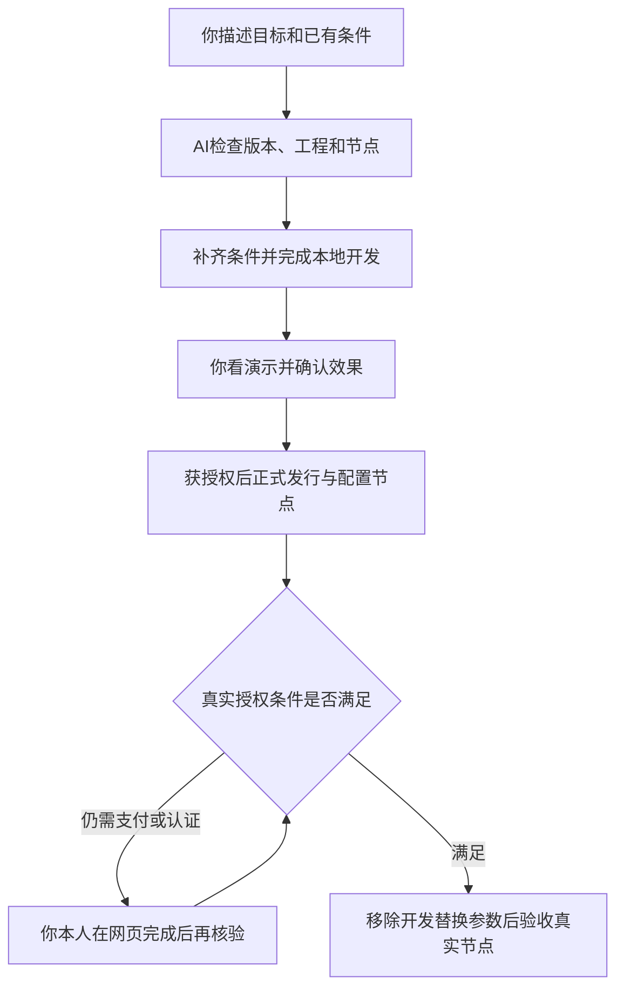

# 不会写代码，也可以让 AI 帮你开发

你负责描述目标和判断体验，AI 负责搭建、编写、构建与核验。你不需要先学会命令或框架；先把下面的信息交给所用的 Agent，让它确认条件，再开始改工程。



## 1. 可以直接交给 Agent 的任务

把方括号内容换成自己的情况。不清楚的项目写“不确定”，让 Agent 先检查或解释，不必猜技术答案。

```text
我要在 Freelog 上开发：[例如一个图片猜谜游戏主题，带一个独立计分插件]。
用户进入后应该能：[描述页面、操作和期望结果]。
我已有的东西：[没有工程 / 已有工程目录 / 已有资源ID]。
我提供的节点：[节点地址 / 还没有节点]；使用环境：[dev 或 test]。
我想使用的资源：[资源ID、完整授权标识、素材目录 / 先让你搜索和提出方案]。
我对授权和费用的要求：[例如先使用免费资源；付费方案先说明再由我决定]。

请先阅读本站平台、运行时和CLI文档，检查工具和已安装版本，列出我缺少的条件。
请区分代码开发、资源发行、节点使用三阶段，说明每阶段的结果和验证办法。
先完成本地开发，不要未经我授权就发行、上架、签约或改变现有线上对象。
需要我登录、验证或处理支付时，打开对应入口并说明目标，由我本人完成。
如果遇到未支持功能或远端操作结果未知，停止该写入分支，先查询，不重复操作。
最终交给我可打开的节点调试地址、工程位置、功能演示步骤和未完成事项。
```

这段任务默认只授权准备和本地开发。你可以按需要进一步授权发行或节点管理；文档本身不代替操作授权。密码、Cookie、令牌或验证码不要粘贴进任务。

## 2. 谁来做哪一步

| 阶段 | AI 可以完成 | 你需要提供或判断 | 完成信号 |
|---|---|---|---|
| 需求 | 拆解页面、交互和主题/插件分工，列出疑问 | 目标、素材、效果、可接受费用 | 你能看懂方案，范围已明确 |
| 准备 | 检查工具、CLI版本、工程与节点条件 | 必要账号、节点归属；本人登录或验证 | 所需版本可获得，真实节点可用 |
| 本地开发 | 初始化工程、写代码、启动服务并检查正式依赖上下文 | 打开演示，说明哪里不符合期望 | 节点中能看到本地修改，功能可演示 |
| 正式发行 | 获授权后处理构建、版本属性、配置、依赖及提交核验 | 确认资源身份、策略条件和是否发行 | 线上版本已确认，不只看到上传完成 |
| 节点使用 | 获授权后配置支持的展品功能，指导激活与检查 | 本人处理所需认证/支付，确认是否对外开放 | 正式入口的真实节点可用 |

技术性的报错先由 AI 定位，不要求你阅读源码兜底。AI 应说明已确认的原因、影响和下一步；只有本人认证、支付或业务取舍等环节需要你参与。

## 3. 条件不同，走不同入口

| 你的情况 | 下一步 |
|---|---|
| 没有节点或没有已启用主题 | [先准备节点](/runtime/node-setup)，完成前可先做不依赖真实SDK的本地界面 |
| 没有工程，希望从模板开始 | 让AI按[CLI主题插件教程](/cli/05-主题与插件)准备工程；先按[安装版本分流](/cli/00-版本选择与AI代办)检查可用命令 |
| 已有本地工程 | 不覆盖工程，按[接入指南](/runtime/quickstart)检查生命周期与开发服务 |
| 第一次做插件，没有线上挂载位置 | 按[首次插件路径](/runtime/development#一个全新插件从哪里开始)先建立正式挂载链，再替换本地代码 |
| 想试用市场上的图片、视频或插件 | 先声明依赖、发行并让节点使用相应版本，再验证真实访问，见[本地开发](/runtime/development) |
| 已有线上资源，只想发新版 | 按[绑定与更新](/cli/04-日常路径)，先检查已有身份及工作稿 |

Node.js 是本地工具环境。CLI 自己要求22.14+；主题插件工程只需符合各自工具链，不要求所有工程与运行时主应用使用同一 Node.js。

## 4. 需要支付的资源怎么办

当前 CLI **暂不执行支付**。策略要求先支付才能获得授权时，未支付就无法取得相应授权；签约、添加依赖、发行版本或生成文件URL都不能替代支付。

需要履约时由对应主体在 Console 或授权页面处理，再重新核验。平台网页支付能力与 CLI 当前未接入是两回事，见[签约、支付与授权](/platform/authorization)。AI 可以解释条款并打开入口，不能把尚未支付的资源标为已可用。

## 5. 你怎样验收 AI 的成果

不必检查所有代码，要求 AI 演示并记录：

- 从哪里打开，以及现在演示的是本地替换代码还是真实线上代码。
- 你提出的每个功能如何操作、结果是什么，失败时怎样返回。
- 图片/视频/插件是否来自真实资源，具体版本与授权是否满足。
- 更新、刷新和再次打开后是否仍正常。
- 工程、资源ID、版本、节点地址以及未完成事项；没有确认的结果不能写“已完成”。

发行或上架后页面没变化，不等于应该再发行一次。先分清[提交恢复](/cli/09-常见情况与报错)与[运行时排查](/runtime/troubleshooting)。
