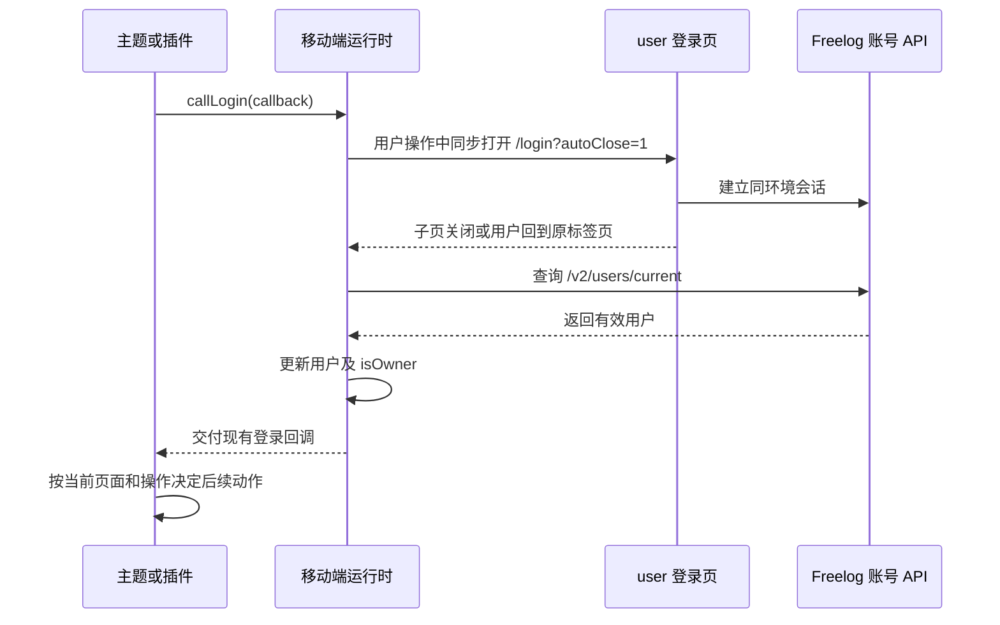

# 移动端统一登录设计

## 第一版决策

所有移动端入口统一使用 user 站点认证。**微信内直接在当前页打开 `/login`**。其他浏览器（含 QQ 内置浏览器）优先新开页，以保留原节点和 `callLogin` 回调。开窗失败时提供「在当前页登录」。原节点保留时，由发起登录的主题或插件管理购买、签约等操作的上下文。

微信分流对应 `FLRT-181` 和 user 接入文档 `FRW-4899`。运行时按 `MicroMessenger` 识别微信，在调用 `window.open` 前切换到当前页流程。这样无需依赖微信是否返回窗口句柄，也不会先打开 `about:blank`。

PC 原页在等待登录时保持可交互。主题或插件可以自行限制跳转，也负责判断返回后能否继续原操作。开窗被拦截或会话检查失败时，PC 在页面角落提供恢复入口。

私密节点直接整页打开统一登录，回跳后由节点重新判断访问权限。过去的页内私密登录隐藏注册和找回入口，统一页显示自己的标准导航。登录成功后，只有符合原权限条件的用户才能进入私密节点。[移动端入口](../packages/mobile-ui/src/App.tsx#L441) · [私密节点](../packages/mobile-ui/src/views/_outAuth/nodePrivate.tsx#L6)

## user 站点契约

核对基线为 `freelogfe-web-repos` 的 `dev@0.19.2`，提交 `c3bbb69f2`。远端分支与这次核对的本地源码一致。浏览器里的部署版本需要在 dev 手测时确认。

| 入口形态 | URL 参数 | 成功后 |
| --- | --- | --- |
| PC 子窗口、移动端新标签页 | `autoClose=1`，可带 `title`、`desc`、`cover` | user 页尝试关闭登录页，原节点重新查询会话 |
| 移动端当前页登录，包括微信、开窗失败后的主动选择和私密节点 | `goTo`，直接交给 `URLSearchParams` 编码 | user 页导航回原地址，运行时重新启动 |

两种入口均使用 `env.ts → baseInfo.HOST → urls.userSignIn`。dev、test、prod 分别打开 `user.devfreelog.com`、`user.testfreelog.com`、`user.freelog.cn` 下的 `/login`。测试应从对应环境的节点域名发起。当前 `localhost` 会按正式环境处理。[环境识别](../packages/freelog-runtime-api/src/config/env.ts#L4) · [登录地址](../packages/freelog-runtime-api/src/config/urls.ts#L14)

- **微信**。`FRW-4894` 已补上回到 `/login` 的参数，`autoClose=1` 可以独立传递。PC 和移动端新标签页均无需提供 `goTo`。扫码入口在登录页窄屏布局中隐藏，微信返回契约仍需在可用的桌面路径实测。
- **回跳地址**。`FRW-4895` 仅接受一次 URL 编码。整页跳转方案保留节点的完整路径、查询和片段。微信、QQ 的节点地址可能是 `share.<环境域名>`，需要保留其中的 `nodename` 等参数。
- **注册**。`/logon` 切页时保留 `autoClose`，但注册成功触发的自动登录 action 仍只传 `goToUrl`。成功后，注册页可能保持打开并跳到官网。用户切回原节点时，运行时可以确认会话。若要和密码登录一样自动回到原标签页，user 仍需让注册成功分支复用关窗逻辑，并保留邀请码流程的跳转优先级。
- **找回和修改密码**。找回密码后回到 `/login`，重新登录成功才算认证完成。已经登录的用户修改密码走 user 的 `/logged/setting` 中的安全设置，独立于这次 `callLogin`。

证据入口位于 user 仓库的 `packages/user/src/pages/login/index.tsx`、`packages/user/src/models/logonPage.ts`、`packages/user/src/utils/loginDestination.ts` 和 `packages/user/src/pages/logged/setting/Security/index.tsx`。运行时微信、QQ 分享壳地址见[分享入口](../packages/freelog-runtime-core/src/structure/share.ts#L14)。

## 原节点保留时的流程

1. **打开页**。在主题或插件点击触发的同步调用链中执行 `window.open`，避免先等待节点信息或接口结果。授权处理器延迟发起或开窗被拦截时，提示用户选择「在当前页登录」或取消。浏览器可能自行决定新标签页形态。[WebKit 用户激活](https://webkit.org/blog/13862/the-user-activation-api/) · [HTML 新开页面规则](https://html.spec.whatwg.org/multipage/document-sequences.html#the-rules-for-choosing-a-navigable)
2. **登记一次登录**。每个节点页面同一时刻只维护一个打开的登录页，重复请求复用已有页面与待完成的回调。由原页持有请求，无需借助统一登录页读取原节点的 DOM 或执行业务回调。
3. **回到节点时检查**。复用 `watchLoginOnReturn` 的 `visibilitychange`、`focus` 和 `pageshow`。存在活动请求且页面可见时检查。移动端检测到子页关闭后也会在原页可见时查询。用携带同环境凭据的 `getCurrentUser()` 请求服务端。`freelogAuth.getUserInfo()` 可能返回内存缓存，适合初始化读取。`uid` 的差异用于触发检查，成功以服务端会话为准。[返回监听](../packages/freelog-runtime-core/src/bridge/eventOn.ts#L25) · [真实会话接口](../packages/freelog-runtime-api/src/index.ts#L12) · [用户缓存](../packages/freelog-runtime-core/src/structure/user.ts#L14)
4. **交付一次结果**。同一请求最多同时进行一次会话查询，旧请求的响应不能结算新请求。成功时先更新用户，再调用移动端现有的完成逻辑。授权处理器走已有的成功和取消路径。取消和结束时释放临时监听及窗口句柄。[移动端完成逻辑](../packages/mobile-ui/src/App.tsx#L314)

### 结果与页面状态

| 观察到的情况 | 登录结果 | 运行时动作 |
| --- | --- | --- |
| 服务端确认有效用户 | `SUCCESS` | 写入身份，结算回调，尝试关闭仍打开的登录页 |
| 用户回到节点，登录页仍可用，服务端明确未登录 | 继续等待 | 保留本次请求，用户仍可继续登录或取消 |
| 浏览器报告登录页关闭，重新查询明确未登录 | `USER_CANCEL` | 结算取消，授权入口恢复原界面。真机需验证浏览器是否会过早断开窗口引用 |
| `getCurrentUser()` 失败 | 可重试 | 原页显示非遮挡提示，保留本次请求 |
| 原节点刷新、关闭或被系统回收 | 原回调随文档销毁 | 回到节点后重新读取会话。后续操作由主题或插件重新发起 |

正常等待过程中，运行时无需渲染遮罩。原页如果只是切换主题内路由，回调可能还有效。发起者需要核对页面、对应展品和本次操作是否仍有效，再继续购买或签约。

## 当前页登录流程

1. 移动端微信和私密节点点击登录后直接进入这条路径。其他浏览器开窗失败时显示「在当前页登录」和「取消」，提示用户回来后可能需要重新发起当前操作。
2. 用户确认离开原页后，清理临时检查和本次 `callLogin` 回调队列，通过 `location.assign()` 跳到同环境 `/login`。通过 `URLSearchParams` 设置原节点完整地址为 `goTo`，省略 `autoClose`。用户在跳转前取消时留在原页，走原有取消回调。
3. 登录成功后，user 导航回 `goTo`。节点初始化时重新读取服务器会话。上一个页面的内存回调没有恢复契约，所以这条路径只恢复用户身份。购买或签约由用户重新触发，或者由主题基于自己持久化的业务状态决定如何继续。

如果某个内置浏览器同时要求统一登录和返回原页面后继续执行旧回调，仅靠整页回跳无法实现。这类续做需要由主题提供可恢复的业务上下文，作为后续单独设计。

## `onUserChange` 兼容性

保持现有职责分工。节点发起登录时，临时监听优先确认会话，同一变化由 `onLogin` 和 `callLogin` 交付。没有活动登录请求时，节点按现有方式比较 `uid` 与缓存身份，并通知 `onUserChange`。这个订阅沿用原有一次触发后清空队列的行为。

只订阅 `onUserChange` 的组件，如果由同一节点的其他组件完成登录、且节点不刷新，可能继续显示旧用户状态。这与原移动端页内登录的边界一致。活动客户端的该订阅会整页刷新，而它自己的登录回调会跳转页面，因此在主动登录完成后再补发一次 `onUserChange` 会改变这些消费者的行为。第一版沿用已有通知语义。[主题插件 API](../packages/docs/api/user.md#onuserchange) · [运行时分流](../packages/freelog-runtime-core/src/bridge/eventOn.ts#L35)

## 实现位置

| 位置 | 实现 |
| --- | --- |
| [移动端 App](../packages/mobile-ui/src/App.tsx#L441) | `LOGIN` 与授权处理器调用同一入口。微信直接当前页登录，其他浏览器尝试新开统一页。新页路径复用 `loginFinished`，当前页路径在回跳后走初始化 |
| [运行时登录控制器](../packages/freelog-runtime-core/src/structure/loginWindow.ts) | PC 和移动端共用 URL 构造、窗口状态及服务端会话检查。原页在正常等待时可操作，遇到开窗或检查失败时显示恢复提示 |
| [移动端登录提示](../packages/mobile-ui/src/views/loginNotice.tsx) | 提供当前页登录、取消和重试。原 `views/user/` 下的登录、注册和找回密码表单已移除 |
| [移动端私密节点](../packages/mobile-ui/src/views/_outAuth/nodePrivate.tsx) | 登录按钮进入当前页统一登录，回跳后走原有节点权限检查 |
| user 站点 | 已有微信参数透传可用于联调。补齐注册自动关窗后，统一页的普通注册才能达到与密码登录相同的返回体验 |

先在 dev 验证两条打开路径。本地构建时按 `freelog-runtime-api`、`freelog-runtime-core`、`mobile-ui` 的顺序运行 `pnpm --filter <包名> build`，前两个包的产物用于 UI 构建。进入 test 和 prod 前验证用户返回节点后可以重新发起购买或签约。

## dev 验收清单

| 场景 | 预期 |
| --- | --- |
| iOS Safari、Android Chrome，密码与验证码登录 | 打开统一页，原页可操作，返回后用户与节点所有者状态正确，登录结果只交付一次 |
| iPhone 微信打开节点书架，点击「登录 / 注册」 | 当前页直接进入统一登录，过程没有空白页。链接带 `goTo` 并省略 `autoClose`，解析后与原书架地址一致，包括 `nodename`、查询和 `#`。登录后回书架并读取新登录态 |
| QQ 内置浏览器及其他浏览器开窗失败 | 先尝试原有开窗路径。选择当前页登录时，回跳保留分享壳和节点路由 |
| 暂时切回节点、关窗取消、网络失败后重试 | 提前切回不会结算为取消；确认关闭且无会话会取消；网络失败可重试 |
| 注册后登录、找回后登录、桌面微信回跳 | 注册即使未关窗，切回节点也能确认会话；找回密码后先登录；桌面微信回到带 `autoClose` 的登录页 |
| 商品 A 点击登录后转到商品 B，或节点被浏览器重新加载 | 运行时同步登录态，主题仅在原操作仍有效时继续；不会恢复已销毁的 JS 回调 |
| 登录期间前台恢复事件连续触发、重复点登录 | 复用现有窗口；只查询一个在途请求；完成回调不重复 |
| 在其他浏览器标签页登录或切换账号 | 无活动请求时按原语义触发 `onUserChange`；有活动请求时以服务端当前会话结算 |
| 私密节点：所有者、其他账号、取消 | 所有者登录后可以进入；其他账号仍看到私密提示；取消留在原页面 |
| dev、test、prod 的入口与回跳 | user 页与会话 API 属于同一环境；保留原页的路径不带 `goTo`，整页回跳的 `goTo` 只编码一次 |
