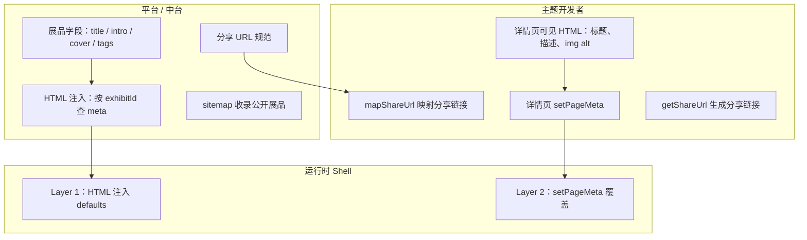

# 展品 SEO 指南

> 第一次接触？建议先读 [SEO 入门教程](./tutorial.md) 第 5 章（场景 2、场景 3）和第 8 章。

Freelog 中的**展品**是图片、视频、文档、音频等媒体资源（区别于**主题**这种布局框架）。主题通过 `getExhibitListByPage` 等 API 拉取展品列表，再播放或展示。

展品 SEO 的核心问题是：**媒体内容本身没有独立 HTML 页面，页面是主题渲染出来的。** 因此需要平台 + 主题配合，为每个展品建立**可收录、可分享、meta 正确**的独立 URL。

## 1. 展品 vs 主题：SEO 对象不同

| 对象 | 是什么 | SEO 关注点 |
| --- | --- | --- |
| **节点** | `a.freelog.cn` 这个站点 | 站点 title、description、og:image |
| **主题** | 布局框架（Vue/React 应用） | 一般不作为独立 SEO 页 |
| **展品** | 图片、视频、PDF、音频、合集等 | **每个展品应有独立详情 URL 和 meta** |

用户搜索「某张图片」「某个视频」时，搜索引擎收录的应是**展品详情页**，而不是主题首页或列表页。

## 2. 展品已有的 SEO 字段

展品 API（`getExhibitById`）返回的数据中，多数 SEO 字段已存在，无需重复维护：

| SEO 用途 | 展品字段 | 说明 |
| --- | --- | --- |
| 标题 | `exhibitTitle` | 优先使用；空则 fallback `exhibitName` |
| 描述 | `exhibitIntro` | 摘要，用于 `description` / `og:description` |
| 封面 / 分享图 | `coverImages[0]` | 微信预览、OG 图；**不要用原始大文件 URL** |
| 关键词 | `tags[]` | 可拼成 `keywords` |
| 资源类型 | `articleInfo.resourceType` | 如 `["图片","照片"]`、`["视频"]` |
| MIME | `versionInfo.exhibitProperty.mime` | 判断 Schema 类型 |
| 作者 | `articleInfo.articleOwnerName` | 结构化数据 author |
| 创建时间 | `createDate` | `datePublished` |
| 图片宽高 | `exhibitProperty.imageWidth/Height` | ImageObject 用 |

```ts
// packages/freelog-type/src/exhibit.ts（节选）
interface ExhibitInfo {
  exhibitId: string;
  exhibitName: string;
  exhibitTitle: string;
  exhibitIntro: string;
  tags: string[];
  coverImages: string[];
  articleInfo: {
    resourceType: string[];  // ["图片", "视频", "文档", ...]
    articleType: number;     // 1 独立 2 合集 3 节点合集 4 存储对象
  };
  versionInfo?: {
    exhibitProperty: {
      mime: string;
      fileSize: number;
      [key: string]: any;    // imageWidth, duration 等
    };
  };
}
```

中台可在发布展品时引导用户填写 `exhibitTitle`、`exhibitIntro`、`coverImages`、`tags`，这就是展品 SEO 的数据来源。

## 3. 展品 SEO 的前提：稳定 URL

主题内部路由（如 `/gallery`、`/player?id=xxx`）搜索引擎难以收录。**展品 SEO 必须走平台分享 URL 规范**：

| URL 模式 | 适用 | 示例 |
| --- | --- | --- |
| `/{exhibitId}/detail` | 独立资源展品 | `/64a26ea41cbfe2002f9cb6e9/detail` |
| `/{exhibitId}/{itemId}/detail` | 合集内单品 | `/64a.../64b.../detail` |

生成与解析：

```ts
// 主题生成分享链接
const url = freelogApp.getShareUrl(
  { exhibitId: '64a...', itemId: '64b...', query: {} },
  'detail'
);

// 主题启动时映射到内部路由（须在路由加载前）
await freelogApp.mapShareUrl({
  detail: (exhibitId, itemId, query) =>
    itemId ? `/media/${exhibitId}/${itemId}` : `/media/${exhibitId}`,
});
```

平台侧（HTML 注入 / sitemap）复用同一套 URL 规则（见 `share.ts` 的 `isShareUrl`）。

### 主题必须做到

1. **每个展品详情页**对应一个分享 URL（或能从分享 URL 还原）
2. 列表页点击展品 → 更新浏览器 URL（`history.pushState` 或虚拟路由）
3. 进入详情页时调用 `setPageMeta`（Layer 2）
4. 分享时使用 `getShareUrl`，保证微信/外链打开同一展品

## 4. 按资源类型的 SEO 策略

不同媒体类型，meta 和结构化数据应区分处理。

### 图片 / 照片

| 字段 | 取值 |
| --- | --- |
| `og:type` | `article` 或 Open Graph 对图片用 `og:image` 即可 |
| `og:image` | `coverImages[0]`，建议 ≥ 300×200，微信建议 300×300+ |
| Schema | `ImageObject` |

```json
{
  "@context": "https://schema.org",
  "@type": "ImageObject",
  "name": "{{exhibitTitle}}",
  "description": "{{exhibitIntro}}",
  "contentUrl": "{{mediaCdnUrl}}",
  "thumbnailUrl": "{{coverImages[0]}}",
  "width": "{{imageWidth}}",
  "height": "{{imageHeight}}",
  "author": { "@type": "Person", "name": "{{articleOwnerName}}" }
}
```

补充：详情页 HTML 中应有 ``，利于 Google 图片搜索。

### 视频

| 字段 | 取值 |
| --- | --- |
| `og:type` | `video.other` |
| `og:image` | 视频封面 `coverImages[0]`，**不要用视频文件 URL** |
| `og:video` | 可选，公开视频可填 CDN 地址 |
| Schema | `VideoObject` |

```json
{
  "@context": "https://schema.org",
  "@type": "VideoObject",
  "name": "{{exhibitTitle}}",
  "description": "{{exhibitIntro}}",
  "thumbnailUrl": "{{coverImages[0]}}",
  "uploadDate": "{{createDate}}",
  "duration": "PT{{durationSeconds}}S",
  "contentUrl": "{{mediaCdnUrl}}"
}
```

注意：

- 微信预览只认 `og:image`，封面图必须配置
- 私密/付费视频：`robots: noindex`，且不暴露 `contentUrl`
- 有字幕时可在 `description` 或扩展字段加入文本，利于搜索

### 音频 / 播客

| 字段 | 取值 |
| --- | --- |
| `og:type` | `music.song` 或 `website` |
| Schema | `AudioObject` 或 `PodcastEpisode` |

```json
{
  "@context": "https://schema.org",
  "@type": "AudioObject",
  "name": "{{exhibitTitle}}",
  "description": "{{exhibitIntro}}",
  "contentUrl": "{{mediaCdnUrl}}",
  "duration": "PT{{durationSeconds}}S"
}
```

### 文档（PDF、Word 等）

| 字段 | 取值 |
| --- | --- |
| `og:type` | `article` |
| `og:image` | 文档封面或节点 Logo |
| Schema | `DigitalDocument` 或 `MediaObject` |

```json
{
  "@context": "https://schema.org",
  "@type": "DigitalDocument",
  "name": "{{exhibitTitle}}",
  "description": "{{exhibitIntro}}",
  "encodingFormat": "{{mime}}",
  "url": "{{canonicalUrl}}"
}
```

文档类 SEO 主要靠前缀 title + intro + 标签；**全文索引**需额外做文本提取（中台或预处理），不在运行时默认范围内。

### 合集（albumType = 2）

合集有两种 SEO 粒度：

| 粒度 | URL | 说明 |
| --- | --- | --- |
| 合集整体 | `/{exhibitId}/detail` | 合集 title、封面、简介 |
| 合集内单品 | `/{exhibitId}/{itemId}/detail` | 每张图/每个视频的独立 SEO |

```json
{
  "@context": "https://schema.org",
  "@type": "ImageGallery",
  "name": "{{exhibitTitle}}",
  "description": "{{exhibitIntro}}",
  "image": ["{{coverImages[0]}}"]
}
```

相册类节点应在 sitemap 中同时收录合集页和各单品页（若主题支持单品深链）。

## 5. 列表页 vs 详情页

| 页面 | URL 示例 | SEO 策略 |
| --- | --- | --- |
| 节点首页 | `/` | 节点级 meta |
| 展品列表 / 分类 | 主题自定义路由 | 节点默认 meta + 可选分类 title；**一般不单独收录每个展品** |
| 展品详情 | `/{exhibitId}/detail` | **展品级 meta，sitemap 必收录** |

列表页通常不是 SEO 重点；**每个展品详情 URL 才是 sitemap 和分享的基本单元**。

```
sitemap.xml 应包含：
  https://a.freelog.cn/
  https://a.freelog.cn/{exhibitId}/detail          ← 每个公开展品
  https://a.freelog.cn/{exhibitId}/{itemId}/detail  ← 合集单品（如有）
```

## 6. 三层分工：展品场景



### 平台 / 中台

1. 展品发布时校验：`exhibitTitle`、`exhibitIntro`、`coverImages` 必填（至少对要 SEO 的展品）
2. 网关 / share 子域：解析 `/{exhibitId}/detail` → 调 `getExhibitById` → 注入 meta
3. 按 `resourceType` / `mime` 选择 Schema 模板
4. sitemap 定时拉公开展品列表写入
5. 未授权 / 下线展品：`noindex` 或不进 sitemap

### 主题开发者

1. 启动时 `mapShareUrl`，让分享链接能打开对应展品
2. 进入展品详情时：

```ts
async function onExhibitDetail(exhibit: ExhibitInfo) {
  freelogApp.setPageMeta({
    title: `${exhibit.exhibitTitle} - ${freelogApp.nodeInfo.nodeTitle}`,
    description: exhibit.exhibitIntro,
    keywords: exhibit.tags,
    og: {
      title: exhibit.exhibitTitle,
      description: exhibit.exhibitIntro,
      image: exhibit.coverImages[0],
      type: getOgType(exhibit), // 按 resourceType 映射
      url: freelogApp.getShareUrl({ exhibitId: exhibit.exhibitId }, 'detail'),
    },
    jsonLd: buildExhibitJsonLd(exhibit),
  });

  // 微信环境
  if (freelogApp.isWeChatOrQQ()) {
    freelogApp.updateWechatShare(/* ... */);
  }
}
```

3. 详情页 DOM 中保留可被爬虫理解的静态结构（即使播放器是 JS 渲染）：

```html
<article>
  <h1>{{ exhibitTitle }}</h1>
  <p>{{ exhibitIntro }}</p>
  
</article>
```

纯 Canvas / 全屏播放器没有文字节点时，SEO 效果会大打折扣。

## 7. HTML 注入：展品 meta 组装示例

服务端根据 `exhibitId` 拉取展品后：

```ts
function buildExhibitSeo(exhibit: ExhibitInfo, node: NodeInfo) {
  const resourceType = exhibit.articleInfo.resourceType;
  const isVideo = resourceType.some(t => t.includes('视频'));
  const isImage = resourceType.some(t => t.includes('图片') || t.includes('照片'));

  return {
    title: `${exhibit.exhibitTitle || exhibit.exhibitName} - ${node.nodeTitle}`,
    description: exhibit.exhibitIntro || node.nodeShortDescription,
    keywords: exhibit.tags.join(','),
    favicon: node.nodeLogo,
    ogType: isVideo ? 'video.other' : 'article',
    ogTitle: exhibit.exhibitTitle,
    ogDescription: exhibit.exhibitIntro,
    ogImage: exhibit.coverImages[0] || node.nodeLogo,
    siteName: node.nodeTitle,
    canonicalUrl: `https://${node.nodeDomain}.freelog.cn/${exhibit.exhibitId}/detail`,
    robots: exhibit.onlineStatus === 1 && isPublic(exhibit) ? 'index,follow' : 'noindex,nofollow',
    jsonLd: JSON.stringify(buildJsonLd(exhibit, isVideo, isImage)),
  };
}
```

## 8. 常见问题

### Q：展品只在列表里展示，没有详情页，怎么做 SEO？

需要主题补一个**详情视图**（哪怕很轻量：标题 + 封面 + 播放器 + 简介），并绑定 `/{exhibitId}/detail`。没有独立 URL，搜索引擎无法按展品收录。

### Q：视频播放用 blob URL / 流式加载，OG 里填什么？

`og:image` 填 `coverImages`；`og:video` 仅在公开且 CDN 直链稳定时使用。微信预览**只看 og:image**。

### Q：1000 张图的相册要进 sitemap 吗？

若每张图有独立 `itemId` 和详情 URL，可以进；若只有合集一个 URL，则只收录合集页。避免 sitemap 爆炸时可按标签/分类分页或限制最近 N 条。

### Q：展品需要授权才能看，还要 SEO 吗？

默认 **noindex**。若希望「看得到标题、点进去才授权」，可注入 title/description 但 `robots: noindex`，或仅收录已公开的展品。

### Q：主题路由是 `?theme=encode(...)`，展品 ID 在参数里，HTML 层能注入吗？

不能可靠注入。**展品 SEO 应优先使用** `/{exhibitId}/detail` 这种 path 型分享 URL，而不是纯虚拟路由 query。

## 9. 最小 checklist

**中台**

- [ ] 展发布表单：`exhibitTitle`、`exhibitIntro`、`coverImages` 必填
- [ ] 公开展品 API 供 sitemap 使用
- [ ] 网关 / share 子域支持 `/{exhibitId}/detail` HTML 注入

**主题**

- [ ] `mapShareUrl` + `getShareUrl` 接入
- [ ] 每个展品有详情视图 + 独立 URL
- [ ] 详情页 `setPageMeta` + 微信分享
- [ ] 详情页有 `h1`、描述文字、`img alt`

**平台**

- [ ] sitemap 收录 `/{exhibitId}/detail`
- [ ] 按 `resourceType` 选择 Schema 模板
- [ ] 未授权展品 noindex

## 相关文档

- [SEO 总览](./index.md)
- [HTML 层 SEO](./html-seo.md)
- [分享 API（开发者）](../../packages/docs/api/share.md)
- [展品 API（开发者）](../../packages/docs/api/exhibit.md)
