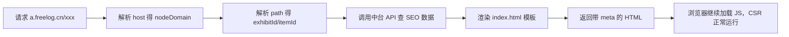

# HTML 层 SEO 实现指南

> 第一次接触？建议先读 [SEO 入门教程](./tutorial.md) 第 3、4、5 章。

HTML 层 SEO 的核心目标：

> **在 JS 还没执行之前，就把正确的 `<head>` 信息交给浏览器、爬虫和微信预览。**

重点不是改 React/Vue 主题代码，而是：**谁返回 `index.html`，谁就要在返回前把 meta 写好。**

## 1. HTML 里要放什么

一个节点/内容页，`<head>` 里建议至少包含：

```html
<head>
  <meta charset="utf-8" />
  <meta name="viewport" content="width=device-width, initial-scale=1.0" />

  <!-- 基础 SEO -->
  <title>文章标题 - 节点名称</title>
  <meta name="description" content="页面摘要，建议 80~160 字" />
  <meta name="keywords" content="关键词1,关键词2" />
  <link rel="canonical" href="https://a.freelog.cn/64a.../detail" />

  <!-- Open Graph：微信、Facebook、Slack 等 -->
  <meta property="og:type" content="article" />
  <meta property="og:title" content="文章标题" />
  <meta property="og:description" content="页面摘要" />
  <meta property="og:image" content="https://cdn.xxx.com/cover.jpg" />
  <meta property="og:url" content="https://a.freelog.cn/64a.../detail" />
  <meta property="og:site_name" content="节点名称" />

  <!-- Twitter -->
  <meta name="twitter:card" content="summary_large_image" />
  <meta name="twitter:title" content="文章标题" />
  <meta name="twitter:description" content="页面摘要" />
  <meta name="twitter:image" content="https://cdn.xxx.com/cover.jpg" />

  <!-- 图标 -->
  <link rel="icon" href="https://cdn.xxx.com/favicon.ico" />

  <!-- 结构化数据 -->
  <script type="application/ld+json">
  {
    "@context": "https://schema.org",
    "@type": "Article",
    "headline": "文章标题",
    "description": "页面摘要",
    "image": "https://cdn.xxx.com/cover.jpg",
    "datePublished": "2026-07-21",
    "author": {
      "@type": "Person",
      "name": "作者名"
    }
  }
  </script>
</head>
```

### 各字段作用

| 标签 | 作用 |
| --- | --- |
| `<title>` | 浏览器标签页标题、搜索结果标题 |
| `description` | 搜索结果摘要 |
| `canonical` | 告诉搜索引擎权威 URL，避免重复收录 |
| `og:*` | 社交分享卡片（**微信预览最关键**） |
| `twitter:*` | Twitter/X 分享 |
| `json-ld` | 结构化数据，利于搜索引擎理解内容类型 |
| `robots` | 控制是否收录，如 `noindex,nofollow` |

## 2. 当前问题

运行时 HTML 模板（`packages/pc-ui/index.html`）仍是占位内容：

```html
<title></title>
<meta name="description" content="Web site created using create-react-app" />
```

这会导致：

- 微信分享抓到空标题或错误描述
- 搜索引擎首屏看到通用占位内容
- 节点首页、展品详情页无法区分 SEO 信息

Shell 仅在拉取节点信息后设置 `document.title`（见 `packages/pc-ui/src/App.tsx`），对爬虫和微信预览来说太晚。

## 3. 注入时机

Freelog 加载链路：

```
a.freelog.cn → 运行时 index.html → JS 启动 → 加载主题 → 加载插件
```

HTML SEO 应在 **返回 index.html 时** 完成，而不是等主题挂载后。



**HTML SEO 不改运行时架构**，只是把 `index.html` 从静态模板变成「按请求动态生成」。

## 4. URL 分类与数据来源

结合现有分享 URL 解析规则（`packages/freelog-runtime-core/src/structure/share.ts`）：

```ts
const urlTest = /^\/?.{24}(?:\/.{24})?\/(\w+)(?:\/|$)/;
```

| URL 类型 | 示例 | SEO 数据来源 | 可注入 |
| --- | --- | --- | --- |
| 节点首页 | `https://a.freelog.cn/` | 节点信息 | ✅ |
| 展品详情 | `https://a.freelog.cn/{exhibitId}/detail` | 节点 + 展品 | ✅ |
| 合集单品 | `https://a.freelog.cn/{exhibitId}/{itemId}/detail` | 节点 + 展品 + 单品 | ✅ |
| 虚拟路由 | `https://a.freelog.cn/?theme=xxx` | 仅节点默认 | ⚠️ 部分 |

解析结果结构：

```ts
// 展品详情
{ exhibitId, type: 'detail' }

// 合集单品
{ exhibitId, itemId, type: 'detail' }
```

## 5. 中台 SEO 数据

### 节点级（首页默认）

来源：现有节点 API（`getInfoByNameOrDomain`）可扩展字段。

| 字段 | 说明 | 现有字段映射 |
| --- | --- | --- |
| `nodeTitle` | 节点标题 | `nodeInfo.nodeTitle` |
| `nodeShortDescription` | 节点描述 | `nodeInfo.nodeShortDescription` |
| `nodeLogo` | 节点 Logo / OG 图 | `nodeInfo.nodeLogo` |
| `favicon` | 站点图标 | 主题 `options_logoImage` 或节点 Logo |
| `keywords` | 关键词 | 中台新增 |
| `robots` | 收录策略 | 根据节点 status 计算 |

### 展品级（详情页）

来源：展品 API（`getExhibitById`）可扩展字段。

| 字段 | 说明 |
| --- | --- |
| `title` | 展品标题 |
| `description` | 摘要 |
| `cover` | 封面图 |
| `publishedAt` | 发布时间 |
| `author` | 作者 |
| `robots` | 收录策略 |

### 权限与 robots 规则

| 节点/内容状态 | robots | 说明 |
| --- | --- | --- |
| 公开（status = 1） | `index,follow` | 正常收录 |
| 私密（status = 2） | `noindex,nofollow` | 非 owner 不可见 |
| 冻结（status = 4） | `noindex,nofollow` | 节点不可用 |
| 暂停（status = 8） | `noindex,nofollow` | 节点下线 |
| 删除（status = -1） | `noindex,nofollow` | 节点已删 |

**SEO 数据应在服务端判断权限**，不要等前端 JS 再决定。

## 6. 动态 HTML 模板

保留现有运行时 HTML 的 body 结构和样式，只替换 `<head>`：

```html
<!DOCTYPE html>
<html lang="zh-CN">
<head>
  <meta charset="utf-8" />
  <link rel="icon" href="{{favicon}}" />
  <meta name="viewport" content="width=device-width, initial-scale=1.0, maximum-scale=1.0" />
  <meta name="theme-color" content="#000000" />

  <title>{{title}}</title>
  <meta name="description" content="{{description}}" />
  {{#if keywords}}
  <meta name="keywords" content="{{keywords}}" />
  {{/if}}
  <meta name="robots" content="{{robots}}" />
  <link rel="canonical" href="{{canonicalUrl}}" />

  <meta property="og:type" content="{{ogType}}" />
  <meta property="og:title" content="{{ogTitle}}" />
  <meta property="og:description" content="{{ogDescription}}" />
  <meta property="og:image" content="{{ogImage}}" />
  <meta property="og:url" content="{{canonicalUrl}}" />
  <meta property="og:site_name" content="{{siteName}}" />

  <meta name="twitter:card" content="summary_large_image" />
  <meta name="twitter:title" content="{{ogTitle}}" />
  <meta name="twitter:description" content="{{ogDescription}}" />
  <meta name="twitter:image" content="{{ogImage}}" />

  {{#if jsonLd}}
  <script type="application/ld+json">{{{jsonLd}}}</script>
  {{/if}}

  <!-- 保留原有 style 和运行时容器样式 -->
</head>
<body>
  <noscript>You need to enable JavaScript to run this app.</noscript>
  <div id="ui-root"></div>
  <div id="freelog-pc-common-auth"></div>
  <div id="freelog-plugin-container"></div>
  <div id="runtime-loading">...</div>
  <script type="module" src="/assets/main.js"></script>
</body>
</html>
```

### 节点首页 meta 组装

```ts
{
  title: nodeTitle,
  description: nodeShortDescription,
  keywords: nodeKeywords,
  favicon: nodeFavicon || nodeLogo,
  ogType: 'website',
  ogTitle: nodeTitle,
  ogDescription: nodeShortDescription,
  ogImage: nodeLogo,
  siteName: nodeTitle,
  canonicalUrl: `https://${nodeDomain}.freelog.cn/`,
  robots: nodeIsPublic ? 'index,follow' : 'noindex,nofollow',
}
```

### 展品详情页 meta 组装

```ts
{
  title: `${exhibitTitle} - ${nodeTitle}`,
  description: exhibitDescription || nodeShortDescription,
  ogType: 'article',
  ogTitle: exhibitTitle,
  ogDescription: exhibitDescription,
  ogImage: exhibitCover || nodeLogo,
  siteName: nodeTitle,
  canonicalUrl: `https://${nodeDomain}.freelog.cn/${exhibitId}/detail`,
  robots: isPublic ? 'index,follow' : 'noindex,nofollow',
  jsonLd: JSON.stringify({
    '@context': 'https://schema.org',
    '@type': 'Article',
    headline: exhibitTitle,
    description: exhibitDescription,
    image: exhibitCover,
    datePublished: publishedAt,
    author: { '@type': 'Person', name: author },
  }),
}
```

## 7. 实现位置

### 方案 A：网关动态 HTML（全站 SEO）

所有访问 `a.freelog.cn` 的 HTML 请求经网关处理：

```
用户请求 a.freelog.cn/64a.../detail
  ↓
Nginx / OpenResty / 边缘 Worker 拦截 index.html
  ↓
调用中台 API：getInfoByNameOrDomain + getExhibitById
  ↓
渲染 index.html 模板，替换占位 meta
  ↓
返回 HTML + 正常加载 JS（CSR 不变）
```

适合：节点首页、分享 URL、普通访问也要 SEO 的场景。

### 方案 B：share 子域专门做 SEO（推荐先做）

现有微信分享已跳转到 `share.{HOST}`：

```ts
// packages/freelog-runtime-core/src/structure/share.ts
rawWindow.location.href = urls.shareBase + search + "&time=" + ...
```

分工：

| 域名 | 作用 |
| --- | --- |
| `a.freelog.cn` | 正常访问，CSR 运行 |
| `share.freelog.cn` | 分享 / 预览 / 爬虫，返回带完整 meta 的 HTML |

优点：

- 不动现有 CSR 主链路
- 微信预览问题最快解决
- 后续可扩展到主域名

### 方案选择建议

| 阶段 | 方案 |
| --- | --- |
| 第一阶段 | 方案 B：`share` 子域注入 |
| 第二阶段 | 方案 A：主域名网关注入 |
| 第三阶段 | 边缘缓存 HTML 快照 |

## 8. 整站 SEO 配套

### sitemap.xml

中台按节点公开内容自动生成，网关或 CDN 提供：

```xml
<?xml version="1.0" encoding="UTF-8"?>
<urlset xmlns="http://www.sitemaps.org/schemas/sitemap/0.9">
  <url>
    <loc>https://a.freelog.cn/</loc>
    <lastmod>2026-07-21</lastmod>
  </url>
  <url>
    <loc>https://a.freelog.cn/64a26ea41cbfe2002f9cb6e9/detail</loc>
    <lastmod>2026-07-20</lastmod>
  </url>
</urlset>
```

生成规则：

- 仅包含公开节点、公开展品
- URL 格式与 `getShareUrl` 保持一致
- 展品更新时刷新 `lastmod`

### robots.txt

公开节点：

```txt
User-agent: *
Allow: /
Sitemap: https://a.freelog.cn/sitemap.xml
```

私密节点：

```txt
User-agent: *
Disallow: /
```

## 9. 能力边界

### HTML 注入能覆盖

- 节点首页
- 展品详情页（`/{exhibitId}/detail`）
- 合集单品页（`/{exhibitId}/{itemId}/detail`）
- 微信 / QQ 卡片预览
- 搜索引擎抓取首页和详情页

### HTML 注入不能覆盖

- 主题内部虚拟路由（如 `/?theme=encode(/blog/list?page=2)`）
- 弹层、Tab 切换
- 登录后才可见的页面内容

这些场景需 Layer 2 的 `setPageMeta`，详见 [SEO 总览](./index.md)。

## 10. 最小落地方案

### 第一步：覆盖 2 类页面

1. 节点首页（`/`）
2. 分享详情页（`/{exhibitId}/detail`）

### 第二步：share 子域注入

- 微信预览立即生效
- 对现有运行时影响最小

### 第三步：中台 SEO 字段

节点：`nodeTitle`、`nodeShortDescription`、`nodeLogo`、`favicon`

展品：`title`、`description`、`cover`、`publishedAt`、`author`

### 第四步：sitemap / robots

按节点 status 和展品公开状态自动生成。

## 11. 与 setPageMeta 的配合

| 场景 | 负责层 |
| --- | --- |
| 首次打开 / 分享链接 / 爬虫 | Layer 1 HTML 注入 |
| 主题内路由切换 | Layer 2 setPageMeta |
| Layer 1 注入的 meta | 作为 defaults |
| setPageMeta 调用 | merge / 覆盖 defaults |

一句话：**服务端保证「第一次打开就对」，客户端保证「SPA 切换也正确」。**

## 相关文档

- **[SEO 入门教程](./tutorial.md)** — 推荐首读
- [SEO 总览](./index.md)
- [展品 SEO 指南](./exhibit-seo.md)
- [分享 API（开发者）](../../packages/docs/api/share.md)
