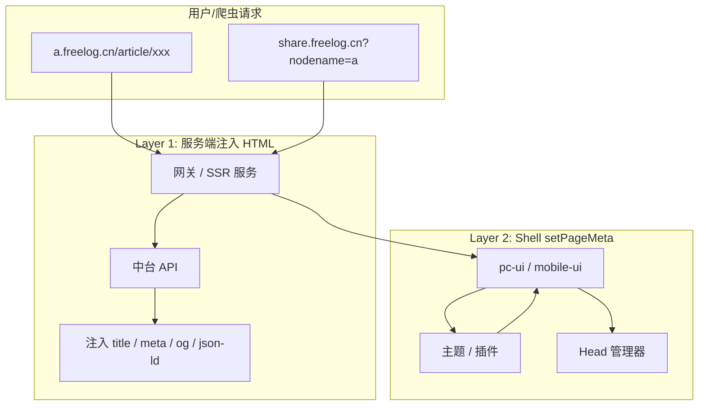

# 搜索引擎 SEO 总览

> **范围**：**百度** + **Google** 的发现、收录、排名。不含微信/社交分享。  
> **请先读 [搜索引擎 SEO 教程](./tutorial.md)**（7 步流程 + 两家差异 + 站长提交）；本文是架构补充。

Freelog 是基于 micro-app 的微前端平台：用户访问节点域名（如 `a.freelog.cn`）时，先加载**平台运行时**，再加载**主题**，主题再加载**插件**。当前运行时为纯 CSR（客户端渲染），搜索引擎爬虫往往读不到 JS 渲染后的内容，需要中台 HTML 注入 + sitemap 等方案。

## 文档导航

| 文档 | 说明 |
| --- | --- |
| **[搜索引擎 SEO 教程](./tutorial.md)** | **推荐首读**：发现 → 抓取 → 索引 → 搜索匹配 |
| [HTML 层 SEO](./html-seo.md) | 中台 HTML 注入实现 |
| [展品 SEO](./exhibit-seo.md) | 图片、视频、文档等媒体展品 |
| 本文 | 架构方案对比 |

## 架构背景

```
用户访问 a.freelog.cn
    ↓
平台运行时（pc-ui / mobile-ui）
    ↓
解析节点信息 + 鉴权 + 状态校验
    ↓
加载主题（micro-app 子应用）
    ↓
主题加载插件（micro-app 子应用）
```

### 当前现状

| 能力 | 状态 |
| --- | --- |
| `document.title` | Shell 在拉取节点信息后设置（爬虫首屏通常不够） |
| 分享深链 URL 规范 | 已有 `getShareUrl` / `mapShareUrl`（可作搜索引擎 detail URL） |
| HTML title / description 注入 | **未实现**，`index.html` 仍为占位内容 |
| `setPageMeta` API | **未实现** |
| sitemap / robots | **未实现** |

## 三层 SEO 方案

不是「中台写 HTML」或「setPageMeta」二选一，而是分层组合：

| 层级 | 方案 | 负责场景 | 优先级 |
| --- | --- | --- | --- |
| **Layer 1** | 中台在 HTML 响应里注入 title/description | 爬虫首屏、收录 | P0 |
| **Layer 2** | Shell 提供 `freelogApp.setPageMeta()` | 主题内切页（辅助，非爬虫首屏必须） | P1 |
| **Layer 3** | 边缘预渲染 / SSR | 提高收录质量 | P2 |



## 为什么单靠 setPageMeta 不够

`setPageMeta` 的典型时序：

```
请求 HTML（空/占位 meta）
  → 下载 JS
  → 执行运行时
  → 请求节点信息
  → 挂载主题 micro-app
  → 主题路由就绪
  → setPageMeta 写入 head
```

很多场景在 JS 跑完之前就决定了 SEO 结果：

| 场景 | 是否等 JS | setPageMeta 够吗 |
| --- | --- | --- |
| 百度 / Google 爬虫（不渲染 JS） | 否 | ❌ |
| 百度 / Google 爬虫（渲染 JS） | 是 | ⚠️ 不稳定 |
| 主题内切路由（列表 → 详情） | 是 | ✅ 辅助 |

## 为什么单靠中台写 HTML 也不够

中台注入适合**请求时就能确定的 meta**，但以下信息只有客户端才知道：

1. **主题内部虚拟路由** — micro-app 的 `router-mode: pure/state`，URL 可能是 `?theme=encode(route)`
2. **动态 tab / 弹层** — 只有客户端知道当前视图
3. **权限态变化** — 前端路由切换后的私密页需 `noindex`

另外，micro-app 沙箱会隔离子应用的 `document.title`，主题不能直接在子应用里改 head，必须经由 Shell 统一管理。

## 方案对比

| 维度 | 中台 HTML 注入 | setPageMeta |
| --- | --- | --- |
| 爬虫首屏 title/description | ✅ 可靠 | ❌ JS 前无效 |
| 搜索引擎收录 | ✅ 不依赖 JS 渲染 | ⚠️ 依赖爬虫执行 JS |
| SPA 路由切换 | ❌ 无法感知 | ✅ 可更新 |
| 私密页 noindex | ✅ 服务端可判断 | ⚠️ 需主题配合 |

## 推荐落地顺序

### 第一阶段（1–2 周）

1. **HTML 层**：节点首页 + 展品 detail URL 的 title/description 注入
2. **中台**：sitemap.xml + robots.txt
3. **控制台**：展品 title / intro 规范

详见 [HTML 层 SEO](./html-seo.md) 与 [搜索引擎 SEO 教程](./tutorial.md)。

### 第二阶段（1 周）

1. Shell 实现 `HeadManager`
2. 暴露 `freelogApp.setPageMeta`
3. 主题路由 guard 中调用

### 第三阶段（按需）

- 主域名全量 HTML 注入
- 边缘 HTML 快照缓存
- 高价值页 SSR

## 中台 SEO 数据模型（建议）

### 节点级（首页默认）

```json
{
  "nodeTitle": "我的博客",
  "nodeShortDescription": "记录设计与开发",
  "nodeLogo": "https://cdn.xxx.com/logo.png",
  "favicon": "https://cdn.xxx.com/favicon.ico",
  "keywords": "设计,前端,博客",
  "robots": "index,follow"
}
```

### 展品级（详情页）

```json
{
  "title": "如何做一个微前端平台",
  "description": "本文介绍主题、插件、运行时三层架构...",
  "cover": "https://cdn.xxx.com/cover.jpg",
  "publishedAt": "2026-07-21",
  "author": "张三",
  "robots": "index,follow"
}
```

### 权限规则

| 状态 | robots |
| --- | --- |
| 公开节点 / 公开内容 | `index,follow` |
| 私密节点 / 未授权内容 | `noindex,nofollow` |
| 删除 / 冻结节点 | `noindex,nofollow` |

## setPageMeta API（规划）

Shell 提供统一 Head 管理器，操作真实 DOM（沙箱外）：

```ts
interface PageMeta {
  title?: string;
  description?: string;
  keywords?: string[];
  robots?: string;
  canonical?: string;
  jsonLd?: Record<string, unknown>;
}

freelogApp.setPageMeta(meta: PageMeta, options?: {
  merge?: boolean;
  scope?: 'page' | 'node';
});
```

主题侧示例：

```ts
// 展品详情页
freelogApp.setPageMeta({
  title: article.title,
  description: article.summary,
  jsonLd: {
    '@context': 'https://schema.org',
    '@type': 'Article',
    headline: article.title,
    datePublished: article.createdAt,
  },
});

// 私密页
freelogApp.setPageMeta({ robots: 'noindex,nofollow' });
```

Layer 1 注入的 meta 作为 **defaults**，`setPageMeta` 在客户端 **merge / 覆盖**。

## 相关代码

| 文件 | 说明 |
| --- | --- |
| `packages/pc-ui/index.html` | 运行时 HTML 模板 |
| `packages/pc-ui/src/App.tsx` | 当前仅设置 `document.title` |
| `packages/freelog-runtime-core/src/structure/share.ts` | detail URL 解析规则 |
| `packages/docs/api/share.md` | detail URL 规范（mapShareUrl / getShareUrl） |

## 延伸阅读

- **[搜索引擎 SEO 教程](./tutorial.md)** — 7 步完整流程
- [HTML 层 SEO 实现指南](./html-seo.md)
- [展品 SEO 指南](./exhibit-seo.md)
