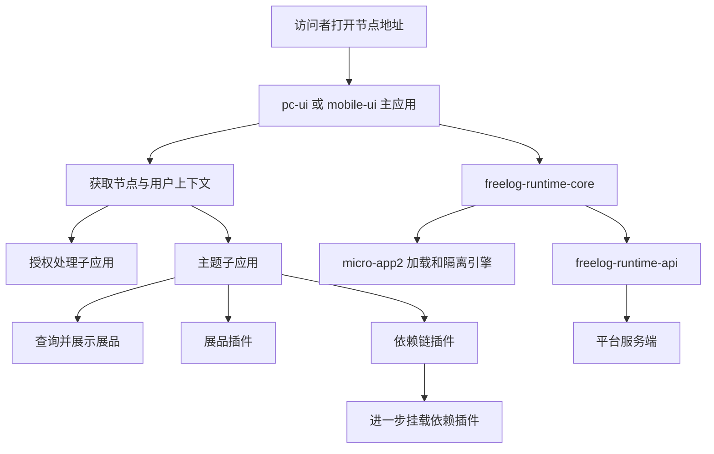
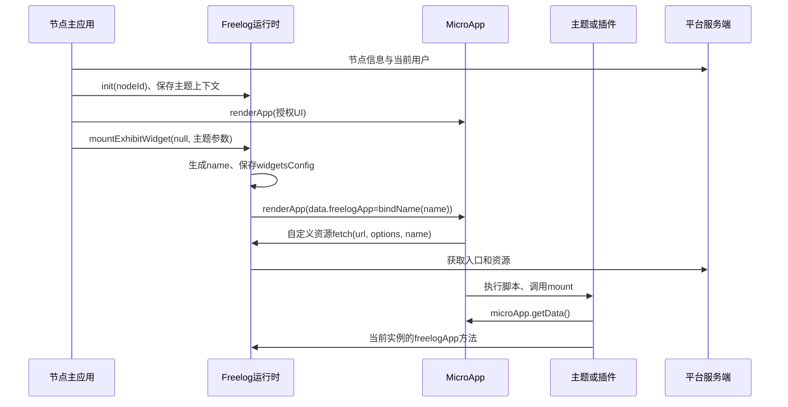

# 02 · Freelog 业务与运行时架构

读完本章，你应能回答：一个节点地址为什么能展示某个主题？一个插件为什么必须带展品或依赖链上下文？问题应交给 MicroApp、运行时、主题，还是平台服务端处理？

本章的“现状”来自当前工作区源码；“设计建议”表示后续可采用的维护方式。本次没有启动真实节点、调用业务接口或验证线上部署版本。

## 1. 从用户看到的页面倒推架构

Freelog 的业务主线是：作者发行资源版本，节点使用资源形成展品，访问者在节点消费内容。主题控制页面组织，插件提供由主题或父插件显式挂载的功能。把插件加入节点或声明为依赖，都不等于浏览器已经挂载插件。

这个模型来自用户提供的 [平台 Agent 入口](https://widget-docs.devfreelog.com/agents.html)、其 [平台对象正文](https://widget-docs.devfreelog.com/markdown/platform/overview.md) 与 [运行时架构正文](https://widget-docs.devfreelog.com/markdown/runtime/architecture.md)。检索日期为 2026-11-09；线上文档与本地实现的部署对应关系尚未核实。



图中的嵌套是业务父子关系。当前实现里，主题调用运行时 API 后，最终仍由同一个主应用中的 `microApp.renderApp` 管理插件，不必为每个插件再启动一套 MicroApp 主应用。

## 2. 六种身份必须分开

| 身份 | 回答的问题 | 在本仓库里的用途 |
| --- | --- | --- |
| 资源/作品身份 | 作者发行的是谁 | `articleId` 等业务字段 |
| 资源版本 | 使用哪一版内容和依赖声明 | 展品版本信息、前端库版本 |
| 节点 `nodeId` | 内容在哪个运营上下文使用 | `baseInfo.nodeId` 进入 API 路径 |
| 展品 `exhibitId` | 节点对外展示谁 | 展品详情、文件流、授权 |
| 依赖位置 `nid` | 沿哪条依赖链使用内容 | 依赖文件流、属性和上游关系 |
| 浏览器实例 `name` | 当前页面中是哪次挂载 | 沙箱、路由、通信、控制器索引 |

同一个资源可在不同节点成为不同展品；同一资源可在依赖树中出现多次；同一展品也可在页面挂载多次。因此不能把资源名、`nid`、展品 ID 和实例名互相替代。

[widget.ts](../packages/freelog-runtime-core/src/structure/widget.ts) 中，主题实例固定叫 `theme`；展品插件名来自 `exhibitId` 的摘要；依赖插件名来自 `topExhibitId + articleId` 的摘要，再拼接 `seq`。这意味着：**同一资源的不同依赖位置未必天然得到不同实例名**。多实例调用方应规划唯一 `seq`，同时核验最终名称，不要假定 `parentNid` 会自动参与命名。当前代码使用 `(seq || "")`，所以 `seq: 0` 不形成额外后缀。

## 3. 各层分别维护什么

| 层 | 当前入口 | 应负责的变化 |
| --- | --- | --- |
| 节点主应用 | [PC App](../packages/pc-ui/src/App.tsx)、[Mobile App](../packages/mobile-ui/src/App.tsx) | 获取上下文、节点状态、主题授权、页面容器、选择主题沙箱模式 |
| Freelog 运行时 | [core 导出](../packages/freelog-runtime-core/src/index.ts)、[freelogApp](../packages/freelog-runtime-core/src/structure/freelogApp.ts)、[widget](../packages/freelog-runtime-core/src/structure/widget.ts) | 挂载身份、依赖上下文、绑定 API、父子控制器 |
| 通用微前端引擎 | [micro-app2](../packages/micro-app2/src/index.ts) | HTML/CSS/JS 加载、沙箱、DOM、路由、通信、生命周期 |
| 平台 API 客户端 | [API 导出](../packages/freelog-runtime-api/src/index.ts)、[请求封装](../packages/freelog-runtime-api/src/services/handler.ts) | 服务路径、节点参数、凭据、响应 |
| 子应用 SDK | [freelog-type 入口](../packages/freelog-type/src/index.ts) | 获取当前应用的能力对象、类型、前端库代理 |
| 主题/插件 | [旧开发文档](../packages/docs/guide/index.md) | 业务 UI、组件状态、自己的订阅与资源清理 |

设计建议：优先在拥有该职责的层修复问题。例如，缺 `nid` 应修复业务上下文；组件重复订阅应修复组件生命周期；通用 `appendChild` 隔离错误才进入 MicroApp 引擎。这样能避免把所有兼容代码都堆进沙箱。

## 4. 一次主题启动的真实顺序

先读 [PC main.tsx](../packages/pc-ui/src/main.tsx)，再读 [PC App.tsx](../packages/pc-ui/src/App.tsx)：

1. `microApp.start` 注册引擎，设置全局生命周期、自定义资源 `fetch`、全局脚本 `loader`。
2. React 挂载节点主应用。
3. 主应用并行读取节点信息和用户信息；设置 `freelogApp.nodeInfo`，调用 API 包的 `init(nodeId)`。
4. 使用 `microApp.renderApp` 挂载授权处理应用，路由为 `pure`，通过 `data.freelogApp` 传入绑定过实例名的能力对象。
5. 检查节点删除、冻结、暂停、私密等状态，再判断主题及其授权状态。
6. 授权允许时，主应用创建 `FreelogLibrary`，并调用 `freelogApp.mountExhibitWidget(null, options)` 挂载主题。
7. `mountExhibitWidget` 发现调用方 `name` 为空，将目标标记为主题并命名为 `theme`；保存展品、依赖树、入口等配置，进入 `mountApp`。
8. `mountApp` 调用 `microApp.renderApp`，传入容器、入口和 `bindName("theme")`。
9. 引擎加载资源并执行子应用；子应用调用 SDK `initFreelogApp` 后获得主题上下文。



注意“资源加载完成”“引擎 mounted”“业务页面已获取数据”是不同里程碑。当前主题的 `beforemount` 会关闭加载提示，`mounted` 才更新 `themeMounted`；业务异步请求仍可能在之后失败。

## 5. 当前真正存在的扩展点

当前集成有三个主要接缝：

- `microApp.start({ fetch })`：引擎取得 HTML、JS、CSS 文本时进入 [freelogFetch](../packages/freelog-runtime-core/src/structure/freelogFetch.ts)，再由 `main.tsx` 调用 `res.text()`。
- `plugins.global[].loader`：根据脚本 URL 提取依赖 `nid`，对 `.getLibraryEntryUrls(...)` 调用做正则改写；这是平台前端库上下文适配。
- `renderApp({ data })`：注入 `bindName(name)` 得到的 Freelog 能力代理和调用方业务数据。

根 [README](../README.md) 描述过 `proxyHooks`、`getHooks`、`setHooks`、`saveSandBox` 和 qiankun 的设想。当前 `micro-app2/src` 与主应用启动配置中没有这套钩子，不能按那段历史文字寻找现成的沙箱注入 API。

其中，脚本正则改写依赖产物语法：压缩器、字符串中的逗号或括号、调用写法变化，都可能影响匹配。维护时先记录输入脚本与改写结果，再决定是在 SDK 显式传上下文，还是改进转换器；不要只凭“本地能运行”判断所有产物兼容。

## 6. 工作区依赖不等于直接运行源码

[pnpm-workspace.yaml](../pnpm-workspace.yaml) 包含 `packages/*`，PC、Mobile、core 的包清单都通过 `workspace:^` 引用 `@micro-zoe/micro-app`。但 [micro-app2/package.json](../packages/micro-app2/package.json) 的入口是：

```text
main   -> lib/index.min.js
module -> lib/index.esm.js
types  -> typings/index.d.ts
```

主应用的 Vite 配置没有把该包重定向到 `src`。因此正常包解析通常消费本地 fork 的 **lib 产物**，不是每次直接编译 `src`。这是配置结论；实际开发服务器有缓存和依赖预构建，仍应通过解析路径、产物内容与浏览器 Sources 核验。

典型变更链应为：改 `micro-app2/src` → 构建 MicroApp → 确认 `lib` 更新 → 必要时刷新主应用依赖预构建 → 再验证主应用。不能只改 TS 后刷新页面便判断补丁无效，也不能拿旧 lib 的成功运行证明新源码正确。

## 7. 三条边界决定长期可维护性

### 7.1 加载能力与平台授权分开

MicroApp 能加载脚本，不代表访问者可读取某展品。平台 API 和服务端决定节点、资源依赖、访问者的授权；运行时提供发起授权 UI 的桥接。签约完成、HTTP 成功、业务 `errCode` 成功、文件可读，应分别检查。

### 7.2 沙箱与安全权限分开

当前沙箱主要解决应用兼容、全局变量与 DOM/路由归属。`bindName` 给 API 绑定上下文，但并非防伪造的身份凭据。同一页面共享对象引用、宿主能力，以及代码中的 `rawWindow` 路径，意味着不能承诺恶意插件无法接触主应用。需要强安全隔离时，应重新设计跨源隔离及受控消息协议，并评估现有 SDK 迁移成本。

### 7.3 引擎状态与业务登记分开

MicroApp 有自己的应用管理；core 同时维护 `widgetsConfig`、`activeWidgets`、`childWidgets` 等 Map。两套状态需要一致。当前 `mountApp` 取得 `success` 后仍会登记控制器；core 中注销辅助函数没有在该挂载包装器里组成完整对称流程。这是静态阅读发现，应使用失败挂载和重复卸载实验验证，而非直接宣布线上泄漏已发生。

## 8. 本章动手练习

准备一个已有授权的测试节点和一个最小插件，使用开发环境，不修改线上内容。

1. 在 `microApp.start`、`mountExhibitWidget`、`mountApp`、`bindName`、SDK `initFreelogApp` 设置断点。
2. 打开节点并记录主题的 `name`、`exhibitId`、`nid`、入口 URL、`iframe` 开关。
3. 再挂一个展品插件和一个依赖插件，比较它们保存的上下文字段。
4. 跟踪一次 `freelogApp.getSelfNid()`，说明为什么子应用不传实例名，而运行时实现可以收到实例名。
5. 找到浏览器实际执行的 MicroApp 脚本，核对是否为当前构建产物。

验收：能自己画出启动顺序；能解释六种身份；能把一次失败定位到平台、core、引擎或业务组件；能证明浏览器执行的版本。以上实验本次未运行。

继续阅读 [主题插件与能力注入](09-主题插件与Freelog能力注入.md)；遇到实际故障时进入 [排障与具体修复方案](10-排障与具体修复方案.md)。
