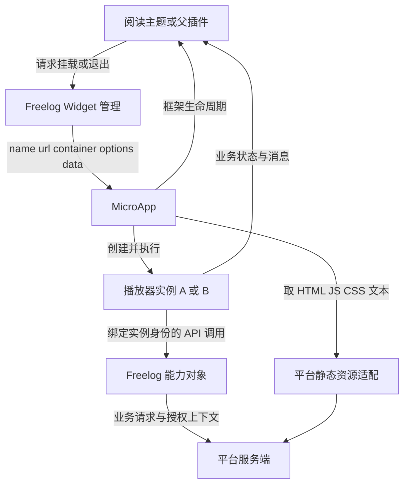
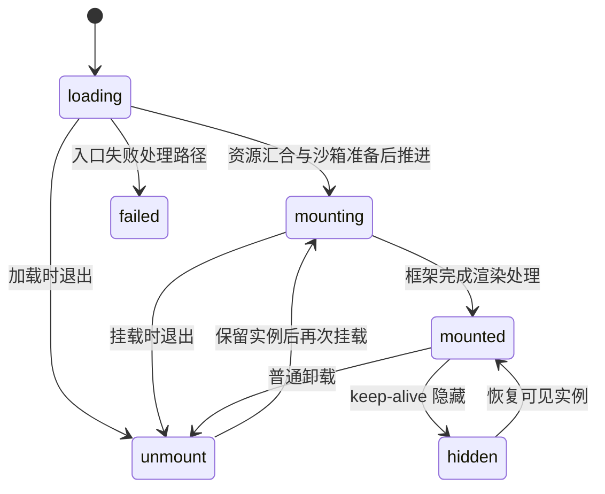

# 03 Freelog／MicroApp上下文中的架构对照

[返回目录](README.md) · [上一章：业务架构](02-Freelog业务与运行时架构.md) · [下一章：加载流水线](04-加载流水线与应用生命周期.md)

本章保留为本地实现上下文的对照材料。全书的架构推导先在 [独立架构第一章](architecture/01-从需求推导微前端边界与方案.md) 完成，再读 [MicroApp实现总图](MICROAPP-MAPPING.md)；不能用本地已经选定的实现方式代替通用方案比较。

读完本章，你应能为一个新插件写清楚：它是谁、谁拥有它、代码在哪里运行、哪些东西共享、什么时候算成功、离开时谁回收。能够沿这些决定推导出所需机制，再进入第 04—09 章验证源码。

本章使用同一条教学场景：**阅读主题装配两个播放器实例 `reader-a`、`reader-b`**。两者加载相同演示代码，但各有内容、播放状态、路由和退出时机。实验基座扮演主题的装配者；在真实 Freelog 中，主题本身也是由 PC／移动主应用管理的子应用，不能把实验角色直接当成线上拓扑。

业务资源、展品、`nid` 等值均为讲义占位。实验台通过 `data` 传递的演示能力不属于 Freelog SDK，也不提供平台授权。第 11 章说明如何运行实验。

## 1. 从一次用户动作推导系统约束

用户先打开 A 播放旧章节，再打开 B 播放另一份内容；A 尚在获取章节信息时，用户关闭 A，然后立即重新打开新章节。一个合理的系统需要给出下面的行为。

| 用户动作 | 应观察到的结果 | 推导出的约束 |
| --- | --- | --- |
| 同时打开 A、B | 同一份代码呈现两个独立状态 | 内容身份与运行实例身份分开 |
| A 内切换页面 | A 的视图变化，B 保持原状态 | 路由映射需要按实例分区 |
| A 创建弹层 | 弹层属于 A，关闭 A 时一并处理 | DOM 操作需要归属，第三方组件需要清理合同 |
| A 通知“播放就绪” | 宿主能区分是哪一实例、哪次打开 | 业务信号要包含实例及本次操作的身份 |
| 关闭尚未就绪的 A | 不留一个无人管理的控制器 | 挂载请求本身也是待释放资源 |
| 重新打开 A | 上一次获取结果不能覆盖这一次状态 | 需要识别失效异步结果，仅比较 name 不够 |
| A 失败 | B 和主题仍能使用，A 有可解释的错误状态 | 故障处理应停在拥有该职责的层 |

最后一行是产品目标，**不是 JavaScript 共用主线程后天然成立的保证**。死循环、共享原型污染或全页导航仍可能影响所有应用。架构必须说明可控制的故障范围，不能承诺一个容器就有进程级隔离。

把这些约束写在方案前面，才有依据判断“加一个 iframe 开关”解决了什么、遗漏了什么。

## 2. 哪些决定已经给定，哪些仍需权衡

本仓库已经采用 MicroApp。此次接管的主要驱动力是保留现有主题插件的独立构建与页面整合方式，同时让内部 fork 的变化可以被单人理解、验证和回退。

为解释这一选择，比较两个有明确边界的方案。

| 方案 | 适用前提 | 换来的能力 | 必须承担的代价 |
| --- | --- | --- | --- |
| 每个播放器直接嵌入一份 iframe 页面 | 可以接受独立 document、布局边界和显式消息协议 | 页面级 DOM／CSS 边界更清楚；跨源及受控 sandbox 可成为另一种安全设计的基础 | 需要处理高度、焦点、导航、登录和跨边界能力；现有同页对象式 SDK 不能直接照搬 |
| 保留 MicroApp，在主页面容器内整合播放器 | 插件遵守当前可信应用的接入约定，需要与主题布局紧密整合 | 复用现有 Widget、数据通信、资源加载和路由适配 | 自己维护 JS／DOM／CSS／导航／清理的兼容层；不能将 Proxy 当成安全权限边界 |

本章沿第二个方案学习，因为它是当前系统实际需要维护的架构。若以后增加运行不可信代码的产品要求，应重新评估隔离与能力协议，不能把现有方案的开关调一遍就宣称满足新要求。

在 MicroApp 方案内部，with 与 iframe 沙箱是两种**执行环境策略**，不是上述两个架构的同义词。MicroApp iframe 沙箱仍把可见 DOM 适配到主页面；它和直接显示一整份 iframe 页面不同。

还有一个边界判断：如果播放器只需复用几个按钮和格式化函数，不需要独立发布、独立挂载，就先做组件／库。微应用越多，生命周期和兼容责任越多，不能按组件体积决定是否采用微前端。

## 3. 先分清四份身份，才能解释重挂载

`reader-a` 和 `reader-b` 可以加载同一入口。这至少涉及四份不同信息。

| 身份 | 教学例子 | 用于决定什么 | 当前实现如何对应 |
| --- | --- | --- | --- |
| 内容定义 | 同一演示播放器版本与入口 | 下载哪一份代码，缓存能否复用 | `app.url`、资源 URL 与平台的展品／依赖信息；没有单一通用的定义对象 |
| 运行实例 | `reader-a`、`reader-b` | 状态、DOM、路由、通信属于谁 | MicroApp `name` 与 `appInstanceMap`；Freelog 另有 Widget 配置与控制器 |
| 拥有者 | 教学阅读主题 | 谁负责退出与子实例清理 | core 的父子登记；不能只凭 DOM 包含关系推断完整业务所有权 |
| 一次挂载的代次 | A 的第 1 次、第 2 次打开 | 哪个异步结果仍然有效 | **建议协议**；当前内核没有统一的挂载 generation 合同 |

`seq` 也不能代替代次：现有 core 使用它参与实例命名，多实例时有用；它不会自动让所有旧 Promise、旧回调失效。绑定实例名的 `freelogApp` 解决调用上下文，也不会自动实现异步任务取消。

可以把设计输入写成下面的**概念契约**。这不是当前 MicroApp 的类型定义，不应直接传进现有 API。

```text
应用定义：entry + 内容版本 + 执行模式 + 路由策略
实例身份：name + owner + container
挂载上下文：instanceName + generation + 有效性标记 + 本次清理清单
能力集合：明确可调用的方法 + 错误形状 + 调用者身份的绑定方式
```

保持这四者分开，才能同时说清“代码可共享”“运行状态独立”和“旧结果不可提交”。若把它们都塞进一个 name 字符串，后续只能靠命名约定猜测所有权。

## 4. 模块边界要同时画出控制流与数据流

先看现有系统的职责，而不是先按文件夹分配功能。



图中“框架生命周期”和“业务状态”是两条不同信号。`mounted` 不能证明章节已取回，`ready` 也不能证明某个文件已获平台授权。实验台只模拟宿主与引擎之间的接缝，不连接图中的平台服务。

| 模块 | 输入 → 输出 | 拥有的状态／资源 | 必须保持的边界 |
| --- | --- | --- | --- |
| 主题／父插件 | 用户意图 → 挂载请求、显示状态 | 插槽、自己持有的子控制器、业务选择 | 退出时处理自己发起但尚未完成的挂载 |
| Widget 管理 | 业务身份与容器 → 控制器 | `widgetsConfig`、活动与父子登记、身份绑定 | 登记事实需要与引擎状态协调，不把失败当活动 |
| MicroApp | name／入口／选项 → 生命周期与挂载结果 | 实例、沙箱、资源处理、通信与路由适配 | 提供运行机制；不判定合同或内容访问权 |
| 资源适配 | URL／请求选项／应用名 → 资源文本或失败 | 当前请求上下文；不应隐式变成业务状态库 | 明确是静态资源路径还是平台内容 API |
| 播放器 | 初始数据／能力 → UI、消息、业务请求 | 组件、轮询、订阅、外部库对象 | 释放自己创建的资源，不要求框架猜业务意图 |
| 平台服务 | 身份与内容上下文 → 允许的内容或业务错误 | 权限、内容与业务状态 | 浏览器的 name、路由和可见性不能代替服务端鉴权 |

真实接缝可从 [PC main.tsx](../packages/pc-ui/src/main.tsx) 的 `start({ fetch, plugins })`、[Widget](../packages/freelog-runtime-core/src/structure/widget.ts) 的 `renderApp({ data })`、[SDK 初始化](../packages/freelog-type/src/index.ts) 的 `getData()` 进入。当前没有旧根 README 所写的 `proxyHooks.getHooks/setHooks/saveSandBox` 接口。

数据中心传递的能力可能是函数和对象引用，不是自动序列化的 RPC。新加一个方法时，必须知道它是否遵循 `bindName` 的首参实例名规则，是否返回 Promise，以及旧调用方怎样处理拒绝。跨模块协议比给文件夹起名字更能决定维护成本。

## 5. 状态不是一条“加载中 → 完成”的线

当前 [constants.ts](../packages/micro-app2/src/constants.ts) 和 [CreateApp](../packages/micro-app2/src/create_app.ts) 已把若干状态分开存储。读状态机时至少同时看下面几项。

| 维度 | 当前字段／机制 | A 场景中的问题 |
| --- | --- | --- |
| 应用生命周期 | `state`：loading、mounting、mounted、unmount 等 | 框架走到了哪个阶段？ |
| 资源就绪 | `loadSourceLevel`：两路完成通知的计数 | 样式与脚本资源处理是否汇合？ |
| 可见性 | `keepAliveState` 与容器迁移 | 看不到 A，是隐藏还是已经退出？ |
| 执行与复用方式 | `umdMode`、with／iframe、沙箱 ready／active | 再打开时重执行入口，还是重调 mount？ |
| 预先加载 | `isPrefetch`、`isPrerender` | 是否已在后台解析或执行了代码？ |
| 本次操作有效性 | 内核现无统一代次字段 | 这个请求结果还属于当前那次打开吗？ |

这些维度存在约束，不代表任意组合都合法。但只看一个 `state` 或一个 DOM 节点，无法解释缓存、隐藏与取消。

例如：keep-alive 的 A 隐藏后可仍保留执行状态；UMD 的 A 卸载后可保留脚本环境；default iframe 的 A 普通卸载后，iframe 与沙箱对象可被删掉，再挂载时重建。相同“页面不见了”，后续动作完全不同。

下面仅画**教学主路径**，不能当成每次必经事件列表。缓存复用、预加载转正式挂载以及失败路径的状态设置需要查真实分支；首次挂载不能仅凭这张图断言一定观察到所有中间状态。



图里的 `hidden`、`failed` 是概念节点：前者对应独立的 keep-alive 状态，后者也不能覆盖每种 error 事件。`before_mount` 是实际源码字段，但为简化主图未单列。第 04 章会区分字段、生命周期事件和 Promise 结果。

### 五个可验证的不变量

这里的不变量是**目标协议与回归要求**，并非宣称现有实现已经全满足。

| 不变量 | 能反驳它的最小实验 | 出错后该查哪里 |
| --- | --- | --- |
| 一个运行中 name 只对应一个有效实例 | 同时向两个容器挂同名应用 | 标签冲突判断与 Widget 命名 |
| A 的普通状态更新不改变 B | 同代码双实例、同 ID/class，分别操作 | 全局代理、DOM 查询、路由与数据通道 |
| 失效代次不能提交业务结果 | A 第 1 次请求延迟，关闭重开后再完成 | 任务有效性、订阅与父控制器持有者 |
| 真正退出后，归属于 A 的活动资源结束或移交 | 退出后发事件、查连接、检查迟到回调 | 应用清理、宿主登记、框架记账边界 |
| 同一次挂载只能结算一个最终结果 | 错误、取消、超时与 mounted 交错 | 调用方结果协议及监听器释放 |

每改一个核心函数，应先指出会影响哪条不变量，再选择实验。这样比机械跑所有组合更能解释测试价值。

## 6. 取消与超时要先定义结果，再设计代码

当前 `renderApp` 返回 `Promise<boolean>`，由 mounted／error 生命周期结算；非法输入等路径可能只输出日志，外部 module 失败也存在等待不结束的风险。`CreateApp` 已在部分回调检查卸载状态，但这不能推导为“自动取消任意业务异步任务”。这些边界见第 04 章。

建议在宿主／应用接缝定义更完整的内部结果：成功、失败、已取消、超时，并记录阶段和原因。这是**建议的上层协议**，不是给现有 API 改了返回类型。

| 结果 | 需要明确的事实 | 资源动作 |
| --- | --- | --- |
| 成功 | 框架完成；业务是否 ready 另行报告 | 宿主持有控制器，应用持有自己的业务资源 |
| 失败 | 哪个阶段失败、原始原因是什么 | 清理本次临时资源，保留可诊断上下文 |
| 已取消 | 用户意图失效，这次操作不再展示 | 让迟到结果失效；取得迟到控制器后按归属清理 |
| 超时 | 在约定时间内没有结算，根因仍可能未知 | 结束外层等待并启动受控清理；不冒充加载成功 |

给 `Promise.race` 加一个计时器，只能结束外部等待。底层下载和挂载可能仍在运行，随后还可能返回控制器。如果代码丢掉这个迟到结果，就只是把孤儿实例藏到了超时之后。

### 用一条时间线解释代次

```text
t0  打开 reader-a，开始第 1 次旧章节请求，标记 g1
t1  用户关闭 reader-a，令牌递增至 g2，使 g1 失效，尝试取消请求并清理视图
t2  再次打开 reader-a，新章节请求属于 g3
t3  新章节先返回，g3 提交到当前视图
t4  旧章节此时返回，g1 已失效，丢弃结果；不覆盖 g3 或发送 ready
```

仅检查 `name === 'reader-a'` 不够，因为 t4 时实例名可能仍相同。仅检查 DOM 存在也不够，因为它可能是 g3 的新视图。代次应绑定到这次业务操作的闭包或上下文，不能每次读取一个已经被新挂载覆盖的全局值后，再误认为自己仍有效。这里卸载也递增，因此令牌不等于打开次数，与贯穿案例采用相同编号。

这条时间线研究的是**业务结果提交权**。另一个问题是“父组件退出后，子挂载控制器才返回”：控制器按 name 操作时，旧控制器不能误卸载新同名实例，需要明确串行化、实例命名或控制器有效性。不要用同一个 `disposed` 片段把两种竞态都宣布解决；后者见第 09 章。

业务代次设计可先用于播放器自己的请求，不需要立即重写内核。若最终证据指向框架内部竞态，才把有效性原则落到对应加载与执行分支，并补定向回归。[贯穿案例](CASE-STUDY.md)将用确定性排程说明修复前后的差异；它不构成对真实内核缺陷的复现结论。

## 7. 资源所有权比“哪个窗口创建”更可靠

最容易遗漏的资源，是应用通过宿主能力间接创建的那一份。A 调用某个宿主函数，宿主函数把回调放进自己的数组；即使 A 的 iframe 被删除，这个数组也可能继续持有 A。另一个典型误判是：关闭视图就等于取消请求。

为 A 建一份简单账本。

| 资源 | 创建／持有者 | 真正退出 A 时的动作 | keep-alive 隐藏时的决定 |
| --- | --- | --- | --- |
| 组件与弹层 | A 的视图代码／组件库 | unmount、dispose、删除对应根节点 | 保留视图状态或按业务收起弹层 |
| 轮询与请求 | A 的业务功能 | 清计时器、abort，并阻止迟到结果提交 | 明确暂停还是继续，恢复时不重复启动 |
| 通信订阅 | 注册回调的一方 | 用原回调取消自己的订阅 | 明确是否保存快照／是否应继续接收 |
| 宿主事件回调 | 宿主注册表持有，A 是业务拥有者 | 需要可取消或按 owner 清理的协议 | 不能靠删 iframe 推断已经暂停 |
| 子插件控制器 | 发起挂载的父应用 | 退出时清理，未返回时保留迟到回收路径 | 由父子可见性策略决定 |
| JS／CSS 原文与处理缓存 | 引擎共享资源中心 | 按缓存契约保留，不因 A 退出破坏 B | 通常保留，但需要版本身份与预算 |

自动清理只能覆盖框架确实代理并记录的部分。with／iframe、default／UMD、隐藏／退出的范围不同，第 08 章有真实机制。判断泄漏时先问“谁还持有引用、谁有释放权”，再看它最初来自哪个 realm。

### 共享缓存不是运行状态共享

同一播放器代码可被 A、B 复用，但 A 的章节选择、路由和监听不能因此变为共享。当前 [source_center.ts](../packages/micro-app2/src/source/source_center.ts) 按资源地址保存 JS/CSS，另以 `appSpace` 保存应用处理信息；`appInstanceMap` 是另一份实例状态。

`destroy` 删除实例和相关内联记录，不会逐项清空全部外部资源 Map。缓存可复用不等于可无限增长，也不等于可以在稳定 URL 下任意替换字节。需要让内容版本、资源地址、处理模式和发布产物具有可解释的对应关系，第 12 章再落到 fork 与构建维护。

### 性能策略也应有责任边界

分别测量冷启动、卸载后重挂、隐藏后恢复、销毁后重开；记录框架 mounted 与业务 ready 两个时刻。下载、解析和业务请求可能重叠，不能把所有耗时简单相加，再据此决定优化位置。

当前 [prefetch.ts](../packages/micro-app2/src/prefetch.ts) 的 level 1／2／3 分别推进资源加载、预解析、预渲染。第 3 级会提前执行代码，若播放器初始化就请求内容或建立连接，它也可能提前消耗业务资源。fiber 则是空闲调度，不是 Worker，不能抢占脚本中的长同步计算。先确定成本在哪一段，再选择预取、缓存或业务暂停。

隐藏实例数量、活跃轮询／连接和共享缓存都需要产品可接受的预算；预算必须来自使用场景和测量，不在讲义里虚构一个全平台阈值。能否恢复得快，与是否允许无限保留，是两份不同的合同。

## 8. 设计错误体验时，区分三条完成信号

| 信号 | 能证明什么 | 不能证明什么 |
| --- | --- | --- |
| 框架 mounted | 引擎走到渲染完成处理 | 所有业务请求成功、内容已授权、播放器能播放 |
| 业务 ready | 应用按自己的约定准备好关键功能 | 其他内容或依赖全部可读、未来操作不会失败 |
| 某次内容请求成功 | 该次请求得到约定结果 | 框架卸载完成、其他展品也获得相同权限 |

教学场景可以约定 `player-ready(instanceName, generation)`，宿主只有在当前代次收到信号后才解除 A 的业务等待状态。这个名称是讲义协议，不是现有 SDK 事件。

A 的资源失败应显示在 A 的插槽内，同时保留 B；授权错误应保留平台错误上下文；业务重试应重试对应业务动作。不要把每个问题都升级成全页刷新，也不要因为有错误 UI 就丢掉最早的原始异常。

观测记录建议只保留最小关联字段：实例名、挂载代次、入口／内容版本、执行与路由模式、阶段、结果和耗时。日志应能回答“是哪一次 A 的哪个阶段”，不需要打印能力对象、完整用户信息或请求凭据。

## 9. 把取舍收束成一份短 ADR

以下是本场景的**教学架构决策记录**，不是声称你们已经实施的新系统。

```text
问题：同代码播放器需要双实例，快速退出／重开时不能提交旧结果。
驱动力：保留独立构建；与主题紧密整合；变更可由单人维护。
决定：沿用当前 MicroApp；先在应用与宿主接缝补清楚所有权、业务 ready 与操作有效性。
备选：直接 iframe 页面，需要另一套布局与跨边界能力合同，当前不做迁移。
代价：共享主页面的兼容边界仍存在，with／iframe 两条执行路径需要分别验证。
落点：播放器业务清理 + 父应用的挂载持有协议；没有证据前不扩大到内核重写。
验收：旧请求延迟返回不能影响新A；退出A后B保持工作；迟到控制器可回收；结果只结算一次。
回退：保留旧接入方式与产物；新协议改变范围明确，出现回归可恢复对应构建。
```

## 10. 以反事实检查你是否真的会做设计

给同一场景提出四个变化，然后解释哪份契约会变。

1. **A、B 必须互斥播放。** 这是主题协调的业务规则，应通过明确消息或能力协调，不是取消实例隔离。
2. **A 隐藏后仍需继续播放。** 这是可见性与业务活动的策略，不能把“隐藏必须停所有计时器”写成框架不变量。
3. **播放器改为原生 module 构建。** 要重新验证执行路径、静态 fetch／loader 覆盖、location 和模块依赖；不能只切一个 iframe 属性后沿用所有经典脚本结论。
4. **开始接纳不可信代码。** 原有安全前提改变，应评估隔离与受控能力架构，不能仅追加几个 Proxy 规则。

本章的通过条件：你能给出一种选择，并说明它的前提、代价、失败路径与可证伪实验。接下来读第 04 章，把这些设计责任逐一映射到真正的加载器与生命周期代码。
