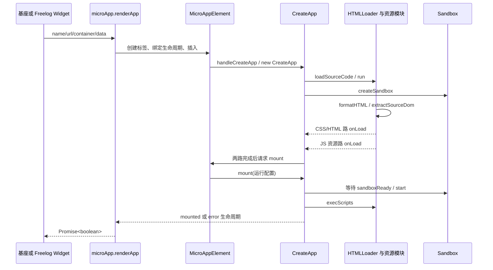

# 04 加载流水线与应用生命周期

[返回目录](README.md) · [上一章：架构设计](03-微前端架构设计与取舍.md) · [下一章：JavaScript 沙箱](05-JavaScript沙箱与隔离边界.md)

本章属于第三部实现分析。前置是 [模块系统](foundations/01-浏览器模块系统与应用身份.md)、[构建产物](foundations/03-Vite与Webpack如何决定应用加载.md) 与 [独立运行时设计](architecture/02-从零设计加载器与运行时协议.md)。带着这些合同检查代码，再理解它的兼容分支。

先完成 [实验台的 A/B 挂载](11-分层实验与验收矩阵.md)，再读本章。目标只有一个：给定 `reader-a` 的入口，能指出“目前在等什么、哪个函数能推进它、失败会落到哪里”。首次只读下方正常轨迹与第 2—4 节；脚本调度、缓存与故障分支留到第二遍。

## 先把一次挂载留在纸上

固定输入：`name=reader-a`、播放器 HTML 入口、左侧容器、一份 `data`。在真实源码中按下面六站跟踪；这里列的是首次普通挂载的关键快照，预取、重挂和 iframe 等待会增加分支。

| 站点 | 输入／对象 | 此刻发生的变化 | 还不能宣称什么 |
| --- | --- | --- | --- |
| `renderApp` | name/url/container/data | 创建标签、配置通信与生命周期监听，然后插入 | 插入标签不等于应用运行 |
| `CreateApp` 构造器 | 归一化后的 name/url 和核心选项 | 实例入 Map，启动入口加载与沙箱创建；`loadSourceLevel` 从 0 开始 | Map 中有实例不等于资源就绪 |
| `extractSourceDom` | 包装后的 HTML | 抽取节点、CSS、脚本；分出两路准备工作 | 取得 HTML 不等于 JS 已执行 |
| `onLoad` 两路汇合 | 两次阶段通知 | 计数推进到 2，满足条件才请求挂载 | 2 表示两路，不是两个资源；defer/module 仍可能后处理 |
| `mount` → `sandboxReady` → `execScripts` | 容器、沙箱、待执行脚本 | 克隆／转移节点，启动沙箱，执行代码并识别钩子 | 页面有节点不等于业务完成 |
| `actionsAfterMounted` | 完成处理后的实例 | 发送框架 mounted，宿主等待可结束 | 章节内容、播放器及授权仍需业务自己的结果 |

现在遮住右侧两列：如果停在第四站，应该看哪两个完成分支？如果停在第五站，应该看沙箱 readiness、脚本异常还是 UMD Promise？回答不出时，先沿一条真实调用链走，不需要同时打开所有沙箱文件。

给实验日志只加足够的上下文：`appName + 操作序号 + 阶段 + 资源URL + 结果`。序号由宿主维护属于建议观测协议；引擎不会因为打印了序号就自动取消旧任务。完整的业务迟到结果案例见 [CASE-STUDY](CASE-STUDY.md)。

## 1. 从一个挂载请求开始

先看 MicroApp 的最小接口，再对接 Freelog。下面代码应放在**独立测试基座模块**中，有真实可达的测试子应用入口与 `#slot`；不直接粘贴进已调用 `start()` 的公司基座。

```js
import microApp from '@micro-zoe/micro-app'

microApp.start() // 每个基座初始化一次；公司基座已有自己的 start 配置
const success = await microApp.renderApp({
  name: 'lesson-a',
  url: 'http://localhost:3001/', // 测试占位入口，需先启动该服务
  container: '#slot',
  data: { lesson: 1 },
  lifeCycles: {
    mounted(event) { console.log('framework mounted', event) },
    error(event) { console.error('framework error', event) },
  },
})
console.log({ success })
```

`renderApp` 并非另一套加载器。它创建 `<micro-app>`，设置配置、通信与事件，然后插入容器。后面走 Custom Element 的同一条链。

## 2. 源码主干：请求如何变成页面



入口文件与职责：

| 顺序 | 真实位置 | 阅读重点 |
| --- | --- | --- |
| 1 | [micro_app.ts](../packages/micro-app2/src/micro_app.ts)：`MicroApp.start`、`renderApp` | 保存原生环境、注册标签，如何等待生命周期 |
| 2 | [micro_app_element.ts](../packages/micro-app2/src/micro_app_element.ts)：`attributeChangedCallback`、`connectedCallback`、`handleConnected` | name/url 校验、延迟挂载、同名判断、缓存复用 |
| 3 | [create_app.ts](../packages/micro-app2/src/create_app.ts)：构造器、`loadSourceCode`、`createSandbox` | 先放入 appInstanceMap，再启动资源和沙箱初始化 |
| 4 | [loader/html.ts](../packages/micro-app2/src/source/loader/html.ts)：`run`、`formatHTML` | 入口处理、HTML 插件、head/body 转换 |
| 5 | [source/index.ts](../packages/micro-app2/src/source/index.ts)：`extractSourceDom`、`flatChildren` | 静态资源抽取与两路完成通知 |
| 6 | [links.ts](../packages/micro-app2/src/source/links.ts)、[scripts.ts](../packages/micro-app2/src/source/scripts.ts) | 资源下载、缓存、CSS 处理与脚本执行顺序 |
| 7 | [create_app.ts](../packages/micro-app2/src/create_app.ts)：`mount`、`handleMounted`、`actionsAfterMounted` | 克隆容器、启动沙箱、执行代码、发送 mounted |

`connectedCallback` 使用连接计数和延迟回调，是为了处理框架瞬间插入／移除标签的情况。不要为了“提速”直接删掉延迟；需要先回归快速切换和先插入后设置属性的应用。

## 3. HTML 入口到底做了什么

`HTMLLoader.run` 取 `app.ssrUrl || app.url`。普通入口经 `fetchSource` 请求；以 JS 扩展名识别的入口会合成带一个 script 的最小 HTML。这说明源码能力比“只能加载 index.html”的旧文档表述更宽，但 Freelog 是否把入口提供为 JS 仍要单独检查。

`formatHTML` 先调用 `plugins.processHtml`，再把 head/body 替换成 `micro-app-head / micro-app-body`。`parseHtmlString` 用 DOMParser 解析，`extractSourceDom` 查找这两个包装节点。普通 HTML 是在这里转成可搬入子应用容器的节点。

`flatChildren` 递归处理：stylesheet link 提取，style 进入 scope CSS，script 提取，img src 补地址。动态创建的 script/link 则经 [source/patch.ts](../packages/micro-app2/src/source/patch.ts) 等代理路径处理。首屏正常而懒加载失败，常常意味着静态路径和动态路径结果不同。

## 4. 为什么有两个 onLoad

`extractSourceDom` 分两路推进：一路等待 CSS 下载／样式处理，另一路等待需要提前下载的 JS。即使某路没有资源，也会通知 `app.onLoad`。

`CreateApp.onLoad` 使用 `++loadSourceLevel === 2` 作为两路汇合点。**这不是两个相同的 mounted，也不是“下载两个文件”。** 文件数量可以为零或很多，两个通知表示两个阶段完成。

教学模型：

```js
let completedBranches = 0
function branchDone() {
  if (++completedBranches === 2) {
    // 真实实现此处还要判断卸载、预取和预渲染等状态。
    console.log('resource branches finished')
  }
}
branchDone() // 样式路
branchDone() // 脚本资源路
```

排查卡住时，要分别定位哪一路没有通知。不要直接把计数改成 `>= 1`；那会在样式或资源尚未准备好时执行应用。

还有一个容易混淆的细节：这里资源路完成，不等于所有 defer/async/module 已经执行。它们的处理还会在 `execScripts` 继续。

## 5. 脚本下载与执行的真实语义

`extractScriptElement` 保存脚本的 `async/defer/module/inline/pure/attrs`。地址对应一份 `ScriptSourceInfo`，其中 `appSpace[app.name]` 保存当前实例的处理结果。

`fetchScriptsFromHtml` 优先下载普通静态脚本；预取时还有额外分支。`execScripts` 按资源集合顺序执行普通脚本，或在 fiber 下排入任务队列；同时收集并发起 defer/async 的下载，等待该组请求结束后，按 `deferScriptInfo` 顺序执行或排队。**本地实现不能假定和浏览器原生 HTML parser 的 async 时序完全一致，并非谁先下载完谁立即执行。** 注释也记录了 fiber 与动态脚本混用的时序风险。

| 脚本分支 | 本地关键路径 | 必须注意 |
| --- | --- | --- |
| 普通经典脚本 | `bindScope` → `code2Function`／`runParsedFunction` | 通过包装把访问引到沙箱，插件 loader 可处理代码 |
| inline／特殊属性脚本 | `runCode2InlineScript` | 插入 script 节点，不意味着关闭沙箱包装 |
| iframe 或无沙箱中的 module | `isTypeModule` → 原生 module script | 外部 module 通常直接设 `src`，依赖图由浏览器加载 |
| 动态 script | `runDynamicRemoteScript` 等 | 必须看动态插入、load/error 和归属代理 |
| ignore | 保留原生处理路径 | 不会享有同样的代理和代码处理，应逐项评估 |
| exclude | 替换／移除 | 资源不执行，和 ignore 完全不同 |

外部原生 module 路径设 `script.src = address`，不能假定所有 module 依赖都经过 `microApp.options.fetch` 或 loader。这个边界直接影响 Freelog 静态资源请求上下文、CORS 和模块依赖路径，详见第 09、10 章。

## 6. 地址补全是本地 fork 的关键改造点

[libs/utils.ts](../packages/micro-app2/src/libs/utils.ts) 的 `CompletionPath` 先放过完整 URL、data/blob，再选择补全规则。本地对 `window.fileHost` 下的路径有特殊拼接，和一般 URL 相对解析不同。

例如**按当前特殊分支直接计算**：

```js
const base = new URL('https://files.example.test/pkg')
const appendLikeLocalBranch = (path) => {
  if (path.startsWith('./')) path = path.replace(/^\./g, '')
  return new URL(base.pathname + path, base.origin).toString()
}
console.log(appendLikeLocalBranch('/assets/a.js'))
// https://files.example.test/pkg/assets/a.js
console.log(appendLikeLocalBranch('assets/a.js'))
// https://files.example.test/pkgassets/a.js
```

这是为了理解现有拼接语义的离线示例，使用虚构域名且不发请求；不表示这些就是你们当前线上入口。真实验证要列出入口是否带尾斜杠、相对路径是否带前导斜杠、`../` 和查询参数等组合。不能简单用 `new URL(path, base)` 替换掉分支，否则以 `/` 开头的包内路径可能又指到文件服务根路径。

修改这类代码时先保存真实输入输出对，再决定契约是“标准相对 URL”还是“包内绝对路径”。对应差异清单在第 12 章。

## 7. 缓存分三层看

1. 浏览器／CDN 的 HTTP 缓存决定同 URL 是否重新请求、得到哪个字节。
2. [source_center.ts](../packages/micro-app2/src/source/source_center.ts) 的 Map 按资源地址保存 JS/CSS 原文与处理结果；不同应用有各自的 `appSpace`。
3. `appInstanceMap` 保存应用实例，普通卸载可保留实例、沙箱或数据，以便重挂载。

源码注释称资源管理中心管理 HTML/JS/CSS，但当前结构直接暴露的是 link/script 两个 Map；HTML 保存在应用的 `source.html`。阅读时要看结构，不能把概括注释当 API。

`actionsForCompletelyDestroy` 删除实例、iframe 和相关内联脚本记录，**不会逐一清空所有外部脚本／样式 Map**。所以 destroy 不是“清除整个页面的所有资源缓存”。稳定 URL 发布了新字节但页面仍执行旧代码时，应同时检查这三层。长期方案是不可变带版本资源地址，再设计缓存淘汰，而不是靠随机 query 全面绕缓存。

## 8. mounted、error 与 Promise 的区别

下列结论来自当前源码，适用于排障，也说明为什么需业务验收。

| 现象／分支 | 框架现在做什么 | 维护含义 |
| --- | --- | --- |
| HTML fetch reject | `onLoadError`，发送错误并设置 load_failed | 相对明确的入口失败路径 |
| HTML 空文本／缺 head/body | 发送 `onerror` 后返回；相关路径未必同样设置失败状态 | 不能只看一个 state 字段判定结果 |
| 某些 CSS/JS 下载 reject | 资源流记录错误后继续阶段完成处理 | 不保证 renderApp 得 false；可能先出现运行错误或缺样式 |
| UMD mount 返回 Promise reject | `handleMounted` 记录错误后仍继续后续 mounted 处理 | mounted 不能证明业务 mount 完全成功 |
| `renderApp` 入参／容器非法 | executor 里只 `return logError` | Promise 可保持 pending；调用者超时应保存现场 |
| 某些脚本异常 | `runScript` 记录再抛出 | 不保证统一转成生命周期 error；需检查原始异常路径 |
| 外部原生 module 加载失败 | `runCode2InlineScript` 对模块完成计数只设置 onload，未见对应 onerror 完成处理 | 可能不触发 mounted，导致等待 pending；属于需浏览器复现的风险 |

因此建议验证“框架 mounted + 子应用自己的关键视图与数据行为”，并给调用方等待加可观测超时。超时只是诊断与恢复的机制，不应直接补发 mounted 或盲目重复挂载同名实例。方案若引入 generation/token，也要让旧异步任务失效，而不仅是 `Promise.race` 结束外层等待。

## 9. 隐藏、卸载、销毁不是同一个动作

| 动作 | 主路径 | 合适的理解 |
| --- | --- | --- |
| keep-alive 隐藏 | `hiddenKeepAliveApp` → 转移 DOM、记录／释放部分事件 | 实例仍活跃，后台计算与定时器不能一概视为暂停 |
| keep-alive 显示 | `showKeepAliveApp` → 重建副作用、转回 DOM、show 事件 | 恢复原实例，通常不重跑完整入口 |
| 普通卸载 | `unmount` → 子钩子 → `sandBox.stop` → 清容器 | 视模式保留一部分实例和缓存 |
| destroy | 卸载后 `actionsForCompletelyDestroy` | 终止实例复用，但共享资源记录不保证全清 |

UMD 模式通过检测 `window.mount` 和 `window.unmount` 钩子成立，不等同于“构建文件名里带 umd”。第一次执行入口会发现钩子，之后可以保留环境并重调 mount。卸载 Promise 和同步异常也有不同后续路径，卡住时先看钩子是否返回永不结束的 Promise 或同步抛错。

## 10. 本章动手与排障顺序

准备一个无业务依赖的最小子应用，按第 11 章启动测试环境。先从正常路径设置断点：`renderApp` → `handleCreateApp` → `HTMLLoader.run` → 两次 `onLoad` → `mount` → `execScripts` → `actionsAfterMounted`。记录每次 name、url、loadSourceLevel 和 state。

随后一次只引入一个故障：入口 404、空 HTML、缺脚本、module 导入失败、加载未结束即移除、挂载后关闭。比较最早异常、生命周期事件、最终 Promise 和残留实例。能解释四者为何一致或不一致，就已经从“会接入”进入“能维护加载器”。

实验台为正常路径提供可运行输入，执行范围与结果见 [验证记录](VALIDATION.md)。本章列出的完整故障注入矩阵仍需分别运行；正常挂载通过不能填满失败分支的验收表。此次文档工作没有修改加载器的错误传播行为。
