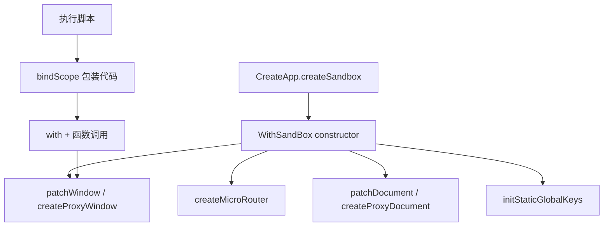

# 05 JavaScript 沙箱：从变量查找到隔离边界

[返回目录](README.md) · [上一章：加载流水线](04-加载流水线与应用生命周期.md) · [下一章：DOM 与 CSS](06-DOM代理与CSS隔离.md)

读完本章，你应能解释一行 `window.foo = 1` 究竟写到哪里，判断一次第三方库兼容改造会不会污染主应用，并为 with / iframe 两条执行路径分别设计验证。

先在 [实验台](11-分层实验与验收矩阵.md) 中挂载 `reader-a`、`reader-b`，观察两个普通全局标记，再进入代理实现。本章专门的逃逸、第三方库与 descriptor 实验需要另外运行；实际已测范围见 [验证记录](VALIDATION.md)。官方随仓库保留的说明见 [sandbox.md](../packages/micro-app2/docs/zh-cn/sandbox.md)。

## 1. 先回答：同一个页面为什么需要多个 window

假设主题和播放器插件都执行 `window.player = ...`。如果它们直接运行在主页面里，后执行者覆盖先执行者。主题卸载时，也无法知道哪些全局变量来自播放器。

沙箱把这个问题分成两件事：

1. 每个应用有自己的全局属性存放对象。
2. 子应用执行代码时，读取、写入、调用浏览器 API 的路径经过代理。

因此沙箱既是执行入口，也是对象访问规则，还承担部分副作用的记账与释放。只有一个 `new Proxy(window, ...)` 不足以实现微前端。

最小教学模型：

```js
// 仅演示属性分流，不是可投入业务的安全沙箱。
const local = Object.create(null)
const proxy = new Proxy(local, {
  get(target, key) { return key in target ? target[key] : window[key] },
  set(target, key, value) { target[key] = value; return true },
})
proxy.player = 'theme'
console.log(local.player) // theme
```

真实实现还要解决 `window === self`、DOM 方法的 this、属性描述符、构造器、路由、脚本模块、卸载等问题。不要把教学模型当作替代方案。

## 2. with 沙箱的真实调用链

从 [CreateApp](../packages/micro-app2/src/create_app.ts) 的 `createSandbox` 开始读。未启用 iframe 时创建 `WithSandBox`；它继承 `BaseSandbox`。



对照三组源码：

| 文件 / 函数 | 要理解的职责 |
| --- | --- |
| [with/index.ts](../packages/micro-app2/src/sandbox/with/index.ts)：构造器、`start`、`stop` | 建立目标对象、路由、document、全局别名和副作用生命周期 |
| [with/window.ts](../packages/micro-app2/src/sandbox/with/window.ts)：`createProxyWindow` | get/set/has/defineProperty/deleteProperty 的具体分流 |
| [scripts.ts](../packages/micro-app2/src/source/scripts.ts)：`bindScope` | 把经典脚本放进函数及 with 作用域；修改执行入口必须读这里 |

`microAppWindow = new CustomWindow()` 是属性目标，`proxyWindow` 是对它的 Proxy。`bindScope` 并非笼统的 `with(proxyWindow)`：当前字符串包装以 `proxyWindow.__MICRO_APP_WINDOW__` 为 with 对象，再将常用全局值交给内部函数；`this` 指向代理。定位变量问题必须同时看作用域对象、函数参数和 Proxy。

### 读取规则

`createProxyWindow.get` 优先读取目标已有属性、`__MICRO_APP_*` 属性、`scopeProperties`，否则回退真实 window。回退函数通过 [bind_function.ts](../packages/micro-app2/src/sandbox/bind_function.ts) 绑定到原生对象，以避免 `Illegal invocation`。

`scopeProperties` 表示即使主应用存在某属性，子应用也应独立处理。例如 `Vue`、`webpackJsonp`、`onpopstate` 的兼容规则定义于 [adapter.ts](../packages/micro-app2/src/sandbox/adapter.ts)。它不是资源授权清单。

### 写入规则

通常写入目标对象，新增属性进入 `injectedKeys`；特定 `rawWindowScopeKeyList` 属性写真实 window，当前包含 `location`。`escapeProperties` 可把属性同步到真实 window，`staticEscapeProperties` 包含 `System`、`__cjsWrapper` 等兼容项。

这意味着“子应用赋值绝不会碰到主 window”并不成立。特别是逃逸属性覆盖了主应用原有值时，`escapeKeys` 主要记录原先不存在的键，不能推导出卸载后会完整恢复旧值。

`getOwnPropertyDescriptor` / `defineProperty` 还会根据描述符来源选择目标。依赖 `Object.defineProperty(window, ...)` 的库，不能只用普通赋值实验验证。

### 顶层变量为什么丢了

经典脚本经函数包装后，`var sdk = ...` 的函数局部变量不会自动成为 `window.sdk`。后续独立脚本若期待全局 `sdk`，就可能报 undefined。优先修改库构建产物的全局导出为 `window` 类型，或显式 `window.sdk = ...`。本地官方文档给出 DllPlugin / Module Federation 的接入方向；不要直接用全局正则替换所有 `var`，那会破坏局部作用域。

## 3. iframe 沙箱到底隔离了什么

读 [iframe/index.ts](../packages/micro-app2/src/sandbox/iframe/index.ts) 的构造器、`createIframeElement`、`patchIframe` 和 `start`：

1. 创建 `display: none` 的 iframe。默认 `src` 使用主页面 origin + pathname，也可使用 `iframeSrc`。
2. 等待 iframe document 初始化，停止原页面加载，创建空的 html/head/body。
3. 使用 iframe 的 window、构造器和脚本执行环境，修补它的路由、document、Node/Element。
4. iframe 中的 document 访问会代理到主页面里的子应用容器；脚本节点等特例保留在 iframe 内。

所以这是“iframe 提供 JavaScript realm，容器提供可见 DOM”的组合。它不是把子应用页面完整显示在独立 iframe，也不是自动启用跨域 iframe 的浏览器安全边界。

[iframe/window.ts](../packages/micro-app2/src/sandbox/iframe/window.ts) 的 `createProxyWindow` 明确提醒：经典脚本的 `window.key`、module 脚本、裸标识符，进入代理的方式不同。不能假定 with 的 `scopeProperties` 与逃逸策略对 module 同样生效。ES module 是否走浏览器原生执行，还要结合 [scripts.ts](../packages/micro-app2/src/source/scripts.ts) 的 `isTypeModule`、`isWrapInSandBox` 和脚本插入路径判断。

iframe 的初始化是异步的；在 `sandboxReady` 前读取 `proxyWindow`、触发导航、立即卸载后重挂载，都是需要覆盖的竞态。`patchIframe` 对 document 就绪有重试逻辑，遇跨域 iframeSrc、无法访问 contentWindow 时，先检查同源与初始化过程，不要盲目加延时。

### 三种执行路径，分别预测再验证

“开启 iframe”与“使用 module”是两个维度。先判断脚本实际如何执行，再判断哪些钩子能影响它。

| 问题 | with＋经典脚本 | iframe＋经典脚本 | iframe＋外部原生 module |
| --- | --- | --- | --- |
| 代码如何执行 | `bindScope` 包装，Function 或 script 路径 | iframe realm 中执行包装代码 | 浏览器加载 script.src 并建立模块依赖图 |
| `window.x` 主要经过哪里 | 代理 window | 包装参数中的代理 window | iframe 的原生全局／已做适配的属性，不能套用经典包装参数 |
| 裸 `location` | 常用全局参数参与代理 | 包装显式传入 proxyLocation | 没有这层经典参数替换；需要验证原生 location 与 `microApp.location` |
| 入口脚本下载 | `fetchSource` 与配置的文本 fetch | 经典脚本仍有该文本路径 | 真正执行所用字节由浏览器原生模块请求取得 |
| JS loader 返回的改写能否直接决定执行字节 | 对此包装分支可以 | 对此经典脚本分支可以 | `runCode2InlineScript` 最终设置原 URL 的 src；即使处理过文本，也不能据此认定原生模块字节已被替换 |
| 依赖、动态 import | 按构建格式和动态资源路径判断 | 同样需要判断实际格式 | 浏览器解析模块依赖；不能宣称全部经过自定义 fetch |
| 可见 UI 在哪里 | 主页面的应用容器 | 主页面容器；脚本等特例在 iframe | 仍有 DOM 适配，不能由模块格式推断完全独立 document |

依据是 [scripts.ts](../packages/micro-app2/src/source/scripts.ts) 的 `isTypeModule → isWrapInSandBox → bindScope → runCode2InlineScript`。预取时可能另行抓取模块文本，但不改变最终原生 `src` 的执行方式。矩阵也不包含所有 inline module 特例。

用一个反证检查理解：如果经典脚本的文本 fetch 能注入请求头，而外部 module 仍被拒绝，你应先比较实际请求发起者与响应协议。直接修改 `with/window.get` 无法修复一个根本没有经过该路径的下载问题。

## 4. 兼容隔离与安全边界分开理解

当前两个沙箱均显式暴露 `rawWindow`、`rawDocument`；主应用 DOM、部分浏览器 API、同源存储和共享对象也不会因 Proxy 自动变成独立副本。子应用若取得主应用对象引用，修改嵌套属性也不必经过 window.set。

因此这里的沙箱主要解决可信应用之间的兼容和污染问题。Freelog 的资源授权仍要由平台 API / 服务端校验；若未来要求运行恶意、不可信代码，需要另行设计不同 origin 的 iframe、消息协议及权限边界。这个建议是架构方向，不是本 fork 已实现的能力。

另一个维护边界：全目录中没有 `proxyHooks` / `getHooks` / `setHooks` / `saveSandBox` 这组接口。根目录旧 README 里关于旧核心的描述不能作为当前 MicroApp 的接入合同。当前可见扩展包括 plugins、`customProxyDocumentProps` 等，以具体实现为准。

## 5. 实验：证明变量究竟写在哪里

在测试子应用自己的入口文件加入以下代码，以 `reader-a`、`reader-b` 两个实例挂载。不要直接在顶层 DevTools Console 输入后就声称测试了代理；Console 默认拿到的是主页面 window。

```js
window.__handbookOwner = window.__MICRO_APP_NAME__
console.table({
  app: window.__MICRO_APP_NAME__,
  type: window.__MICRO_APP_SANDBOX_TYPE__,
  selfIsWindow: self === window,
  localOwner: window.__handbookOwner,
  rawOwner: window.rawWindow.__handbookOwner,
  sameArrayConstructor: Array === window.rawWindow.Array,
})
```

预期：普通自建属性不应因 B 执行而覆盖 A，也不应自动出现在 rawWindow。构造器身份要分别记录 with 与 iframe，不能写死所有模式结果。卸载 A 后保留 B，再重挂 A，检查 B 未被删除，A 的状态符合 default / UMD 模式预期。实验结束从子应用移除探针。

再做两个反例：一个第三方库用 `var SDK` 导出，另一个显式 `window.SDK` 导出。对比后续脚本可见性，能解释区别才算掌握包装执行。

## 6. 从现象走到改造点

| 现象 | 先取证 | 合理的处理顺序 |
| --- | --- | --- |
| SDK 在独立页面可用，嵌入后 undefined | 查看产物如何导出、脚本实际执行顺序 | 修正全局导出；必要时对特定文件使用 loader；最后才考虑关闭隔离 |
| `Illegal invocation` | 栈中原生 API 的 this 是谁 | 保留原生绑定；不要对所有函数统一 bind，构造器和类可能被破坏 |
| B 修改了 A 状态 | 查 escapeProperties、rawWindow、共享对象引用 | 减少逃逸，改为明确通信或独立数据；添加双应用回归 |
| iframe 模式卡住加载 | iframe src、同源、sandboxReady、document 重建 | 修入口和初始化条件；用卸载中断用例验证，不用固定超时掩盖 |
| Vite 模块的全局行为不一致 | 判断是原生 module 还是包装经典脚本 | 分别验证两条执行路径，避免只修 with.get |

本次只建立解释与建议，未修改上述实现。下一章继续追踪同一行 `document.body.appendChild` 为什么最终进入应用容器。
