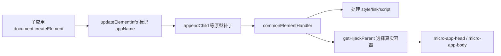

# 06 DOM 代理与 CSS 隔离：为什么弹层会跑错地方

[返回目录](README.md) · [上一章：JavaScript 沙箱](05-JavaScript沙箱与隔离边界.md) · [下一章：路由虚拟化](07-路由虚拟化与导航.md)

本章目标：沿“创建节点 → 标记应用 → 插入容器 → 改写样式”的链路定位故障，知道 CSS 隔离在哪些地方会失效。先在 [实验台](11-分层实验与验收矩阵.md) 对比 A/B 的同名根节点，再读源码；本章扩展 CSS 语法与弹层矩阵仍需单独验证，已测范围见 [验证记录](VALIDATION.md)。

## 1. DOM 隔离首先是所有权问题

主题和播放器都调用 `document.querySelector('#app')`，不应随机取得对方的根节点。弹层库调用 `document.body.appendChild(dialog)`，也不应让当前应用的弹层脱离应用容器。

MicroApp 没有给每个应用创建一份完全独立的可见 document。它通过节点标记、查询代理和 DOM 插入补丁，把属于某个应用的操作映射到该应用容器。



重点源码：[with/document.ts](../packages/micro-app2/src/sandbox/with/document.ts)、[iframe/document.ts](../packages/micro-app2/src/sandbox/iframe/document.ts)、[adapter.ts](../packages/micro-app2/src/sandbox/adapter.ts)、[source/patch.ts](../packages/micro-app2/src/source/patch.ts)。

## 2. 创建、查询和插入是三个不同关口

### 创建时标记

with 的 `createProxyDocument` 包装 `createElement` / `createElementNS`，随后 `updateElementInfo` 写 `__MICRO_APP_NAME__`。静态 HTML 节点由 `patchStaticElement` / `patchElementTree` 递归标记。iframe 同样修补创建节点的方法，并补充 ownerDocument、baseURI 等兼容信息。

`__PURE_ELEMENT__`、阻止标记的状态以及未经过代理创建的节点属于特殊路径。节点上没有 appName 不一定是 CSS 错误，可能是它在一开始就未被识别为子应用节点。

### 查询时选择范围

with 的 document Proxy 并不在每个 get 分支直接实现 querySelector；全局 `patchElementAndDocument → patchDocument` 修补原生 Document 的查询方法，根据当前应用标记查询容器。

iframe 则修补 iframe Document 原型，查询可见容器；脚本等场景还会回退 iframe document。不要简单写成“所有查询只会访问容器”：`head` / `body` 等唯一元素以及非法选择器、DOMParser 生成的独立 document 都有特殊处理。

[utils.ts](../packages/micro-app2/src/libs/utils.ts) 中 `setCurrentAppName`、`throttleDeferForSetAppName`、`throttleDeferForIframeAppName`、`removeDomScope` 协调当前操作属于谁。这套临时执行上下文并不是浏览器提供的 AsyncLocalStorage，回调切换、嵌套应用和调用主应用函数时尤其要检查上下文是否清除。

### 插入时重定向

`commonElementHandler` 从节点标记或当前上下文找到 app，经过 `handleNewNode` 和 `invokePrototypeMethod`，由 `getHijackParent` 重定向真实父节点：

| 表面操作 | 常见实际去向 |
| --- | --- |
| 往 `document.head` 插入 style/link | 当前容器的 `micro-app-head`，资源可能先转为其他节点 |
| 往 `document.body` 插入弹层 | 当前容器的 `micro-app-body` |
| iframe 模式插入 script | iframe 的 microHead / microBody 等特殊路径 |
| 普通容器内插入元素 | 保留普通 DOM 插入语义，再处理所属资源 |

动态 link/script 可能替换成 style/comment/另一个 script，原节点和实际节点由 WeakMap 关联。因此删除资源时也要走对应映射，不能只假设 append 和 remove 操作的节点对象完全相同。

## 3. 为什么 parentNode 看起来“说谎”

部分弹层库判断 `popper.parentNode === document.body`。为了兼容这种判断，with 路径可能为节点定义 parentNode getter：实际在 `micro-app-body`，读取时返回主页面 body，或 `getRootElementParentNode` 的结果。

在 [patch.ts](../packages/micro-app2/src/source/patch.ts) 的 `invokePrototypeMethod` 里读完整条件。它对已离开容器的节点还要返回真实父节点，以支持异步销毁。不要因为 Element 面板和 JS 的 parentNode 不一致就立即删掉这段补丁；它是兼容层的重要组成。

排查时同时记录“DOM 面板中真实树位置”“节点 appName”“JS parentNode 返回值”。只凭第三项会误判。

## 4. CSS 隔离的实际变换

入口是 [scoped_css.ts](../packages/micro-app2/src/sandbox/scoped_css.ts) 的 `scopedCSS → commonAction → CSSParser.exec`。前缀由 `createPrefix` 生成，使用运行时 tagName 和应用 name。

```css
/* 普通选择器示意 */
.card { color: red }
/* 处理后 */
micro-app[name=reader] .card { color: red }

/* body 规则示意 */
body .card { padding: 8px }
/* 处理后 */
micro-app[name=reader] micro-app-body .card { padding: 8px }
```

它还补全 CSS `url(...)`：外部 CSS 相对资源需要基于 CSS 文件目录，而不能一律基于 HTML 入口。图片失败时先查看转换后的地址，再判断是资源读取还是 CSS 问题。

### 当前源码必须知道的限制

1. `formatSelector` 遇符合 `html` / `:root` 规则的选择器会跳过普通加前缀流程。不能把“所有选择器都被隔离”当不变量。主题变量、rem 根字号及全局 reset 要单独验证。
2. 前缀主要限制子应用普通规则向外影响；主应用的通配符、继承属性和全局 CSS 仍可能影响子应用。两边使用 CSS Modules / 约定命名，并缩小宿主 reset 范围。
3. `keyframesRule` 解析并保留动画名，没有看到按 appName 重命名的逻辑。两个应用都定义 `@keyframes spin` 是应加入回归的冲突场景；字体名称等全局标识也要自行管理。
4. parser 是定制解析器。源码中即使有 `:is` / `:where` 示例注释，也不等于所有逗号、嵌套选择器、新 CSS 语法都有测试保证。遇新语法先用真实压缩产物复现，再缩小到最小 CSS。
5. 空 style 会用 MutationObserver 等待内容，存在 `data-styled` 特殊处理；不能推导所有运行时 CSS-in-JS、CSSOM `insertRule` 都自动经过文本改写。
6. `ignore`、排除资源配置、`disable-scopecss`、`scopecss-disable` 注释会影响处理路径。开关一变，隔离行为也变，定位时必须记录。

官方随仓库说明：[scopecss.md](../packages/micro-app2/docs/zh-cn/scopecss.md)。其中注释开关应在产物中保留，压缩器删除注释后会产生与开发环境不同的结果。

## 5. 弹层错位的具体诊断顺序

先定位弹层真实 DOM，然后按下表逐项取证；不要直接全局关闭样式隔离。

| 证据 | 更可能的原因 | 优先方案与验收 |
| --- | --- | --- |
| 弹层在当前 micro-app-body，颜色却不对 | 宿主规则覆盖、继承或样式优先级 | 用 Computed 追到具体规则；缩小宿主规则，双应用对比 |
| 弹层出现在真实 body，且缺 appName | 创建过程脱离代理或由主应用服务创建 | 使用库的挂载容器选项，把弹层根放应用内部；确认卸载后根消失 |
| DOM 在容器，selector 前缀正常，但按钮被裁切 | overflow、transform、定位上下文 | 检查布局与 containing block；调整弹层容器/布局，验证滚动和缩放 |
| iframe 模式点击/实例判断异常 | 跨 realm、ownerDocument / instanceof 兼容 | 对比创建者与操作方 realm；保留 adapter 特判，Chrome/Firefox 都验证 |
| 热更新后样式未转换 | CSS-in-JS、CSSOM 或被忽略 style | 捕获新增 style 的属性和写入方式；优先使用库支持的容器/构建配置 |

确需修 fork 时，补丁应落在已经识别出的边界：节点所属错误修标记/上下文；容器错误修映射；规则错误修 parser。把三类问题都堆入 `getHijackParent` 会扩大兼容风险。

## 6. 实验：观察一个动态节点的旅程

在本地测试子应用的入口或按钮回调中运行，A/B 两个应用均可加入。探针名称故意相同，用来检查查询是否串应用。

```js
const probe = document.createElement('div')
probe.className = 'handbook-dom-probe'
probe.textContent = window.__MICRO_APP_NAME__
const style = document.createElement('style')
style.textContent = '.handbook-dom-probe { outline: 2px solid magenta }'
document.head.appendChild(style)
document.body.appendChild(probe)
console.log('owner', probe.__MICRO_APP_NAME__)
console.log('query sees self', document.querySelector('.handbook-dom-probe') === probe)
// 用同一个子应用上下文中的按钮调用此函数清理。
window.removeHandbookProbe = () => { probe.remove(); style.remove() }
```

通过条件：DOM 面板中节点属于正确容器；两应用各自查询命中自己；style 正文的前缀匹配 name；清理 A 不删除 B。若查询结果不同，不先改代码，沿创建标记→上下文→查询目标逐点记录。

另外建立一份 CSS 回归样本：普通多选择器、body、`:root`、`:is(.a,.b)`、`@media`、`@layer`、嵌套语法、动画同名、相对 url、空 style 后填文本、CSSOM 动态插入。为每项记录“原文、转换后文本、浏览器计算结果”，而不是只截图。

当前 [jest.config.js](../packages/micro-app2/jest.config.js) 指向的 `src/__tests__/source/scoped_css.test.ts` 在当前检出的目录中不存在。新增 parser 修复前，应先恢复或补齐相应回归用例；本次未宣称这些浏览器结果或单元测试已通过。
