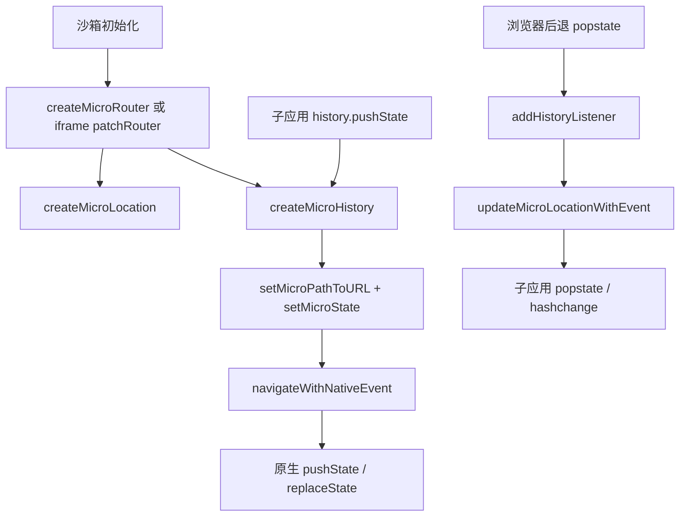

# 07 路由虚拟化：一个地址栏如何承载多个应用

[返回目录](README.md) · [上一章：DOM 与 CSS](06-DOM代理与CSS隔离.md) · [下一章：通信与清理](08-通信与副作用清理.md)

本章目标：把“浏览器 URL”“子应用所见 location”“history 中保存的状态”“框架路由状态”分开，然后沿源码判断一次导航会不会刷新页面、通知谁、如何恢复。首次只跟 search 模式的一次 push；state/pure 与 native 两种模式留到对照阅读。可运行输入在 [实验台](11-分层实验与验收矩阵.md)，完整后退／分享／刷新矩阵仍需分别验证。

## 1. 先不要从 Vue Router 开始

主题可能是 Vue，插件可能是 React。MicroApp 需要在框架以下提供一层浏览器 API 兼容：让两个应用认为自己各有 location/history，同时把必要信息映射进唯一的浏览器地址栏和历史栈。

以主题从 `/` 到 `/articles/42?tab=comments` 为例，要同时回答：

- 子应用读到的 pathname/search 是什么？
- 主页面地址栏怎么编码？
- history.state 里存什么？
- 后退时谁接收 popstate，是否造成一次重复导航？
- 卸载、隐藏、刷新和复制 URL 后能恢复哪些状态？

这些问题比“换成 hash 路由就好”更接近维护需要。

## 2. 五种模式及其代价

[constants.ts](../packages/micro-app2/src/constants.ts) 的当前默认值是 `search`；[core.ts](../packages/micro-app2/src/sandbox/router/core.ts) 的 `initRouterMode` 决定最终模式。单应用 `disable-memory-router` 的优先级高于单应用 router-mode，再参考全局设置；无效模式回退默认值。

| 模式 | 主要映射方式 | 使用前应接受的边界 |
| --- | --- | --- |
| `search` | 子路径编码为以 appName 为键的 query；宿主已有 hash 且无 search 时有附到 hash query 的分支 | 地址可变长；主应用不能把这些参数当普通业务参数无限归一化 |
| `state` | 子路径主要保存在 `history.state.__MICRO_APP_STATE__` | 单独复制可见 URL 不包含全部子路径状态；不能当可分享深链的保证 |
| `pure` | 常规 push/replace 只更新子应用内部位置，不增加宿主历史 | 适合组件式插件；浏览器后退不等于插件内部逐页后退 |
| `native` | 主子应用基于共享浏览器路径协同；子应用 origin 视角偏向主应用 | 需要明确 baseroute 和主应用路由归属，不适合多个应用同时争夺同一路径 |
| `native-scope` | 路径协同类似 native，但子应用 origin 视角指向子应用 | 资源 origin 与路由可见 origin 的差异仍需验证，不能照搬 native 的绝对 URL 假设 |

pure 的源码对 location 跳转也有临时 state 等分支，因此准确说法是“常规 history 导航不增加宿主栈”，不是“任何操作绝不碰浏览器历史”。官方随仓库说明见 [router.md](../packages/micro-app2/docs/zh-cn/router.md)。

## 3. 读源码的最短路径



按顺序读 [router/index.ts](../packages/micro-app2/src/sandbox/router/index.ts)、[history.ts](../packages/micro-app2/src/sandbox/router/history.ts)、[core.ts](../packages/micro-app2/src/sandbox/router/core.ts)、[event.ts](../packages/micro-app2/src/sandbox/router/event.ts)，最后读 [location.ts](../packages/micro-app2/src/sandbox/router/location.ts)。iframe 起点另见 [iframe/router.ts](../packages/micro-app2/src/sandbox/iframe/router.ts)。

### history 导航：写状态，然后更新位置

`createMicroHistory` 替换 pushState / replaceState，基于当前 microLocation 解析目标地址。非 pure 模式通过 `setMicroPathToURL` 映射宿主路径，通过 `setMicroState` 合并每个应用的状态。它保留其他应用的记录，而不是直接覆盖整个 history.state。

with 的 history.state getter 读取该应用的子状态；其他 history 方法可能仍绑定到主 history。iframe 的 go 同样代理主 history。不要假设每个子应用真有独立浏览器历史栈。

### 后退：先解析，再分发

`addHistoryListener` 监听真实 window 的 popstate，排除隐藏或预渲染应用，并过滤 `onlyForBrowser`。通过 `getMicroPathFromURL` 取目标，再由 `updateMicroLocationWithEvent` 更新位置并给子应用发送格式化事件。

这是为什么不能修一个后退问题时无条件 `window.dispatchEvent(new PopStateEvent(...))`：你可能同时让主路由与子路由响应，形成循环。必须先知道应该通知主、子还是两者。

### 主应用修改 history.state：保护共享协议

`patchHistory → reWriteHistoryMethod` 对主页面 history 做补丁。当框架在同 URL 写 state 时，尝试保留 `__MICRO_APP_STATE__`，并为活动应用补回必要路由信息。

若你的主应用自己清空 state，或第三方库替换 history 方法，症状往往是“页面正常，后退错页”。取证应比较导航前后完整的 state 结构，同时避免把敏感业务对象直接打印到公共日志。

## 4. location 赋值不等于框架内导航

[location.ts](../packages/micro-app2/src/sandbox/router/location.ts) 的 `commonHandler` 特意模拟浏览器行为：同源但 pathname/search 变化的 location.href / assign / replace 路径可能刷新；只改 hash 又有特殊分支；跨 origin 可以走真实页面导航。

with 的 window.location 直接赋值也有落到真实 window 的路径。因此要做 SPA 内跳转时，优先使用子框架 router 或已确认的 microApp.router，不能把 `location.href = '/detail'` 当安全的内部状态更新。

`microApp.router.push/replace` 在 [api.ts](../packages/micro-app2/src/sandbox/router/api.ts) 中先验证 name/path 与活动应用，再等 sandboxReady。隐藏、预渲染或还没进入活动状态时可能拒绝；SDK 返回 Promise 的位置要处理错误，不要用 setTimeout 猜挂载完成。

## 5. beforeEach 名字相似，合同却不同

当前 `executeNavigationGuard` 的注释与调用顺序表明：先改变浏览器 URL，再执行 beforeEach / afterEach 回调；`runGuards` 没有实现框架路由常见的 `return false` 或 `next()` 阻断合同。

因此 MicroApp 的这里更接近导航通知。资源是否可读仍要依赖平台与服务端鉴权；不要用它承担授权校验的唯一防线。需阻止业务页面访问时，在子应用框架路由和服务端权限层实现，并验证越过前端入口后的 API 仍会拒绝无权访问。

## 6. Freelog 改造最容易漏看的地址基线

with 构造器调用 patchRouter 时，对包含 `window.fileHost` 的 url 做拆分；iframe 构造器用 `window.HOST_END` 处理同类入口；`clearRouteStateFromURL` 也使用这些平台全局值。源码分别见 [with/index.ts](../packages/micro-app2/src/sandbox/with/index.ts)、[iframe/index.ts](../packages/micro-app2/src/sandbox/iframe/index.ts)、[router/index.ts](../packages/micro-app2/src/sandbox/router/index.ts)。

这是平台入口资源地址和逻辑路由基线之间的适配，不应按普通静态站的 `/index.html` 直觉替换。两个沙箱使用的拆分表达式并不完全相同；是否造成特定线上问题，需要具体入口 URL 与初始化值复现，本次不直接判定为已发生缺陷。

以后若改造，建议把输入输出先列成表：普通 HTTP 入口、Freelog 文件入口、含查询参数入口、子目录入口、不同环境 host、缺失配置。先锁住“期望逻辑基线”，再考虑合并处理函数，避免仅为统一代码而改变语义。

## 7. 实验与排错

在测试子应用代码中加入诊断按钮，输出当前应用视角与主页面视角。以 `history.pushState` 观察 API 层；如页面框架不响应，这是原生 pushState 不自动给该框架发 popstate 的正常差异，需要另用框架 router 测页面行为。

```js
function snapshot(label) {
  console.log(label, {
    app: window.__MICRO_APP_NAME__,
    child: location.pathname + location.search + location.hash,
    browser: window.rawWindow.location.href,
    childState: history.state,
    browserMicroState: window.rawWindow.history.state?.__MICRO_APP_STATE__,
  })
}
snapshot('before')
history.pushState({ handbook: 1 }, '', '/handbook-route?x=1#part')
snapshot('after push')
```

每种模式记录两份结果，再做框架路由跳转、浏览器后退/前进、硬刷新、复制地址到新标签、隐藏后重显、卸载后重挂。只在测试节点执行，实验会改本地页面地址和历史。

| 现象 | 优先检查 | 通过标准 |
| --- | --- | --- |
| 主子应用循环刷新 | 宿主监听完整 query、归一化移除子路由参数，或 location 被误用 | 一次点击只有一次逻辑导航，无反复 mount/unmount |
| 后退丢子页面 | state 被覆盖、模式预期错误、appName变化 | 返回准确子路径和状态，不误影响另一插件 |
| 刷新/分享后回首页 | 只存在 state 的信息是否可从 URL 重建 | search 深链可恢复；state/pure 明确说明恢复合同 |
| native 模式先404再消失 | baseroute、异步主路由卸载、事件延迟 | 主路由接管后不让旧子应用覆盖地址；慢网也通过 |
| 卸载后地址残留参数 | clearRouteStateFromURL、destroy/keepRouteState 组合 | 删除当前应用记录，保留其他应用路由和宿主业务参数 |

本章的验收是解释所有状态的来源和去向；不是选一个模式后让所有应用强行共享它。维护时保留 mode、name、入口基线和主子框架版本这四个复现条件。
