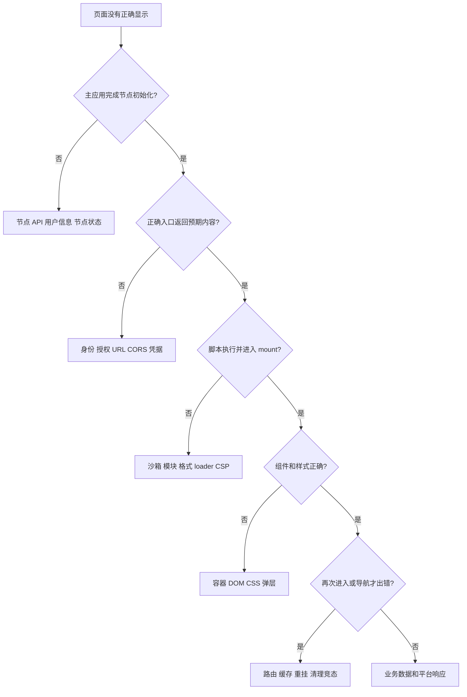

# 10 · 排障与具体修复方案

本章把“微前端不工作”拆成具体假设，每个问题按证据 → 定位 → 最小修复 → 验收推进。修复片段是候选方案，**本次没有应用到运行时代码，也没有在真实平台节点复现这些故障**。机制实验台的已测结果见 [验证记录](VALIDATION.md)，不把它们扩大为本章全部风险已经确认。

## 先按症状进入，不从头猜

| 现在的症状 | 第一份证据 | 优先阅读 |
| --- | --- | --- |
| 一直加载／首屏白屏 | 最早失败请求的状态与正文类别，框架等待是否结束 | [入口](#entry-failure)、[资源](#resource-path)、[module](#module-path) |
| 第二次打开才错 | 上次退出方式、业务请求先后顺序、实际实例名 | [完整异步案例](CASE-STUDY.md) → [重挂清理](#reentry)、[登记](#registry) |
| A/B 串状态或找错根节点 | 写入者、节点 appName、实际容器、共享对象 | [DOM 与弹层](#dom-style) → 第 05、06 章 |
| 后退／刷新／分享错页 | 路由模式、真实 URL、子 location、history.state | [导航恢复](#navigation) → 第 07 章 |
| 关闭后还轮询或响应事件 | 资源持有者与退出前后计数 | [退出](#reentry) → 第 08 章资源账本 |
| 文件／SDK 显示无权限 | 实例、展品、依赖身份和业务错误码 | [授权上下文](#authorization) → 第 09 章 |
| 修了 src 页面却没变化 | 实际 lib 摘要和浏览器 Sources | [第 12 章产物检查](12-Fork差异与持续维护.md) |

第一次完整练习先做 [CASE-STUDY](CASE-STUDY.md)：它给出固定输入、反例、排除其他假设的证据、最小修正与通过断言。下列症状条目用于把同一方法迁移到其他问题；不要同时应用全部候选补丁。

## 1. 先建立一条可追踪的故障记录

不要一开始就更换沙箱或禁用隔离。先记录：

| 信息 | 为什么需要 |
| --- | --- |
| PC/Mobile、运行时与 MicroApp 构建版本 | 两个主应用入口可能独立变化，源码和 lib 可能不一致 |
| `name`、展品 ID、`topExhibitId`、`nid`、`seq` | 区分身份错位和实例名冲突 |
| 入口 URL、沙箱模式、路由模式 | 决定加载和执行路径 |
| 第一个失败请求的 URL、状态、响应类型 | 避免把授权 JSON 或错误 HTML 当脚本问题 |
| 最早的异常堆栈和生命周期顺序 | 后续报错经常只是上游失败的结果 |
| 首次、再次、隐藏后恢复、快速退出时的区别 | 区分初始化、缓存、清理和竞态 |

调试记录使用脱敏 URL，不记录 Cookie、授权头、令牌、合同私密内容。建议按“实例名 + 一次挂载序号”关联日志；这是后续观测建议，当前仓库没有统一实现此关联 ID。

通用路径：



<a id="entry-failure"></a>

## 2. 入口请求成功，但子应用白屏

**先验证：** Network 中入口究竟是 HTML，还是登录页、授权响应、404 页面？HTTP 200 只证明传输成功，不保证业务内容正确。

真实调用：[main.tsx](../packages/pc-ui/src/main.tsx) 的自定义 `fetch` → [freelogFetch](../packages/freelog-runtime-core/src/structure/freelogFetch.ts) → `res.text()` → 引擎 [HTML loader](../packages/micro-app2/src/source/loader/html.ts)。当前主应用把 Response 转成文本前没有检查 `ok`。

**候选最小修复：** 在主应用资源获取适配层保留失败状态，不把错误响应继续交给 HTML/脚本解析器：

```ts
fetch(url: string, options: any, appName: string) {
  return freelogFetch(url, options, appName).then((response: Response) => {
    if (!response.ok) {
      throw new Error(`资源请求失败: app=${appName}, status=${response.status}`)
    }
    return response.text()
  })
}
```

这仍不足以判断 HTTP 200 的业务错误内容。应按资源类别补入口内容/业务响应识别，并遵循文件服务已有协议，而不是一律要求某个固定 MIME。

**验收：** 入口 404、500、网络拒绝应进入清楚的错误路径；合法 HTML/CSS/JS 仍能加载；HTTP 200 的平台错误响应有可辨识诊断；不会无限显示“加载中”。PC/Mobile 两个适配入口都要检查。

<a id="resource-path"></a>

## 3. HTML 能读到，JS/CSS/chunk 地址却错了

**先验证：** 对比原始 HTML、重写后的地址、最终网络请求。特别查看 `/assets/...`、相对路径、CSS `url()` 和动态 import 的区别。

调用定位：[HTML loader](../packages/micro-app2/src/source/loader/html.ts)、[scripts](../packages/micro-app2/src/source/scripts.ts)、[links](../packages/micro-app2/src/source/links.ts)、[动态资源 patch](../packages/micro-app2/src/source/patch.ts)、[请求 patch](../packages/micro-app2/src/sandbox/request.ts)。Freelog 还会在自定义 [freelogFetch](../packages/freelog-runtime-core/src/structure/freelogFetch.ts) 中改写部分文件地址。

**修复顺序：**

1. 确认目标包发布时 `index.html` 在正确层级，入口和资源实际存在。
2. 对照 [Vite 接入指南](../packages/docs/framework/vite.md) 检查子应用构建 `base`，再验证生产产物；不要只观察 dev server。
3. 检查引擎完成的 URL 与平台文件服务要求是否一致，避免两层重复补前缀。
4. 若仅某类动态资源失败，构造只包含一个相应资源的最小应用，沿这一类 patch 调试。

**验收：** 首屏 JS/CSS、懒加载路由 chunk、CSS 背景图、运行时插入 script/link 都命中正确展品或依赖链；带 query/hash 的 URL 不丢参数。

### 当前静态风险：文件 URL 判定使用子串

`freelogFetch` 使用 `url.includes(host)`、`url.includes(urls.HOST)` 判断平台域，还用 URL 子串判断展品 ID，并直接访问 `widgetConfig`。这不能替代 URL 结构判断，也不能保证配置一定存在。

**候选修复方向：** 先用 `new URL` 解析，使用明确配置的 `origin` / `hostname` 白名单及路径协议判断；配置缺失时返回有上下文的拒绝；重新构造 URL 时显式保留 `search`。不要在尚未确认 CDN 和子域规则时直接改成“所有后缀匹配域均携带凭据”。

**回归数据：** 合法文件域、合法 API 域、外部 URL 的 query 含平台域名、相似域名、未知 appName、展品 ID 恰好出现在无关 query 中、带查询参数的文件链接。仅通过这些用例仍不等于服务端鉴权正确。

## 4. 本地开发地址能打开，放到节点里加载失败

**先验证：** HTTPS 页面加载 HTTP 子应用是否被混合内容拦截；证书是否在当前浏览器可信；请求是否预检失败；是否需要 Cookie；WebSocket 是否连接失败。

独立访问成功，只证明顶层导航成功。主应用跨源 fetch、module 加载和 HMR 各自有浏览器约束。

**最小解决方案：** 为开发入口提供可用的 HTTPS；在开发服务显式配置需要的来源和资源访问；带凭据时核对服务端 CORS 与 Cookie 策略。`Access-Control-Allow-Origin: *` 不适用于携带凭据的跨域响应。浏览器可能还有本地网络访问策略，按实际失败信息处理。

`dev=<URL>` 或 `widget_entry` 只替换代码入口，不能创建节点、展品、依赖位置或授权。必须先确认 [dev.ts](../packages/freelog-runtime-core/src/structure/dev.ts) 进入了预期开发分支，再检查 [widget.ts](../packages/freelog-runtime-core/src/structure/widget.ts) 最终传给 `renderApp` 的 URL。

**验收：** 在节点上下文中验证入口、脚本、样式、API 和 HMR；关闭开发替换后能回到发布入口；未授权内容仍不可读取。

<a id="module-path"></a>

## 5. Vite 应用报 module、import 或 location 异常

**先验证：** 记录最终沙箱模式、脚本 `type`、模块入口及动态依赖请求。不要仅凭框架名称推断当前执行模式。

当前主应用 [App.tsx](../packages/pc-ui/src/App.tsx) 用主题属性 `bundleTool === "vite"` 决定 `iframe`；插件挂载由调用方传 `renderWidgetOptions.iframe`。因此主题正常而插件不正常时，先比较这两个配置来源。

**最小解决方案：** 按 [Vite 指南](../packages/docs/framework/vite.md) 与本手册 [沙箱章节](05-JavaScript沙箱与隔离边界.md) 验证 iframe 模式及模块链。旧文档建议在特定 location 问题下使用 `window.microApp.location`；采用前仍要确认业务需要的是子应用虚拟导航还是外站跳转。把所有 `window.location` 替换成一个对象，可能改变登录跳转等业务语义。

**验收：** 首次加载、动态 import、热更新、普通重挂和深链接均通过；子应用内部导航不意外刷新整个节点；外站跳转行为符合预期。iframe 沙箱仍共享当前架构中的 DOM 和宿主能力，不能把模式切换当成安全隔离升级。

<a id="dom-style"></a>

## 6. 弹层丢样式、盖住其他应用，或根本找不到容器

**先验证：** 弹层实际插入哪里？它及样式是否有正确应用归属？主应用和不同子应用是否出现同名 ID？查看 Elements 和 Computed，再看 CSS 选择器是否匹配。

定位：[DOM/资源 patch](../packages/micro-app2/src/source/patch.ts)、[scoped_css](../packages/micro-app2/src/sandbox/scoped_css.ts)、with/iframe 的 document 代理，以及应用的弹层库配置。

**最小解决方案：** 优先让组件库的弹层挂到当前子应用中明确的容器，设置合理的定位、滚动与层级；检查全局 reset、字体和继承属性。不要通过关闭全应用样式隔离修一个弹层。当前 [mountApp](../packages/freelog-runtime-core/src/structure/widget.ts) 会强制 `disable-scopecss: false` 与 `disable-sandbox: false`。

**验收：** 同时挂两个插件，分别打开弹层和遮罩；焦点、滚动、关闭、卸载都正常；另一个应用的样式和交互不改变；移动端触摸与滚动单独验证。具体隔离机制见 [DOM 与 CSS](06-DOM代理与CSS隔离.md)。

<a id="navigation"></a>

## 7. 浏览器返回走错页面，或分享链接无法恢复

**先验证：** 区分主应用地址、子应用虚拟地址、路由模式和外站导航；记录操作前后浏览器 URL 与 `history.state`，不要只观察屏幕。

当前 core 默认用 `search` 模式；授权 UI 使用 `pure`。`mountApp` 先计算默认值再展开 `renderWidgetOptions`，所以显式选项仍可能覆盖默认。SDK 类型支持的 `search` / `pure` / `state` 是当前业务约定，不能直接把其他版本文档中的模式照搬进来。

**最小解决方案：** 先为需要可分享的应用约定如何编码路径；仅需临时 UI 的应用可以用不占用地址的模式，但要接受刷新不能仅靠 URL 恢复。修改 [widgetUtils.ts](../packages/freelog-runtime-core/src/structure/widgetUtils.ts) 的 `getCurrentUrl` 或 `assembleUrl` 时，检查它们是否保留原有查询参数、路径和 hash，而不是只验证一个 `/` 页面。

**验收：** A 插件内部切换两页、B 插件切换一页、浏览器后退和前进、复制链接到新页面、刷新，各步状态符合协议；开发参数和授权 UI 不意外吞掉业务路径。机制详见 [路由章节](07-路由虚拟化与导航.md)。

<a id="reentry"></a>

## 8. 第二次进入报错，或隐藏以后仍在请求

**先验证：** 本次退出是隐藏、普通卸载还是 destroy？React root 是否在卸载后重新创建？业务轮询是否停止？是否持有迟到挂载的控制器？

**最小解决方案：** 按 [上一章](09-主题插件与Freelog能力注入.md) 实现对称 mount/unmount 和异步竞态清理；keep-alive 在 `afterhidden` 暂停业务，在 `aftershow` 恢复；框架组件、WebSocket、Observer、请求控制器和第三方对象由它们的拥有者显式释放。

**验收：** 连续挂载/卸载多轮，业务订阅和网络请求数量回到基线；隐藏时保留状态但暂停约定业务；恢复不重复启动；父应用快速离开时不留下子应用。内存有短期抖动不等于泄漏，使用多轮快照和引用链判断。

### 当前静态风险：宿主回调绕过子应用自动清理

[eventOn.ts](../packages/freelog-runtime-core/src/bridge/eventOn.ts) 的 `onLogin`、`onUserChange` 把函数存入宿主数组；当前 API 没有配套按实例取消订阅的返回值。沙箱无法自动推断宿主数组中的哪些引用应随某插件退出删除。

**候选修复方向：** 增加具有实例拥有者的订阅登记，并返回取消函数；在真正卸载时解除该实例订阅，keep-alive 隐藏采用明确的暂停策略。保持旧调用兼容后逐步迁移 SDK，不要一次清空全局数组，破坏其他应用。

**回归：** 插件 A、B 同时订阅，卸载 A 后仅 B 收到下一次事件；相同回调重复注册的策略明确；隐藏/恢复不翻倍；主应用监听初始化不重复。

## 9. 插件确实显示了，但 getAllWidget 返回空

这是一个有直接静态证据的协议不一致：

- [widget.ts](../packages/freelog-runtime-core/src/structure/widget.ts) 在 `mountApp` 末尾调用 `addChildWidget(name, widgetControl)`，保存的是控制器对象。
- [jdPatch.ts](../packages/freelog-runtime-core/src/structure/jdPatch.ts) 的 `getAllWidget` / `getActiveWidget` 却用 `id === id2`，将引擎字符串名与保存的值比较。

在这些值按当前代码正常产生时，对象不等于字符串，所以可能得到空结果。这里证明的是协议冲突；本次未在真实业务中复现。

**候选最小修复：** 先选定 `childWidgets` 统一保存字符串 name 或控制器对象，再让写入、读取、去重与删除遵守同一协议。如果希望保留当前按字符串过滤和 `removeChildWidget(key, childKey: string)` 接口，最小候选是把写入改为：

```ts
if (name) addChildWidget(name, widgetControl.name)
```

再补充类型约束，检查所有外部消费者后落地。单改读取为 `.name` 也能局部解决，但仍需统一删除和去重语义。

**回归：** A 挂 B 和 C，B 挂 D；A 只枚举 B/C，B 只枚举 D；卸载 B 后按照约定移除 B；隐藏应用是否出现在 active 列表与 `excludeHiddenApp` 参数一致。

## 10. 依赖插件 getSelfProperty 没返回属性

[widgetUtils.ts](../packages/freelog-runtime-core/src/structure/widgetUtils.ts) 中，展品分支使用了 `await getExhibitById(...)`；依赖分支却直接将 `getExhibitDepInfo(...)` 的 Promise 当响应访问：

```ts
const res: any = getExhibitDepInfo(name, topExhibitId, { articleNids: nid })
if (!res.data || (res.data && res.data.errCode !== 0)) {
  return res
}
```

此时 `res.data` 为 undefined，所以提前返回 Promise；外层 async 仍会等待它，但下面提取 `articleProperty` 和缓存属性的逻辑没有执行。

**候选最小修复：** 在依赖分支等待请求，然后验证数据非空，再按 API 协议提取字段：

```ts
const res: any = await getExhibitDepInfo(name, topExhibitId, { articleNids: nid })
if (!res.data || res.data.errCode !== 0) return res
const first = res.data.data?.[0]
if (!first) {
  throw new Error(`依赖属性不存在: app=${name}, nid=${nid}`)
}
const property = first.articleProperty
res.data.data = property
widgetConfig.property = property
return res
```

这里的“空结果抛错”是建议，最终可改为项目约定的业务错误返回，但必须与 SDK 合同一致。还需考虑直接修改 API 响应是否符合缓存/调用方约定。

**回归：** 用真正延迟解析的 Promise 覆盖成功响应、非零 errCode、空数组、网络拒绝；验证返回数据形状和缓存。不要只用同步对象 mock，否则会漏掉缺 await 的核心原因。

<a id="registry"></a>

## 11. 挂载失败后，运行时仍显示有活动插件

静态定位：[mountApp](../packages/freelog-runtime-core/src/structure/widget.ts) 无论 `renderApp` 返回的 `flag` 是 true 还是 false，都执行 `addWidget` 和父子关系登记；`unmount` 包装仅转发 MicroApp 调用，没有对称更新所有 core Map。

**候选修复方向：** 定义控制器状态协议：加载中、运行中、隐藏、已卸载、已销毁、失败。`success: false` 不应进入“活动”登记；卸载成功后解除 active/父子关系，destroy 时按约定淘汰配置和数据。加载所需配置可能在资源请求前就必须存在，所以不要为了“失败不登记”把 `widgetsConfig` 一律延迟到 mounted 后写入。

别把所有卸载都做成删除：keep-alive 隐藏和普通资源缓存仍需要保留可恢复上下文。具体删除时机要同时参考 [unmountApp](../packages/micro-app2/src/micro_app.ts) 的结果与引擎生命周期。

**回归：** 入口失败、挂载时取消、keep-alive 隐藏、正常卸载、重复卸载、destroy、相同实例重挂；比较引擎应用列表和 core 各 Map，确保活动性及拥有者关系一致。

<a id="authorization"></a>

## 12. SDK 调用有响应，业务仍显示未授权

**先验证：** 分别检查用户身份、节点身份、展品 ID、依赖位置、HTTP 状态、业务 `errCode` 与授权结果。个人有合同不能推出节点或访问者有访问权。

调用链：[SDK](../packages/freelog-type/src/index.ts) → `bindName` → [API exhibit](../packages/freelog-runtime-api/src/api/exhibit.ts) → [frequest](../packages/freelog-runtime-api/src/services/handler.ts) → 平台服务。授权 UI 调度在 [bridge/index.ts](../packages/freelog-runtime-core/src/bridge/index.ts)，它不是授权判定服务端的替代。

**最小解决方案：** 先修正身份和依赖上下文，保留平台错误码，按授权桥接返回更新 UI；需要重新拉取内容时再发请求。不要吞掉错误后返回空对象，也不要以关闭沙箱或伪造实例名绕过业务错误。

当前 [request.ts](../packages/freelog-runtime-api/src/request.ts) 的 Axios 响应错误拦截只输出日志，没有显式返回 `Promise.reject(error)`。这可能把失败链变成 fulfilled undefined；**应通过错误响应 mock 确认当前 Axios 版本的实际表现**，再决定补上拒绝传播。修复时回归所有调用方对拒绝/业务错误的处理，避免把原本展示错误 UI 的流程变成未处理拒绝。

## 13. 怎样把一次定位变成可维护的补丁

按这个顺序执行：

1. 将现象缩小为一个最小子应用或纯函数用例，明确失败发生在哪一层。
2. 用例在修改前失败，且证明真实因果，例如依赖属性测试必须使用异步响应。
3. 只修改拥有该职责的模块，保留协议与边界；新增行为与兼容影响写进变更说明。
4. 检查源码、类型及构建产物一致，分别验证 PC、Mobile 受影响路径。
5. 执行定向回归，再按改动范围选择导航、并发应用、重挂和泄漏验证。
6. 记录仍未验证的浏览器、构建工具和业务授权场景，准备上一版可回退产物。

本章列出的代码风险不是本次已修复项目。后续每项应独立复现、测试和提交，避免把通信、鉴权、路由、沙箱同时重写。持续维护流程见 [Fork 差异与持续维护](12-Fork差异与持续维护.md)。
