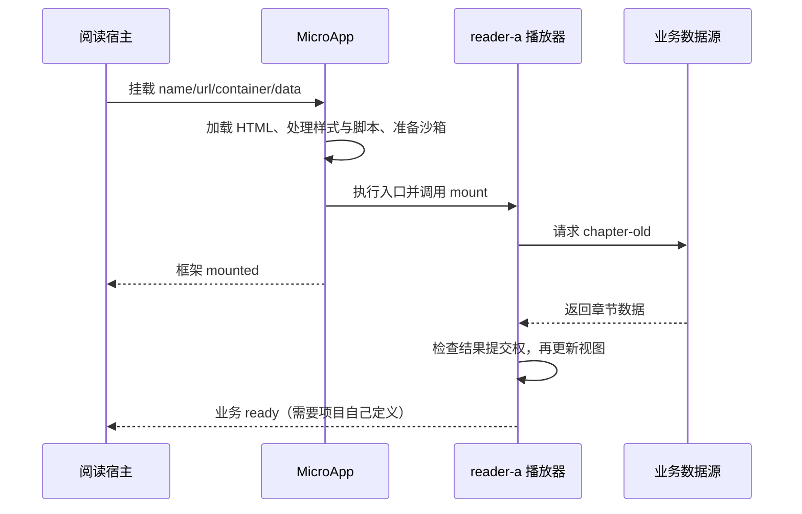

# 贯穿案例：旧请求为什么会改掉新播放器

[返回学习入口](README.md) · [实验步骤](11-分层实验与验收矩阵.md) · [自测与答案](14-自测答案与进阶挑战.md)

本书围绕一个固定场景展开：教学阅读宿主在左右两栏挂载同一份播放器代码，实例分别叫 `reader-a`、`reader-b`。你打开、关闭、再打开 A，B 一直保留。先观察正常共存，再解释为何旧结果有时会污染新视图。

下面的异步故障由可执行教学模型确定性重现，**不等于已在真实 Freelog 节点复现，更不表示本轮修复了 MicroApp**。真实引擎实验与教学模型的证据各自保留。

## 1. 先统一对象，避免每章重新理解一个系统

| 对象 | 教学场景 | 对应到真实 Freelog 时 |
| --- | --- | --- |
| 阅读宿主 | 实验页面；启动一个 MicroApp 单例 | 节点 PC／移动主应用启动引擎；真正的主题本身仍是子应用 |
| 播放器定义 | 一份 HTML、CSS、经典脚本 | 一个主题／插件资源版本的构建产物 |
| 实例 | `reader-a`、`reader-b`；各有容器和环境 | Widget 根据业务上下文生成 name，可能还需唯一 seq |
| 一次挂载 | A 第一次打开、退出后再次打开 | 同一实例环境可能在 UMD 模式复用，但本次工作已经不同 |
| 业务章节 | `chapter-old`、`chapter-new` | 当前播放／展示的内容；这些字符串是教学标识，没有平台授权含义 |
| 教学能力 | `data` 中传的证据回调 | 可用来理解函数引用如何跨接缝传递；不是 `bindName` 或真实 SDK 的实现 |

实例名、入口 URL、业务依赖身份、挂载代次必须分开。理解这一点后，才能正确设计缓存与失效规则。

## 2. 正常打开时，四条线同时推进



这是一个允许先 mounted、后业务就绪的教学时间线。如果 mount 返回的 Promise 包含数据加载，部分处理会等待该 Promise；实际顺序取决于项目入口。设计观测协议时不能只认一个“成功”灯。

把本次实例记成下面这张卡，查源码只追会改变其中字段的函数：

```text
definition   = 当前播放器构建入口
name         = reader-a
container    = 左栏
visibility   = visible
framework    = mounting → mounted
business     = loading → ready | failed
generation   = 本次业务挂载代次（建议由业务显式管理）
owned        = 请求、轮询、监听器、子插件控制器
```

`generation / business` 是建议的业务记录，不是当前 MicroApp 自动注入的字段。引擎已有的 state、keepAliveState、loadSourceLevel 和预取标记见第 03、04 章。

## 3. 故障输入与正确结果

输入不靠“网速碰巧慢”：旧请求先发，新请求后发；明确让新结果先返回，再返回旧结果。

| 时刻 | 动作 | 正确结果 |
| --- | --- | --- |
| T0 | A 挂载，发起 old 请求 | old 属于第 1 次挂载 |
| T1 | A 卸载 | 第 1 次挂载的结果失去提交权 |
| T2 | A 再挂载，发起 new 请求 | new 属于当前挂载；B 不受影响 |
| T3 | new 返回 | 展示 new |
| T4 | old 返回 | 丢弃 old，继续展示 new |

只使用 `active = true/false` 不够：T2 已经把 active 重新设为 true，T4 会误以为旧请求仍有效。需要同时辨别“应用是否活跃”和“结果属于哪次挂载”。

## 4. 先运行反例，再看修正模型

在仓库根目录运行，不需要浏览器、服务、平台账号或新增依赖：

```powershell
node microfrontend-handbook/examples/pending-result.mjs
node --test microfrontend-handbook/examples/pending-result.test.mjs
```

先预测两组 paints，再看输出。

```text
broken-model paints = [chapter-new, chapter-old]
fixed-model  paints = [chapter-new]

fixed trace:
start:chapter-old:g1
unmount:g2
start:chapter-new:g3
commit:chapter-new:g3
discard:chapter-old:g1
```

这里 g2 是卸载时使旧任务失效的一次递增，g3 才是新挂载。代次不需要与用户打开次数相等；只需单调变化，并且每个结果与创建时的值比较。编号不影响业务 ID，也不承担授权。

模型源码在 [pending-result.mjs](examples/pending-result.mjs)，断言在 [pending-result.test.mjs](examples/pending-result.test.mjs)。模型将网络替换为手动 resolve 的 Promise，从而只考察结果顺序；它没有执行真实网络取消。

## 5. 从症状推到责任层

不要看到“重开才出错”就立即重建沙箱。按证据排除四个候选。

| 假设 | 最小区分证据 | 若证据支持，应改哪里 |
| --- | --- | --- |
| 下载了错误版本 | 同次操作的入口与资源字节／版本是否改变 | 入口、制品或资源缓存协议 |
| A/B 全局或 DOM 串线 | 错误结果是否来自 B；查询是否命中 A 的容器 | 节点归属、共享对象或执行环境 |
| A 的旧业务请求回填 | 错误结果标识是 old；完成晚于新挂载 | 子应用的结果提交权与清理 |
| 宿主重复登记／同名冲突 | 引擎 name、控制器、core Map 与真实容器是否一致 | 实例管理、父子登记及挂载串行化 |

本教学输入只让第三项成立。正确做法是以最小证据锁定它，不顺手重写另外三层。

真实入口参照：[Widget.mountApp](../packages/freelog-runtime-core/src/structure/widget.ts) → [renderApp](../packages/micro-app2/src/micro_app.ts) → [CreateApp.mount](../packages/micro-app2/src/create_app.ts) → 子应用 mount；退出参照 `unmount → handleUnmounted → sandBox.stop`。框架的这些生命周期不能替业务判断某份 HTTP 响应是否仍应显示。

## 6. 最小修正：让旧结果失去提交权

核心变化只有两项：开始新工作时记录代次，提交结果前验证代次与活跃性。

```js
let generation = 0
let active = false

async function showChapter(chapter) {
  active = true
  const mine = ++generation
  const value = await loadChapter(chapter) // 调用方提供；失败仍需显式处理
  if (!active || mine !== generation) return
  renderChapter(value)
}

function disposeChapter() {
  active = false
  ++generation
  // 同时释放真实拥有的计时器、监听器及请求等资源。
}
```

这是业务模式示意，完整可运行版本用依赖注入固定输入。若一个挂载内也能切换章节，每次切换也应更新令牌；不要只在 mount 时更新。

`AbortController` 用于减少无用请求，代次用于控制结果提交，两者解决不同问题。已经完成或不接受 signal 的工作仍需要失效检查；代次也不会自动释放网络、计时器和监听器。错误回调同样要验证是否属于当前工作，避免旧错误盖掉新成功页面。

**另一种竞态要单独处理**：父组件退出后，子插件挂载才返回控制器。这时需要回收迟到控制器，见第 09 章。当前控制器的 unmount 按 name 找应用，若该 name 已被新实例复用，旧控制器可能误卸载新实例。因此应先串行化同名挂载或分配互不复用的实例名／seq，不能把上述业务令牌当成全部框架取消协议。

## 7. 怎样验收，而不只看修正例子漂亮

| 用例 | 必须观察到 |
| --- | --- |
| 正常请求完成 | 当前结果提交一次 |
| 退出后旧请求完成 | 不提交，不重建 DOM |
| 新请求先完成、旧请求后完成 | 页面保留新内容 |
| A 退出，B 请求完成 | B 正常提交，不被 A 的代次影响 |
| 请求失败 | 明确拒绝／错误结果，不吞掉后伪装成功 |
| 新挂载之后旧请求失败 | 旧错误不覆盖当前 UI；需在真实项目补相应错误状态测试 |

此目录测试覆盖前五种中的异步反例、修正、退出、多实例与失败传播；完整 UI、真实请求取消及最后一项还需在实际子应用验证。修补内核前，应再证明问题经过的是内核负责的路径；本案例没有给出这种证据，因此不修改内核。

## 8. 这份维护记录怎样交给未来的自己

```text
结论：旧业务任务仍持有回调，退出和重挂未让其失去提交权。
证据：固定 old/new 返回顺序时，错误模型最终绘制 old。
选择：在子应用工作单元中记录代次，退出失效；真实资源仍成对释放。
未选择：重建沙箱、清全局缓存、统一延时；它们没有证明修复此因果链。
验证：当前结果可提交、迟到结果不提交、多实例独立、失败不吞。
上线前：接入真实入口与错误 UI，核对请求取消和同名控制器风险。
回退：撤回业务侧提交权补丁及其对应产物，不改变平台授权。
```

学完本例后，在第 14 章迁移题中把“旧请求成功”换成“旧请求失败”或“用户未退出但切换章节”，重新设计观察与断言。能处理变化，才说明掌握了原理。
