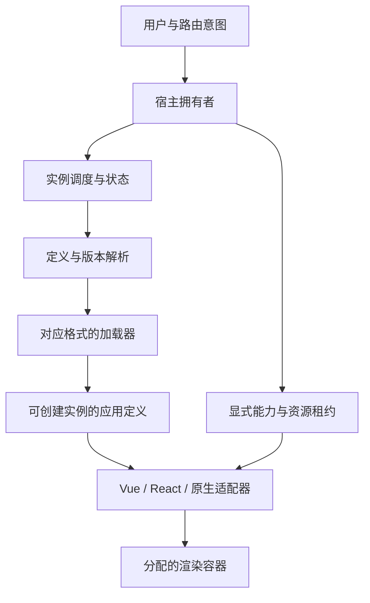

# 架构 01：先定义需要独立的东西，再决定如何装配

[课程入口](../README.md) · [基础技术](../foundations/01-浏览器模块系统与应用身份.md) · [下一章：设计运行时](02-从零设计加载器与运行时协议.md)

本章先不选择任何微前端框架。输入是 Freelog 这类平台的业务要求，以及前六篇底层技术得到的约束；输出是一份能比较方案、分配责任、检验实现的设计。

如果在这里就把某产品的属性开关抄成架构，后面只会知道怎么配置，不能判断实现是不是符合自己的要求。

## 1. 从业务动作取得需求，而不是从框架目录取得需求

平台中，节点主应用取得上下文，主题组织页面，主题与插件可以继续加载插件或前端库。资源、展品、依赖位置和运行实例是不同身份。[业务参考](../02-Freelog业务与运行时架构.md)保留本地证据；本章只提取设计所需的事实。

| 业务动作 | 设计上真正需要的独立性 | 不能顺带假定的能力 |
| --- | --- | --- |
| 作者独立交付主题／插件 | 构建、版本与发布节奏独立 | 不意味着代码已经安全隔离 |
| 主题同时使用两个播放器 | 实例状态、渲染根、路由与资源所有权分开 | 不要求下载两份框架或生成两张模块图 |
| 插件加载自己的依赖插件 | 父子拥有者、依赖位置与能力上下文清楚 | DOM 包含关系不自动等于业务所有权 |
| 用户快速关闭再打开插件 | 旧工作失效、迟到实例可回收 | 不能仅靠移除容器取消 Promise |
| 升级某个插件 | 版本可识别、加载路径可恢复 | 不意味着宿主旧 SDK 一定兼容 |
| 在不同设备访问节点 | 有界加载与后台工作、清晰故障呈现 | 没有测量不能编造全平台性能阈值 |

这里有一个必须明确的前提：代码来自谁、是否可以信任？平台允许第三方发布，不自动等于每段代码可信，也不自动等于当前运行时已提供恶意代码防护。需要按业务规则明确这一点；不同答案会改变执行环境与能力协议。

## 2. “微”对应的是变化边界

一个很大的按钮库未必应该成为微应用；一个很小但独立发行、独立授权、独立退出的播放器，反而可能值得拥有应用边界。

按下面四个问题判断：

1. 它是否必须在宿主发布之后独立更新？
2. 它是否拥有独立的状态、数据请求与退出时机？
3. 它需要与宿主交换组件对象，还是只需稳定的数据／能力协议？
4. 它失败、变更版本、退出时，谁承担兼容和清理责任？

如果只是共同编译的一组组件，优先库／组件即可。采用运行时远程交付之后，节省的是部分发布耦合，增加的是远程协议、资源定位、兼容与故障处理成本。微前端不是去掉耦合，而是把一些编译期约束变成运行时约束，需要显式管理。

## 3. 六类独立性应分别作决定

| 维度 | 可选策略 | 它不能替代什么 |
| --- | --- | --- |
| 交付 | 同构建库、远程 ESM、HTML 入口、远程模块容器 | 不提供状态或安全隔离 |
| 渲染 | 宿主组件树、独立 Vue app／React root、独立 document | 不直接决定模块版本是否共享 |
| 执行 | 同 realm、代理适配、iframe realm、跨源 iframe | 不自动决定 CPU／进程隔离 |
| 样式与布局 | 命名规则、编译 scope、Shadow DOM、独立 document | 不保证业务订阅被释放 |
| 路由 | 宿主独占、子 memory、明确子路径分区、状态投影 | 不等于资源加载基址 |
| 能力与数据 | 同页对象、显式消息、服务端请求上下文 | 客户端协议不能代替服务端鉴权 |

方案是这些策略的组合。把 Module Federation、iframe、CSS Modules 放在同一张“哪个框架更好”的表里直接打分，会混淆它们负责的维度。

## 4. 先比较四种结构，再看产品名称

### 方案 A：远程组件，由宿主渲染

远端交付 React 组件或 Vue 组件，宿主把它纳入自己的树。状态上下文、错误边界、设计体系容易整合，但双方框架运行时、组件 ABI、共享模块身份与插件协议耦合更强。React 组件的 Hook 必须连接到对应 renderer 使用的 React；Vue 组件的运行环境与注入上下文也不能随意混配。

适合明确统一框架、愿意维护组件级契约的体系。它不是“技术栈无关”的接入方式。

### 方案 B：远程应用，自己拥有渲染根

宿主获取定义，调用应用工厂与生命周期；远端在分配的容器创建 Vue app／React root／原生视图。双方只交换普通数据和明确能力，避免相互传 VNode、ReactElement 或响应式代理作为通用协议。

它减少组件级框架耦合，但要求应用根的创建、提交／ready、update、退出、资源清理有明确适配。没有沙箱也能做这种结构，前提是参与代码遵守可接受的共享约束。

### 方案 C：整页 iframe，显式跨边界通信

远端保留自己的文档、样式、路由与框架。若采用不同 origin 并设计 sandbox、消息校验与能力授予，可以获得不同于同页 Proxy 的浏览器权限边界。需要付出布局、焦点、滚动、登录、导航、消息和版本协议成本。

“独立 document”与“独立进程／不卡主页面”不是同一保证；后者不能由一项 HTML 属性推导。跨边界业务能力仍可能形成风险，需要逐项设计。

### 方案 D：HTML／经典脚本兼容装配

对已有应用的 HTML、script、link 进行处理，提供执行与 DOM／路由适配，把它们整合到宿主页。好处是覆盖大量历史产物，代价是要承接原本由浏览器、构建器与框架共同完成的隐含约定。

例如一个脚本依赖 currentScript、一个 Vite 模块依赖原生 URL、一个弹层挂到真实 body、一个打包 runtime 使用固定全局 chunk 名称。每种兼容都要说明保留了哪些原生语义、改写了哪些行为。

四个方案可以按应用类别共存，但每多一种，就多一套交付、测试和排障合同。单人维护应先缩小实际承诺的组合，不要以“支持所有技术栈”代替可验证范围。

## 5. 本书独立设计采用什么边界

为检验架构原理，先设计一条**可信代码、原生 ESM、独立渲染根、显式生命周期、无通用沙箱**的最小应用通道。它足够覆盖定义缓存、多实例、取消意图和退出所有权，而且可以在不依赖既有微前端库时实现。

这条通道是教学设计，不是本轮决定迁移平台。历史 HTML 应用、原生模块、非可信文档可能需要其他适配器。现在先让一个契约闭合，再讨论兼容范围。

这里没有“统一直接调用所有框架内部 renderer”。适配器隐藏的是框架差异，运行时处理的是框架之外的实例身份与意图。

## 6. 用五份身份减少歧义

| 身份 | 示例 | 更新时机 |
| --- | --- | --- |
| 应用定义 | player@7，带版本入口 | 升级代码／依赖／资源图 |
| 实例 | 左栏播放器 A | 用户创建一个独立运行对象 |
| 拥有者 | 当前阅读页／父插件 | 业务视图或父应用切换 |
| 挂载工作 | A 的第 n 次进入 | 新的一次进入与退出 |
| 子工作 | 本次章节请求／保存任务 | 同一挂载内也可以多次更换 |

模块系统告诉我们定义可以复用；框架系统告诉我们每个根保存自己的状态；调度系统告诉我们旧异步工作可能继续；于是必须把这些身份分开。它们不是为了多加几个 ID，而是分别决定缓存、命名、清理与提交权限。

当前平台有资源／展品／依赖位置等另一组业务身份。它们应由平台适配层映射到上述结构，不把全部业务 ID 塞进通用引擎的每条 Proxy 分支。

## 7. 不变量应能被一个反例推翻

| 目标不变量 | 最小反例 | 所需的责任 |
| --- | --- | --- |
| 同一未决或活动实例名不能被并发复用 | 两次重入争抢同名容器 | 名称租约与串行化 |
| 一个渲染容器同一时刻只有一个框架根拥有 | 宿主清 DOM 而子 root 仍在更新 | 容器租约与适配器退出 |
| 旧工作不能提交新 UI／旧控制器不能卸载新实例 | new 先 old 后，或旧句柄迟到调用 | 工作令牌与对象绑定控制器 |
| 一个实例退出不影响其他实例 | A 清共享框架／样式导致 B 坏掉 | 共享资源引用与所有权 |
| 清理失败不能冒充完成退出 | unmount 抛错后立即复用同名实例 | 失败隔离记录与恢复协议 |
| 当前字节可解释 | HTML 是旧版、lazy chunk 已被新发布删除 | 原子版本交付与旧资源保留 |

后面所有功能都要能追溯到一条不变量。没有明确责任的全局补丁即使让某个 demo 跑起来，也不能说明架构正确。

## 8. 开始实现之前应交付的架构材料

一张执行／渲染／能力空间图，一份应用定义与生命周期协议，一张资源所有权表，一份支持矩阵，以及正常／取消／失败／重挂／升级的验收输入。

现在可以进入下一章：亲自设计并阅读一个不依赖现成库的运行时。等我们知道自己需要什么，再拿具体微前端实现逐项对照。
