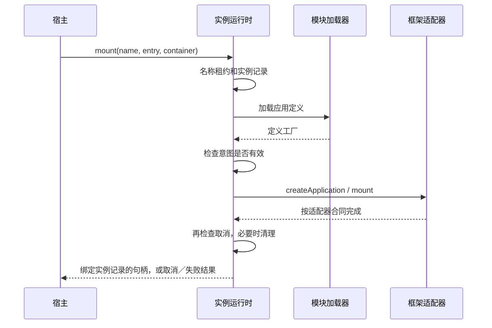

# 架构 02：从零设计一个能解释失败的微前端运行时

[上一章：边界与方案](01-从需求推导微前端边界与方案.md) · [下一章：交付与演进](03-交付安全性能与演进决策.md) · [可运行实验](../FOUNDATION-EXPERIMENTS.md)

这里设计的是可信原生 ESM 应用的教学通道。它不是一个完整沙箱产品，价值在于让你亲自回答加载、创建、渲染、取消与清理之间的关系。完整最小实现位于 [runtime.mjs](../foundations-lab/runtime.mjs)，不导入 MicroApp。

## 1. 先定义交付物，不从一个模糊 URL 开始

完整的应用定义至少应能回答下面这些问题。

```text
definitionId / version：哪份定义，怎样稳定识别字节
format：native-esm | classic-html | remote-container | document-frame
entry：绝对入口以及依赖资源的基址约定
framework：必要的适配器协议与运行时要求
dependencies：内置哪些依赖，要求宿主共享什么及允许版本
capabilities：需要宿主授予哪些能力
style / route：样式根与导航所有权
protocolVersion：生命周期与消息的版本
```

这是目标定义，教学实现为了看清状态，只接收 name、entry、container、props、capabilities。不能因为示例省略了 manifest，就认定生产不需要它。

格式决定加载器接口。原生 ESM 走 import；远程容器可能需初始化共享 scope 后 get 模块；整页 iframe 走导航与握手；HTML 兼容通道需解析与处理资源。不要先设计一个 `downloadString()`，再把所有格式勉强塞进去。

## 2. 三个生命周期层：definition、instance、work

定义被加载和求值后，可以用于很多实例；每个实例内部还会有多次工作。

```text
definition player@7
  ├─ instance A → mount #1 → chapter request 1 / request 2
  │              → unmount
  │              → mount #2（是否同实例复用要有约定）
  └─ instance B → 独立 root / state / cleanup
```

因此至少要有两张状态表：定义加载表与实例表。工作有效性可以由适配器／业务管理，不强迫所有请求共享一个全局令牌。

教学实现的 `definitions` Map 按 entry 缓存加载 Promise；`instances` Map 保存 name 对应的实例记录；`containers` WeakMap 以容器引用记录租约。它们分别控制定义复用、名称占用与容器排他。原生 import 本身还有模块缓存；删除一张自己的 Map，并不等于清空浏览器模块记录。

## 3. 框架适配器应该交付什么

我们选择工厂形态：

```js
export function createApplication() {
  return {
    mount(container, props, capabilities) { /* 创建这一实例的框架根 */ },
    unmount() { /* 幂等释放这个实例确实拥有的资源 */ },
  }
}
```

Vue 适配器内部可以每次创建 app、设置 provide／插件、挂载；React 适配器内部创建 root、render，并在退出时 root.unmount。实例构造、框架提交和业务 ready 不能因为统一成一个函数就自动变得同步。

这需要把完成语义写清楚：

| 层次 | 何时算完成 | 实现者 |
| --- | --- | --- |
| 接受／提交渲染请求 | mount 已把工作交给对应框架 | 适配器 |
| 框架提交到 DOM | 框架完成约定的 commit／patch | 对应框架回调或适配器显式观测 |
| 业务 ready | 关键数据和能力满足业务约定 | 子应用发出带有效工作身份的信号 |

React 的提交型 mount 不能只 `return Promise.resolve()` 就被叫作“DOM 已提交”。若宿主需要后两种信号，必须额外设计错误、取消、永不就绪和多次更新后的信号语义。教学运行时只尊重适配器的返回合同，不替它推断真实业务 readiness。

## 4. 一次 mount 的推导与执行

最小顺序应当是：

1. 校验定义和目标容器，取得实例名称／容器租约。
2. 等待定义加载；期间实例仍可能被取消。
3. 再次检查意图，失效时不创建实例。
4. 调用工厂取得独立实例对象，开始 mount。
5. mount 返回后再次检查意图；若已经失效，清理刚创建的对象。
6. 仅对有效实例交付控制器，控制器绑定这个对象的记录。



输入输出可对应 [runtime.mjs](../foundations-lab/runtime.mjs) 中 `mount` 的两个 await 和两次 signal 检查。浏览器还会做模块的加载与求值；我们没有用一张外部状态表替代它。

容器校验在教学实现中只检查非空对象引用，并按对象身份排他；不使用跨 realm 容易误判的 `instanceof Element`，也没有完整证明该对象是可用 DOM 容器。真实 DOM 操作能力由框架适配器验证，生产注册层还应约束可分配区域。失败、取消完成后释放租约；cleanup_failed 保留名称和容器，旧句柄清理则不能删掉新记录的租约。

若生产适配层为同一物理节点创建多个不同Proxy引用，单凭WeakMap引用身份也无法识别它们等价。应由宿主发放规范化容器或明确租约令牌，再交给适配器；不要把教学对象排他扩大成任意DOM代理环境下的完整所有权证明。

## 5. 为什么控制器应绑定对象，而不是只绑定 name

假设旧 A 已退出，同名新 A 创建成功，用户迟到地调用旧控制器 unmount。如果其实现只是 `runtime.unmount('A')`，就可能找到新 A。

教学实现返回的句柄闭包捕获旧 record：`unmount: () => dispose(record)`。删除实例表时又检查 `instances.get(name) === record`，确保旧记录不能删除同名新记录。清理函数也保存本实例的幂等状态。

这不是“加一个自增 ID 就解决所有竞态”。关键是把 ID／对象身份用于实际查找与删除规则，而不是只把它打印在日志里。对应测试明确执行“旧 A 退出 → 新 A 创建 → 再次调用旧句柄 → 新 A 保留”。

## 6. 取消意图、取消操作与完成清理分别是什么

`cancel(name)` 在教学实现中只设置取消信号。它不声称能撤销原生 import，也不等于调用框架 unmount。加载回来后，运行时根据意图决定是否创建；mount 中取消，则在适配器返回后清理。

调用 unmount 则等待该记录的未决工作并清理它。若底层永不结束，这个最小实现也会一直等待：它保留名称，不偷偷复用一个尚未处理完的身份。生产还需要可观测超时、隔离未决工作、人工／自动恢复策略，不能靠 `Promise.race` 直接宣称清理完成。

一条合理状态路径是：

```text
loading → mounting → mounted → unmounting → unmounted
   ↘ cancelled-before-create
              ↘ cancelled-after-mount → cleanup
   ↘ failed → cleanup
                 ↘ cleanup_failed（保留隔离记录，禁止无声复用）
```

这张图表示设计状态，不是某个现成库的状态枚举。教学实现为了保持短小，部分中间阶段记录在事件表而不单独写入 status。

## 7. 失败处理也有所有权

三个输入需要不同处理：

| 失败点 | 已经拥有的资源 | 正确结果 |
| --- | --- | --- |
| 定义加载失败 | 加载记录、名称租约 | 保留原始拒绝；不要创建视图，按策略释放或隔离租约 |
| 适配器 mount 失败 | 已创建的 app／root／订阅可能部分存在 | 调适配器 cleanup，再向调用者报告失败 |
| cleanup 又失败 | 仍可能残留资源 | 两份原因都保留，记录 cleanup_failed，不假装干净退出 |

教学实现使用 AggregateError 保存 mount 与 cleanup 两个原因；清理失败的记录继续占用 name。这个示例没有自动修复或强制回收隔离实例；它选择让失败可见，交由更高层处理。

还应约定重试语义。浏览器可能缓存某些模块失败，自己重置定义 Map 不保证相同 URL 的 import 重试得到新字节。重试必须按错误类型与版本策略设计，不能所有失败都加随机 query。

## 8. 数据与能力通过边界时怎样约束

props 用来描述状态，capabilities 用来授予操作；二者都要有版本与所有权。

```text
props = { chapterId, locale, ... }
capabilities = {
  loadChapter(id, signal),
  subscribeSession(callback) -> unsubscribe,
  reportReady(workIdentity),
  signal
}
```

这是接口草图，不是实际平台 SDK。对于同页可信代码，传函数引用很方便，但宿主需要定义有效期：旧应用退出后保留的函数还能不能调用？订阅由谁取消？结果是否允许回填？跨源边界则不能直接传普通函数，通常要转为消息／RPC 协议，处理请求 ID、来源、版本、错误、取消与超时。

如果允许传框架组件、Context、VNode、ref 或 reactive 对象，就主动引入了框架运行时身份耦合。它可能是某些产品的合理选择，但不应混进“通用 JSON 数据”的假设里。

## 9. 路由和样式应是协议，而非任意全局补丁

第一步可以由宿主独占 URL，子应用使用 memory history 并通过能力请求导航；第二步再设计可分享路径映射。只有明白框架路由如何接入 history 后，才评估是否需要浏览器 API 虚拟化。

样式同样可以先要求明确应用根、CSS Modules／约束命名、可控弹层容器。若要更强的样式边界，再评估 Shadow DOM 或独立 document。不能先选一个选择器 parser，再宣布它就是完整样式架构。

## 10. 用测试证明设计，而不是用测试背实现

[runtime.test.mjs](../foundations-lab/runtime.test.mjs) 直接注入可控制的定义加载与适配器，不需要真实网速。测试的对象是下面这些用户可观察合同：

- 同一份定义只加载一次，A/B 却产生两个实例。
- 加载中取消不创建实例；未结算名称不能被第二个请求占用。
- mount 过程中取消，返回后发生一次清理，不发有效句柄。
- 旧句柄重复卸载不会影响新的同名实例。
- 挂载失败会清理；清理失败保留两个原因与隔离记录。
- 不同 name 也不能占用同一容器；正常退出可转交，旧句柄不能释放新租约；缺容器在加载前失败。

再由浏览器实验验证 native entry 实际能创建两个 DOM 实例；React／Vue 的实验独立验证适配器需要承担的渲染语义。这两层结果缺一不可，不能用纯函数测试替代框架真实执行。

## 11. 这个最小设计明确没有解决什么

它没有 JS／CSS 安全沙箱、HTML 资源抽取、跨域授权、模块卸载、完整路由协调、生产 manifest、依赖协商、HMR、版本灰度、内存预算和自动恢复。它也没有完整的 props update／activation 协议。

这些缺口不是藏起来的 TODO，而是下一层架构输入。你现在应该能指出每项应由哪个模块负责、增加它会改变哪条不变量。掌握这一点之后，分析复杂框架才不会只剩下记文件名和开关。
