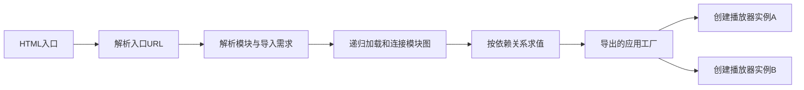

# 基础 01：浏览器模块系统决定了什么才是“同一份应用”

[课程入口](../README.md) · [下一章：执行环境与调度](02-浏览器执行环境调度与安全边界.md) · [底层实验](../FOUNDATION-EXPERIMENTS.md)

先暂时拿掉任何微前端框架。你有两栏播放器，都由同一套代码实现。浏览器究竟会执行入口一次还是两次？代码只执行一次，是否还能创建两个应用？把入口加上随机参数，能否得到安全隔离？这些问题必须先于选择沙箱。

本章区分五件事：**源码文件、模块记录、代码求值、运行实例、渲染根**。它们没有一一对应关系。

## 1. 从一张 HTML 到一张可执行模块图

假设部署目录是：

```text
https://cdn.example.test/player/v7/index.html
https://cdn.example.test/player/v7/entry.js
https://cdn.example.test/player/v7/runtime.js
https://cdn.example.test/player/v7/chunks/lyrics.js
```

HTML 声明 `<script type="module" src="./entry.js">`。entry 中又声明 `import { createPlayer } from './runtime.js'`。这里至少发生四层处理：

1. HTML 处理脚本元素，把 src 解析为入口 URL。
2. JavaScript 解析 entry，取得静态导入需求。解析不等于执行它的业务函数。
3. 宿主加载并连接依赖，建立 import/export 绑定关系。找不到导出可以在业务执行前失败。
4. 对依赖图求值，初始化模块状态；由应用代码决定是否创建视图、订阅与请求。



JavaScript 规定模块记录、连接和求值；浏览器宿主还负责 URL、请求与模块映射。不要把这两层混成“浏览器 eval 一个 JS 字符串”。[ECMAScript 模块语义](https://tc39.es/ecma262/multipage/ecmascript-language-scripts-and-modules.html#sec-module-semantics)、[HTML 模块解析与加载](https://html.spec.whatwg.org/multipage/webappapis.html#module-specifier-resolution)是两层依据。

这立即导出一个微前端要求：加载器必须说清自己交付的是 **HTML 文本、经典脚本，还是原生模块图**，每种交付物需要的链接与执行协议不同。

## 2. 变量有三种常被混淆的存放位置

经典脚本的顶层 var、全局词法声明和 ES 模块中的声明并不等价。下面用独立测试页面推导，不在带现有全局变量的业务页运行。

```html
<script>
  var classicName = 'classic';
  let lexicalName = 'lexical';
  console.log(window.classicName); // classic
  console.log(window.lexicalName); // undefined
</script>
<script type="module">
  const moduleName = 'module';
  console.log(window.moduleName); // undefined
  console.log(this);              // undefined
</script>
```

模块代码默认严格，拥有模块环境；它仍能访问可见的浏览器全局对象，却不会因每个模块都有私有绑定而拥有自己的 document 或 location。

因此“使用 ESM”能避免许多顶层命名冲突，却没有提供 DOM、CSS、导航、原型或网络权限隔离。给一个库导出函数和给一段脚本包上函数，处理的也不是完全相同的执行环境。

再看 `new Function`：它按函数体语法解析文本，不会为里面的静态 import 建立原生模块记录；其外层词法环境也不是调用者局部闭包。把含 `import ... from ...` 的 Vite 开发代码塞进它，不能靠加 window 参数补齐模块链接器。动态 import 是另一种表达式，但仍需要可解释的模块基址与宿主行为。

这些语言层差异可对照 [模块的严格模式与作用域](https://developer.mozilla.org/en-US/docs/Web/JavaScript/Guide/Modules)、[Function 构造器](https://developer.mozilla.org/en-US/docs/Web/JavaScript/Reference/Global_Objects/Function/Function)。

## 3. live binding：导入的是绑定，不是拷贝

考虑两个文件：

```js
// counter.js
export let count = 0
export const initial = count
export function increment() { count++ }
```

```js
// reader.js
import { count, initial, increment } from './counter.js'
increment()
console.log(count, initial) // 1 0
```

count 指向模块导出的可变绑定，initial 在初始化时保存了当时的数字。导入者不能直接给 count 赋值，但可通过模块提供的方法触发原绑定变化。

这对共享状态的影响比“多个应用 import 同一个库”更具体：如果这个库在模块顶层导出一个 store，多个消费者可能真的连到同一份状态；如果导出 `createStore()`，每次调用则能创建独立状态。是否共享由模块身份与 API 共同决定，不由文件夹名决定。

循环依赖也由绑定初始化顺序决定。A/B 可以在连接阶段互相取得绑定，但若求值时读取尚未初始化的 let/const，会出现暂时性死区问题。循环不是必然错误；把读取推迟到所有模块初始化之后，可能成立。架构上应避免让宿主和插件在顶层互相启动对方，否则一个看似普通的 import 会变成难以推导的启动环。

### 解析、连接和求值失败应分别诊断

| 输入错误 | 更早失败的阶段 | 为什么不是同一类“应用白屏” |
| --- | --- | --- |
| 普通函数体里放静态 import | 语法解析 | 还没有合法模块记录和应用工厂 |
| import 一个不存在的导出 | 模块连接 | 文件可能全部可下载，但绑定无法成立 |
| 循环中提前读取未初始化绑定 | 求值 | 图能连接，实际初始化顺序不满足读取 |
| 工厂可取但 mount 抛错 | 应用执行 | 模块系统已完成自己的合同，失败由应用适配器处理 |

把这些错误都交给一个外层 timeout 会丢掉真正原因。构建工具可以提前发现其中一部分，但运行时远程图和版本混用仍可能在客户端暴露。

### top-level await：入口请求完成后，还可能在等整张图

```js
// configuration.js，原生模块
export const config = await fetch('/configuration.json').then(r => r.json())
```

导入它的模块需要等待相应异步求值完成，不能因为字节下载结束就使用尚未就绪的导出。独立依赖分支可以继续推进，但依赖这份结果的分支受约束；错误也沿模块求值结果传播。[V8 的 top-level await 原理](https://v8.dev/features/top-level-await)解释了这套图上的等待行为。

这使 `await import(entry)` 的含义更清楚：它等待的不只是一个 HTTP 请求，还包括该图相应的连接／求值。若顶层工作永不结束，宿主外层加超时不会自动撤销它。相互动态导入再互相等待，还可能引入无法完成的依赖关系。

将整个产物改成 async Function 不等价于支持原生 top-level await：模块绑定、依赖图、referrer和求值缓存仍需要真正的模块系统。若产物目标不支持这种语义，构建阶段也应明确拒绝或限定支持范围，不能把失败留给含糊的沙箱选项。

## 4. URL 身份不是文件字节身份

在同一浏览器文档的模块环境中，对同一已解析 URL 的重复 import 通常复用同一模块实例；换一个 query 会得到不同的模块身份。不能把这个规则简化为“整个浏览器进程里所有同 URL 都共用同一个对象”：不同文档／realm 还有各自环境。[动态 import 的缓存与命名空间](https://developer.mozilla.org/en-US/docs/Web/JavaScript/Reference/Operators/import)给出了相关边界。

```js
const a = await import('/modules/counter.js')
const b = await import('/modules/counter.js')
const c = await import('/modules/counter.js?instance=other')
console.log(a === b) // 同一环境、同一解析地址时为 true
console.log(a === c) // false
```

query 只能影响对应模块节点的身份，**不会自动复制整张依赖图**。如果这两个入口都静态导入同一地址 `/shared/react.js`，依赖仍可能收敛到一份模块记录。反过来，两个入口即使版本字符串相同，最终解析到不同地址，也可能装载两份 React。

例如 `/player/entry.js?copy=a` 与 `?copy=b` 都写 `import './shared.js'`，相对解析通常得到同一个 `/player/shared.js`，而不是自动附上两个入口的 query。下载缓存、模块映射与对象状态应分别观察：服务器对这两个 query 返回相同字节，仍不意味着模块身份相同。

所以用随机 query“隔离应用”会造成两个问题：顶层初始化反复执行，可能累加副作用；一些共享依赖仍旧共享，安全与状态边界并未因此闭合。长期还可能让模块图持续增长。原生 ESM 没有与 import 对称、可让宿主任意清空模块记录的标准 `unimport()`。

## 5. 用工厂把代码身份和实例身份拆开

错误的多实例设计往往在模块顶层保存唯一 app、唯一 container 或唯一 currentUser。

```js
// 这个文件即使被两个插槽使用，也只有这一份闭包状态。
let currentContainer
export function mount(container) { currentContainer = container }
```

更可推导的接口是：模块导出工厂，工厂为每个实例分配自己的闭包。

```js
export function createApplication() {
  let container = null
  let cleanup = () => {}
  return {
    mount(target, capabilities) {
      if (container) throw new Error('instance already mounted')
      container = target
      // 构建视图；每个实例获得自己的回调、状态和释放清单。
      cleanup = startView(target, capabilities)
    },
    unmount() {
      cleanup()
      cleanup = () => {}
      container = null
    },
  }
}
```

这是协议示意，startView 由具体框架适配器提供。代码只求值一次，也能创建 A/B 两个实例；模块缓存保留而实例退出，是正常且有用的生命周期组合。[基础实验](../FOUNDATION-EXPERIMENTS.md)中的原生插件就是这个结构。

Vue 的 `createApp`、React 的 `createRoot` 还会创建各自的运行与渲染状态。它们与这里的业务工厂相关，但不是同一层身份。下一轮必须继续问：框架根是否可以复用、context 谁持有、组件退出会停掉哪些副作用。

## 6. CommonJS 与 Webpack 为什么不是原生 ESM 的别名

CommonJS 常把文件转换为函数包装，执行后导出 `module.exports`；宿主 require 缓存决定模块执行与复用。原生浏览器没有直接提供 Node 的 require、文件解析器和这套缓存协议。

Webpack 则可以在浏览器里生成自己的模块表、缓存、异步 chunk 加载器和共享容器。相同源码经过打包之后，业务依赖可能由 Webpack runtime 连接，而不是浏览器逐个解析原始 import。此时 `publicPath`、chunk runtime 的全局名称和共享 scope 就会影响加载身份。

两套链接器可以共存，但不能凭 `.js` 后缀判断调用方式。第 03 章会沿产物解释 Vite／Webpack；现在先保留一条因果链：

```text
源码采用哪种模块语法
  → 构建器把它变成什么格式
  → 部署后由哪个加载器解析依赖
  → 谁缓存代码、谁保存实例状态
  → 谁能真正释放副作用
```

## 7. import 成功与应用启动成功是两个结果

一个模块可以成功求值并导出工厂，但工厂 mount 失败；也可以在 import 时就启动一个全局 timer，随后 mount 失败。销毁容器既不会撤销模块求值，也不会自动停止那个 timer。

推荐把模块顶层限制为定义与确有必要的静态初始化，把可撤销的工作放进明确生命周期。若宿主已取消挂载，不能取消原生 import 本身的所有底层工作，就必须在 await 之后重新检查意图是否有效，再决定是否创建实例。

```js
const definition = await import(entryUrl)
if (signal.aborted) return // 不创建已失效实例；不宣称模块求值被撤销
const instance = definition.createApplication()
await instance.mount(container, capabilities)
```

这仍不是完整运行时：mount 本身若异步，也要处理过程中取消、失败与清理；控制器应绑定实例对象，不能只依靠一个可复用的名字。后续独立架构设计会补齐协议。

## 8. 本章推导出的微前端设计约束

1. 定义描述应包含格式与版本，不能只有一个没有含义的 URL。
2. 加载定义与创建实例分离，允许一份代码产生多个应用。
3. 共享依赖应按实际模块身份验证，版本号相同不是充分条件。
4. 模块顶层副作用需要明确所有者；不能寄望销毁视图撤销 import。
5. 选择 HTML／经典脚本／ESM／远程模块容器，会改变链接器责任，不等于只换下载函数。

<details>
<summary>自测：给入口加 ?v=2，就能让两个播放器完全隔离吗？</summary>

不能。入口模块可能被复制，而相同依赖 URL 仍共享；DOM、CSS、history、同源存储与原型也没有因此分开。正确设计要先明确希望隔离的维度，再决定模块工厂、依赖策略、DOM 根及执行环境。若目标仅为同代码多实例，通常先用实例工厂，不为每次挂载制造一份新模块图。

</details>
