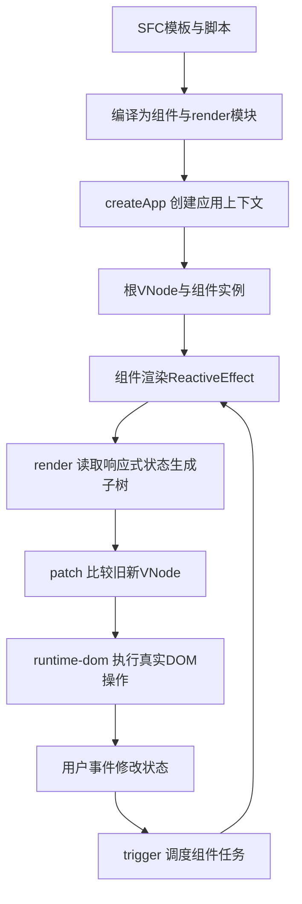

# 04 Vue：从模板编译、响应式依赖到应用退出

[返回全书入口](../README.md) · [本章证据与版本](../research/vue-evidence.md) · [构建与模块图](03-Vite与Webpack如何决定应用加载.md)

先暂时拿掉所有微前端框架。一个页面上有两个由不同团队交付的 Vue 播放器：A 展示章节一，B 展示章节二。我们需要回答：它们为何会更新，更新谁的 DOM，为什么共享一份 Vue 仍能有独立配置，移除容器后为什么有些工作还在继续。只有把这些答案推导出来，才有依据设计微前端的挂载、隔离和退出协议。

本章不是 Vue API 目录。每一段都沿同一条因果链：**源码或产物是什么 → 谁持有状态 → 什么触发下一步 → 对微前端契约提出什么要求**。

## 1. 版本先钉住：三个项目不是同一个 Vue

| 本地材料 | 能确认的版本 | 不能据此认定 |
| --- | --- | --- |
| [Vue CLI 子应用 package.json](../../packages/micro-app2/dev/children/vue3/package.json) 与其 [yarn.lock](../../packages/micro-app2/dev/children/vue3/yarn.lock) | 声明 `vue:^3.2.37`，该锁文件固定 Vue/runtime-core 3.2.37；compiler-sfc 还出现单独的 3.2.26 记录 | 声明范围不是本机正在执行的版本；该 demo 当前没有安装的 node_modules/vue |
| [main-vite package.json](../../packages/micro-app2/dev/main-vite/package.json) 与其 [pnpm-lock.yaml](../../packages/micro-app2/dev/main-vite/pnpm-lock.yaml) | 声明 `vue:^3.4.21`，独立锁固定 3.4.21 | 不能把这个子目录的锁当成根 pnpm 工作区已经安装它的证明 |
| [docs-new 已安装 Vue](../../docs-new/node_modules/vue/package.json) | 本次实际读取为 3.5.44，`dist/vue.global.js` 存在 | 这是本机文档工具链的现成依赖，不是所有主题插件的线上 Vue 版本 |

原理走读固定到 [vuejs/core v3.5.44](https://github.com/vuejs/core/tree/v3.5.44)。公开的组合式 API 原理可以跨版本理解，内部字段、调度与异步 scope 处理仍要按版本检查。尤其 3.5.44 的依赖结构使用 `Dep/Link`；把早期教学图里的 `WeakMap → Map → Set<effect>` 原样当成这版源码是不准确的。

## 2. `.vue` 文件为什么不能直接“放进页面执行”

一个单文件组件通常同时包含三种不同语言：

```vue
<script setup>
import { ref } from 'vue'
const count = ref(0)
</script>

<template>
  <button @click="count++">{{ count }}</button>
</template>

<style scoped>
button { color: darkgreen; }
</style>
```

浏览器不能把整个文件当 JavaScript 解析。构建器调用 SFC 编译器拆分 descriptor：script 形成组件 setup 逻辑，template 形成 render 函数，style 走 CSS 转换；插件再组织导入和导出。这个过程中产生的是一个**模块图**，并非“一份 HTML 里塞了 Vue”。

先只编译 template。此次对本地 compiler-sfc 3.5.44 实际调用 `compileTemplate`，得到的代码具有下面的结构：

```js
// 省略编译器生成的事件缓存等细节，只保留关键关系。
import { toDisplayString, openBlock, createElementBlock } from 'vue'
export function render(ctx) {
  openBlock()
  return createElementBlock('button', {
    onClick: () => ctx.count++,
  }, toDisplayString(ctx.count), 1 /* TEXT */)
}
```

这里有四个容易被忽略的事实。

1. `render` 的结果是 VNode，不是已经插入页面的 DOM。
2. helper 来自模块导入的 Vue 实例。修改 `window.Vue` 不会自动替换这个已经链接好的导入。
3. 模板表达式在渲染执行时读取状态；依赖收集发生在这一段执行中，不发生在“下载 .vue 文件”时。
4. 编译器把动态点编码进产物，例如 TEXT 标记。运行时利用它缩小需要检查的内容，但仍须有正确的应用实例、容器与旧 VNode。

源码入口是 [compiler-core/compile.ts 的 baseCompile](https://github.com/vuejs/core/blob/v3.5.44/packages/compiler-core/src/compile.ts)：`baseParse → transform → generate`。更上层的 [compiler-sfc/compileTemplate.ts](https://github.com/vuejs/core/blob/v3.5.44/packages/compiler-sfc/src/compileTemplate.ts) 选择对应编译器、传递选项并产生映射。AST、transform、codegen 分工不同：前者解释语法，中间阶段识别指令与动态关系，最后生成可执行的 JS。

**推导出的架构要求：** 微前端不能只约定“入口能下载”。还应知道入口是原生模块、打包后的经典脚本还是需要构建工具转换的源码，依赖解析谁负责，CSS 与动态 chunk 如何定位。把带 import 的 Vue 编译产物塞进任意 `new Function`，连 JavaScript 语法与链接阶段都可能没过，谈不上框架挂载。

## 3. 从 render 函数到 DOM：谁在驱动更新

Vue 的核心 renderer 并不先假定 DOM；它接收一组宿主操作。runtime-dom 提供创建元素、插入、移除、设置属性与事件等浏览器实现，runtime-core 负责解释 VNode 与组件关系。



第一次挂载的主要路径可以这样读：

```text
runtime-dom.createApp(...)
  → ensureRenderer().createApp(...)
  → createAppAPI 产生 app 与 appContext
  → app.mount(container)
  → 根 VNode 记录 appContext
  → render / patch / processComponent
  → mountComponent / setupComponent
  → setupRenderEffect
  → componentUpdateFn 首次执行
  → renderComponentRoot 产生 subTree
  → patch(null, subTree, container)
```

随后更新，不是再创建一个 app：组件的渲染 effect 重新执行，拿新子树与 `instance.subTree` 进行 patch。关键文件是 [runtime-dom/index.ts](https://github.com/vuejs/core/blob/v3.5.44/packages/runtime-dom/src/index.ts)、[apiCreateApp.ts](https://github.com/vuejs/core/blob/v3.5.44/packages/runtime-core/src/apiCreateApp.ts)、[renderer.ts](https://github.com/vuejs/core/blob/v3.5.44/packages/runtime-core/src/renderer.ts)。

在 `setupRenderEffect` 中，3.5.44 把 `componentUpdateFn` 放进 `ReactiveEffect`，给它设置 scheduler，scheduler 把带组件身份的 job 送进 `queueJob`。因此组件实例、渲染 effect、VNode、DOM 不是四个独立对象：它们组成了可回收的所有权链。

**对微前端的要求：** 宿主交出一个明确的 DOM 容器，子应用持有自己的 app/root；宿主应调用子应用的退出接口，让这条链被 renderer 正式解除。宿主擅自 `container.innerHTML = ''` 只改变树，不等于 renderer 已经忘记组件、停止 effect 或执行生命周期。

## 4. 响应式到底记录了什么

### 4.1 先建立最小关系，再看真实结构

假设状态是 `reactive({ count: 0 })`。组件 render 执行时读 `state.count`，必须把“这个对象的 count 影响这个组件渲染”记下来。修改 count 时才能找到需要重新计算的订阅者。

教学关系是：

```text
原始对象 target
  → key "count"
  → 依赖 Dep
  → 当前订阅者：组件渲染 effect、computed 或 watcher
```

Vue 3.5.44 的 [baseHandlers.ts](https://github.com/vuejs/core/blob/v3.5.44/packages/reactivity/src/baseHandlers.ts) 在相关读取路径调用 `track(target, GET, key)`，写入后按新增／修改等情况调用 `trigger`。[dep.ts](https://github.com/vuejs/core/blob/v3.5.44/packages/reactivity/src/dep.ts) 的 `targetMap` 是按原始对象分区的 WeakMap，下面是 key 到 Dep 的映射；Dep 与订阅者之间使用 Link 记录双向依赖关系及版本等信息。它不只保存一个“值变了”的布尔量。

[effect.ts](https://github.com/vuejs/core/blob/v3.5.44/packages/reactivity/src/effect.ts) 在 `ReactiveEffect.run` 周围设置并恢复 `activeSub`、跟踪状态和依赖集合。一次运行结束后，会清理不再被本次执行使用的依赖。

### 4.2 条件依赖解释了“为什么不是所有更新都重渲染”

```js
const state = reactive({ advanced: false, basic: 1, detail: 10 })
const label = computed(() => state.advanced ? state.detail : state.basic)
```

当 advanced 为 false，当前计算需要 basic，不需要 detail。切为 true 后，下一轮依赖转向 detail。响应式依赖由实际执行的读取决定；不是编译器提前扫描完所有变量后永久订阅全部字段。

这还解释两个故障：解构出一个基本值后，你拿到的是那次读取的值，不是自动跟随原属性的连接；把同一个原始对象和代理对象混用，可能绕过原本预期的读取／写入路径。跨微应用共享数据时，需要明确传的是普通快照、可变对象还是某一套 runtime 的响应式代理。

**架构推导：** 用普通数据快照和显式更新协议跨应用传递，耦合面通常更清楚。若决定共享 reactive store，就必须同时约定 runtime 身份、版本、写入权、订阅退出和错误处理；“都叫 Vue 3”不足以成为协议。

## 5. 调度、nextTick 与浏览器显示不是同一个时刻

下面代码的关键不在 count 最后为 2，而在什么时候更新 DOM。

```js
state.count = 1
state.count = 2
console.log(container.textContent) // 此刻不应假定已经完成这一轮组件patch
await nextTick()
console.log(container.textContent) // 通常可观察本轮Vue DOM更新后的2
```

当前 [scheduler.ts](https://github.com/vuejs/core/blob/v3.5.44/packages/runtime-core/src/scheduler.ts) 的主关系是 `queueJob → queueFlush → resolvedPromise.then(flushJobs)`。同一个 job 的排队有去重与顺序约束；组件任务可按身份组织，watcher 还有 pre/post/sync 等不同调度策略。`nextTick` 基于当前 flush Promise 或已 resolve 的 Promise，等待 Vue 调度的一轮处理。

必须分开这四个时刻：

| 时刻 | 已发生什么 | 还不能推出什么 |
| --- | --- | --- |
| 修改响应式值 | JS 内存中的值变了，相应订阅者获通知／调度 | DOM 已更新 |
| Vue flush | 队列中的相关渲染／回调完成处理 | 浏览器已经把像素绘制到屏幕 |
| nextTick 后 | 当前 Vue flush 的等待已结束 | 所有外部请求、第三方库动画或另一应用工作都完成 |
| 浏览器后续渲染机会 | 可能进行样式、布局与绘制 | 给这个页面建立了跨应用事务或统一 ready |

本次在本地 Vue 3.5.44 实际运行一个 effectScope 内的 watchEffect：初始读 0，同步把 ref 改为 1、2，再等待 nextTick，观察为 `[0, 2]`；stop scope 后改为 3 不追加。这验证了该样本的排队合并与 scope 停止，不意味着任意 watcher 模式都只有一次触发。

**对微前端的要求：** `mount()` 的 Promise 需要明确承诺什么。返回 `nextTick()` 可以表达“我请求的这轮 Vue DOM 更新可观察”，不能暗示内容 API、所有 Teleport、浏览器绘制或其他框架也已经就绪。布局协同应约定测量时机；业务 ready 必须另有语义。

## 6. keyed diff 的核心是身份，不只是更快

用 A、B、C、D 四个播放器条目举例，旧列表 `[A,B,C,D]` 变成 `[B,A,D,C]`。如果 key 是稳定业务 ID，renderer 可以识别哪些 VNode／组件保留、哪些移动、哪些新建或卸载。这样输入框、局部状态与外部播放器对象才继续跟随同一个条目。

3.5.44 [renderer.ts 的 patchKeyedChildren](https://github.com/vuejs/core/blob/v3.5.44/packages/runtime-core/src/renderer.ts) 大致依次处理头尾已对齐项、纯新增／删除、剩余区间的 key 映射；必要时用 `getSequence` 找到可保持相对顺序的子序列，减少真实移动。不同节点类型及编译优化标记会改变实际分支，不能把每次列表更新都画成完整的一次 LIS。

如果你把数组下标当 key，交换条目时组件身份可能按位置保留，再换成新 props；看起来“数据到了B，输入状态却像A”，根因可能完全在 Vue 列表身份中，与沙箱无关。

进一步推导：Vue 的 `key`、微应用 `name`、平台资源 ID 各自位于不同层。稳定 key 不能修同名微应用冲突；唯一微应用 name 也不能修子应用内部错误列表 key。设计架构要把身份逐层分开，而不是要求一个字符串承担所有角色。

## 7. 多个 createApp 共享什么，不共享什么

`createApp()` 不会为你创建新的浏览器 window、document 或 JavaScript realm。它创建一份 Vue 应用上下文。

[apiCreateApp.ts](https://github.com/vuejs/core/blob/v3.5.44/packages/runtime-core/src/apiCreateApp.ts) 的 `createAppContext` 包含 config、全局组件／指令注册、provides 和若干缓存；每次 createApp 得到新的 context。根 VNode 带上它，组件实例继承所属应用或父组件上下文。

```js
const appA = createApp(Player, { name: 'reader-a' })
const appB = createApp(Player, { name: 'reader-b' })
appA.provide('theme', 'green')
appB.provide('theme', 'orange')
appA.mount(containerA)
appB.mount(containerB)
```

同一份 Vue runtime 可以支持上述两个 app，它们的注入和应用级注册不因为共用一份依赖就自动合并。[apiInject.ts](https://github.com/vuejs/core/blob/v3.5.44/packages/runtime-core/src/apiInject.ts) 沿组件／app provides 查找；它不是在全页面 DOM 上向上找属性。

但下列对象仍可能共享：同一模块导出的 store；插件实现自己写在模块外的 Set；window 上的服务；document.body；CSS、Cookie 与网络。插件的“每个 app.use 都记录一次安装”与“插件内部状态每 app 一份”也不是同一件事。插件若在模块顶层建立全局连接，appContext 隔离无法替它复制连接。

**容器契约还要明确：** Vue 普通 mount 会接管容器内容；同一容器不能同时交给两个 app 当独立根。将宿主自己的按钮、状态和子应用根混在同一个由子 renderer 接管的内容区，可能被一次 mount 清空。入口应接收真实 Element，而不是到全局 document 猜 `#app`。

**重挂载规则：** 一个 app 实例用于一次挂载生命周期。`app.unmount()` 后，要再次进入就重新 createApp；不要以为 unmount 自动把旧 app 的 isMounted 恢复成可重复 mount 的初态。源码 mount 分支仍会阻止旧 app 重挂。共享“组件定义与代码”可以，复用“已退出的 app 实例”不可以。

## 8. 卸载为什么能停止部分工作，却不能停止所有工作

### 8.1 组件 scope 是自动清理的关键

组件实例持有 EffectScope；渲染 effect 和在合适活动 scope 中创建的响应式工作被记录进去。退出路径中的 `unmountComponent` 会执行 beforeUnmount，`scope.stop()`，标记 job 不再调度，递归卸载子树，再安排 unmounted 钩子。`scope.stop()` 会停止自己记录的 effects、执行 scope cleanup，并处理其子 scopes。见 [component.ts](https://github.com/vuejs/core/blob/v3.5.44/packages/runtime-core/src/component.ts)、[renderer.ts](https://github.com/vuejs/core/blob/v3.5.44/packages/runtime-core/src/renderer.ts)、[effectScope.ts](https://github.com/vuejs/core/blob/v3.5.44/packages/reactivity/src/effectScope.ts)。

这是一套**记录与拥有关系**，不是全页面垃圾回收开关。

| 工作 | 默认怎样绑定 | 应用退出还要做什么 |
| --- | --- | --- |
| 同步 setup 中创建的 computed/watch/watchEffect | 通常记录在组件活动 scope | 正常 app.unmount，让 Vue 走退出链 |
| 原生 setInterval、window listener、WebSocket、第三方播放器 | 不因“写在 setup”自动成为响应式 effect | 在 onUnmounted／onScopeDispose 等合适位置显式 clear/remove/close/dispose |
| 调用宿主能力注册的回调 | 真正引用可能存在宿主数组中 | 宿主提供取消句柄或按 owner 清理，子应用调用它 |
| 模块顶层创建的 effect／单例连接 | 不天然归属于后来创建的某个 app | 模块或服务提供独立 acquire/release／dispose 合同 |
| 显式 detached effectScope | 与父 scope 自动管理分开 | 持有 scope 并显式 stop，除非有明确其他拥有者 |

### 8.2 “异步创建 watcher”需要精确说明上下文

一个普通回调中的新 watcher 不天然获得之前 setup 的拥有关系：

```js
setup() {
  let stopLate = null
  let alive = true
  onUnmounted(() => { alive = false; stopLate?.() })
  setTimeout(() => {
    if (!alive) return
    stopLate = watchEffect(() => console.log(shared.value))
  }, 100)
}
```

这个示例还应记录并 clear 那个定时器；alive 是防止退出后创建新工作，stopLate 是处理已经创建的工作。二者责任不同。实际项目更适合在同步 setup 先建立 watcher，再在内部判断“数据是否已准备好”，减少孤立创建路径。[官方 watchers 说明](https://vuejs.org/guide/essentials/watchers.html)也专门区分同步与异步创建的拥有关系。

但不能进一步写成“所有 await 后创建的响应式工作都失去 scope”。`<script setup>` 的顶层 await 可以由编译器变换为 `withAsyncContext` 相关调用，显式保存／恢复组件上下文；v3.5.44 还对失效 scope 恢复有具体保护。见 [apiSetupHelpers.ts](https://github.com/vuejs/core/blob/v3.5.44/packages/runtime-core/src/apiSetupHelpers.ts)。普通 setTimeout、任意 Promise.then、手写 async setup 与编译后的顶层 await 不能混为一条规则，必须看实际编译输出和版本。

### 8.3 请求取消、响应失效与 Vue scope 也分开

停止 watcher，不代表已经发出的 HTTP 请求被浏览器取消。取消请求，也不保证已经完成的回调不会提交。一个章节 watcher 应同步注册本轮失效清理，给 fetch 传 signal，结果提交前还验证本轮是否有效；下一次章节选择与整个 app 退出都可能让旧工作失效。

`onWatcherCleanup` 是较新版本 API，不能直接要求 3.2.37 的旧插件使用；它还有同步调用时机要求。跨版本写法可使用 watcher 提供的 cleanup 参数并在恰当时机注册，仍要处理真实浏览器资源与 Promise 拒绝。不要用“Vue会自动清理”跳过信号、所有权和错误协议。

## 9. Vue KeepAlive、DOM 隐藏、微应用缓存是三层不同机制

Vue `<KeepAlive>` 缓存的是其组件树中的组件实例。停用时可以把节点移到存储容器，保留实例和状态；再次激活时移动回来并更新。3.5.44 的 [KeepAlive.ts](https://github.com/vuejs/core/blob/v3.5.44/packages/runtime-core/src/components/KeepAlive.ts) 的 deactivate 路径没有把它变成一次 scope.stop 的真正卸载。

因此仅切换到另一个被缓存组件，不意味着它的 timer、订阅或所有响应式计算暂停。`onActivated/onDeactivated` 是设计暂停／恢复策略的入口；被缓存状态、组件实例和业务活动三者要分别决定。真正被淘汰或应用根退出时，才走对应正式卸载。

| 动作 | 层次 | 可能保留什么 | 不应推断什么 |
| --- | --- | --- | --- |
| `display:none`／隐藏一个 DOM 容器 | 浏览器样式 | 组件、effects、所有连接 | 不可见即停止工作 |
| Vue KeepAlive deactivated | Vue 组件树 | 实例、局部状态、依赖关系 | onUnmounted 已执行 |
| 微前端宿主缓存整个应用 | 宿主运行时 | Vue app、根 DOM、脚本环境，具体看协议 | Vue 自动知道应用被宿主“隐藏” |
| `app.unmount()` | Vue 应用 | 构建代码和外部持有的共享对象仍可存在 | 模块缓存被清空，宿主引用全部释放 |

如果宿主缓存了整个 Vue app，却没有引发组件层的 KeepAlive 切换，`onDeactivated` 不会仅因宿主移走 DOM 自动成为通知。架构必须定义 `suspend/resume` 或等价可见性协议，并让 Vue 适配层翻译为业务暂停，不把几个同名 keep-alive 开关混用。

## 10. Teleport 让逻辑树和物理 DOM 树分开

一个组件可以在自己的 setup 中 inject 应用配置，渲染一个 Teleport，把弹层放到专门的 overlay 根。

```js
return () => h(Teleport, { to: overlayRoot }, [
  h('button', { onClick: close }, '关闭'),
])
```

Teleport 的逻辑父组件仍是原组件：provide/inject、props、组件事件仍沿 Vue 关系处理。真实 DOM 的祖先、层叠上下文、继承样式和原生事件冒泡路径，却由最终插入位置决定；不能把 Vue 自定义组件事件当成浏览器 DOM 冒泡。它们是两套传播机制。[Teleport 官方说明](https://vuejs.org/guide/built-ins/teleport.html)与 [Teleport.ts](https://github.com/vuejs/core/blob/v3.5.44/packages/runtime-core/src/components/Teleport.ts) 中的 target 解析／移动路径支持这个区分。

这正是微前端弹层容易出问题的原因：

- 将 target 写成全局字符串 `body`，可能绕开应用的样式前缀与退出范围。
- 将 target 放在另一个 document／realm，还要面对节点构造器、事件与样式边界。
- 一个宿主提供的 overlay 服务若持有子回调，子 app 退出后也需要服务取消协议。
- 即使 Vue 仍能按其 VNode 关系卸载 Teleport 内容，也不能据此推断微前端框架的选择器隔离和宿主资源清理自动成立。

Vue SFC 的 `scoped` CSS 也不是 Shadow DOM：编译器／runtime 使用 scope 标识参与选择器与节点匹配，仍有继承、根节点和深选择器等规则。Teleport 可以保留组件 scope 标识，但改变物理祖先，因此“组件 scoped”与“宿主给所有子样式加容器前缀”会形成不同的匹配条件。应分别查看转换后 CSS、节点标识和真实祖先，不能只看源码样式是否写了 scoped。[SFC CSS 官方说明](https://vuejs.org/api/sfc-css-features.html)

**架构推导：** 宿主最好提供明确的本实例 overlayRoot 与释放合同；子应用直接接收 Element，而不是扫描真实 body。需要跨应用顶层覆盖层时，应设计专门服务并记录 owner，不能把它作为一个隐形全局出口。

## 11. 共享 Vue、复制 Vue 与跨 realm 的真正边界

先区分三个选择：

1. 两个 app 共享**同一模块实例**的 Vue，各自 createApp。这可以共享代码成本，不自动共享 appContext。
2. 两个 bundle 各带一份 Vue。它们各有模块私有状态；在彼此独立的 DOM 根内运行可以成立，但跨边界共享响应式代理和组合式 API 需要额外验证。
3. iframe 中各带 Vue。除了模块副本，还增加 realm 身份；DOM 类型检查、原生对象引用、事件和共享能力都要按跨 realm 设计。

为什么复制 runtime 会影响响应式？考虑：A 这份 Vue 的 `reactive` 创建一个 Proxy，B 这份 Vue 的 `watchEffect` 执行读取。读取进入 A 的 getter，A 的 track 读取 A 模块里的 activeSub；当前活动 effect 却由 B 的 effect.run 设置在 B 模块里。A 不一定能发现 B 的订阅者。这是由模块私有跟踪状态推导出的可验证风险，不是“浏览器看见都是 Proxy 就自动连接”。

`isReactive(x)` 返回 true 也不能证明这个 Proxy 已接入当前 renderer 的依赖图。属性标记可被识别，与订阅者确实被记录，是不同结论。

同样，插件内使用了另一份 `inject`、effectScope 或 scheduler，不能只看 API 名称相同就保证上下文互通。某些构建／SSR 路径为重复 Vue 的 currentInstance 提供了特定兼容逻辑，不能扩大成所有版本和所有私有状态都共享；固定源码 [component.ts](https://github.com/vuejs/core/blob/v3.5.44/packages/runtime-core/src/component.ts) 中的条件编译分支正好提醒我们检查构建目标。

**可操作选择：** 若跨微应用只交换普通数据与命令，各自内置 runtime 往往更易独立版本管理；若决定共享响应式对象或 Vue 组件，则要锁定模块身份、兼容版本和 renderer 归属，并证明实际产物只解析到预期实例。Module Federation 的 singleton 声明只是链接策略之一，不是自动满足全部 Vue 上下文合同。

## 12. 不依赖微前端框架的最小 Vue 应用适配器

先自己写出一个可重复进入、明确退出的应用接口，再问某个微前端框架能否承接它。下面代码在已经加载 Vue 3.5.44 global build 的独立页面中执行；它仅用 Vue 与浏览器，不需要 MicroApp。宿主提供专属空容器和可取消订阅，代码不查询全页面 `#app`。

```js
const V = globalThis.Vue

function createVuePlayer() {
  let app = null
  let root = null
  let disposeHost = null

  return {
    async mount(container, { name, host }) {
      if (app) throw new Error('此适配器已有活动应用')
      if (!container || container.nodeType !== 1) {
        throw new TypeError('需要本实例独占的 Element 容器')
      }
      root = container
      const Player = {
        props: ['name'],
        setup(props) {
          const count = V.ref(0)
          const onResize = () => host.record(props.name, 'resize')
          const timer = setInterval(() => count.value++, 1000)
          window.addEventListener('resize', onResize)
          disposeHost = host.subscribe(props.name, value => {
            host.record(props.name, 'message:' + value)
          })
          V.onUnmounted(() => {
            clearInterval(timer)
            window.removeEventListener('resize', onResize)
            host.record(props.name, 'component-disposed')
          })
          return () => V.h('p', props.name + ':' + count.value)
        },
      }
      const created = V.createApp(Player, { name })
      app = created
      try {
        created.mount(container)
        await V.nextTick()
        // 这里只能承诺此轮Vue DOM处理；业务内容ready需要另定协议。
      } catch (error) {
        created.unmount()
        disposeHost?.()
        disposeHost = null
        app = null
        root = null
        throw error
      }
    },
    unmount() {
      const current = app
      app = null
      try {
        current?.unmount()
      } finally {
        // 宿主资源由宿主提供的取消句柄释放，Vue不会遍历宿主注册表。
        disposeHost?.()
        disposeHost = null
        root = null
      }
    },
  }
}
```

host 的合同是 `subscribe(owner, callback) → 幂等取消函数` 与 `record(owner, event)`。这里 name 是观察标签，不是服务端权限；宿主不得向教学代码传真实凭据。

可以给它补上最小宿主，并直接在独立测试页运行：

```js
const seen = []
const registrations = new Map()
const host = {
  record(owner, event) { seen.push({ owner, event }) },
  subscribe(owner, callback) {
    registrations.set(owner, callback)
    return () => {
      if (registrations.get(owner) === callback) registrations.delete(owner)
    }
  },
}
const slotA = document.createElement('section')
const slotB = document.createElement('section')
document.body.append(slotA, slotB)
const playerA = createVuePlayer()
const playerB = createVuePlayer()
try {
  await playerA.mount(slotA, { name: 'reader-a', host })
  await playerB.mount(slotB, { name: 'reader-b', host })
  playerA.unmount()
  await V.nextTick()
  const before = seen.length
  window.dispatchEvent(new Event('resize'))
  console.log(seen.slice(before)) // 只应有 reader-b 的 resize
  console.log(registrations.size) // 1
  await playerA.mount(slotA, { name: 'reader-a', host }) // 内部新建createApp
} finally {
  playerA.unmount()
  playerB.unmount()
  slotA.remove()
  slotB.remove()
}
console.log(registrations.size) // 0
```

这段宿主注册表以 owner 为键，故前提是两份不同 owner，且同 owner 的替换遵守约定。它没有实现跨应用消息队列或权限校验，也没有把临时测试注册表当生产服务。

本次直接从正文提取适配器与宿主代码，配合现有 jsdom 16.7.0 和 Vue 3.5.44 global build 实际执行，观察到仅 B 的 resize、退出 A 后注册数 1、全部退出后注册数 0。它验证片段可以连起来工作；jsdom 不是真实浏览器，不覆盖渲染布局、网络、跨 realm 或所有事件行为。

这份最小例仍有清楚的前置条件：宿主对同一适配器串行调用 mount/unmount；不在 mount 的 nextTick 等待期间并发启动另一轮；host.subscribe 能成功建立并返回取消句柄；需要业务暂停时还应增加 suspend/resume，而不是仅移动 DOM。生产适配器要补失败中途的细粒度资源回收和实例代次，不能把本例当完备调度器。

**为什么每次 createApp？** 组件定义可以复用，但 renderer 的 app 生命周期只用一次。**为什么不用全局 `window.app`？** 那会让 A/B 争用同一引用。**为什么另存 disposeHost？** 宿主服务持有回调，Vue 的组件 effectScope 并不拥有那份注册表。

## 13. HMR 与“生产中能再次挂载”不是同一种能力

Vite 改了模板后，Vue HMR runtime 可以替换 render 并清渲染缓存；改了组件脚本后，可能更新定义、标脏，再触发组件重建或根 reload。见固定版本 [hmr.ts 的 rerender/reload](https://github.com/vuejs/core/blob/v3.5.44/packages/runtime-core/src/hmr.ts)。

它依赖开发工具提供的模块替换协议和 HMR 记录，不能证明发布后的入口可以反复执行，更不能替你清掉所有模块顶层计时器。一个“改模板仍保留计数”的开发体验，只说明那条热更新分支保留了某些状态；它不说明全新 app、普通卸载、宿主缓存或不同 Vue 副本也有同样行为。

将“热更新后没泄漏”用作微前端生命周期验收还有另一个问题：dev 中源码模块、插件注入和依赖预构建的路径，与 production chunk 并不相同。需要分别验证冷启动、正式退出重进和热更新，不把其中一个当另外两个的替代。构建差异回到第 03 篇。

## 14. SSR 与 hydration：如果以后支持，契约多在哪里

普通客户端 mount 从 VNode 创建 DOM；hydration 则接管已经由服务端生成的 HTML，建立客户端 VNode、组件和既有 DOM 的对应关系。它不是“入口HTML里已有内容，调用一次普通 mount 就算SSR”。

微前端支持 SSR，至少要同时确定：哪个应用输出哪段 HTML、服务端与客户端组件版本是否一致、初始状态如何传递、挂载前是否有人移动／改写过这段 DOM、Teleport 输出归谁、每个服务端请求是否有独立应用与状态。

客户端与服务端随机值、时区、无效 HTML、条件执行和数据不一致都可能造成 mismatch；框架有恢复处理，不代表恢复零成本，也不保证保住原本期望的 DOM 身份。[SSR 官方说明](https://vuejs.org/guide/scaling-up/ssr.html)与固定 [hydration.ts](https://github.com/vuejs/core/blob/v3.5.44/packages/runtime-core/src/hydration.ts)提供依据。

这对架构的结论很具体：如果首版只支持客户端 Vue 微应用，就把SSR/hydration明确排除；如果业务要求SSR，就把它列为入口、状态、容器与发布协议的一部分，不能在通用加载器上加一个 ssr 布尔值便宣称解决。

## 15. 四个可以区分假设的独立实验

以下实验不需要 MicroApp；在加载指定 Vue global build 的独立 HTTP 页面中执行。浏览器真实执行结果应以本书验证记录为准；本章已执行 Node 编译／scope 与 jsdom 适配器样本，不把它们冒充下表的全部浏览器验证。

| 实验 | 固定输入与动作 | 预期与反证 |
| --- | --- | --- |
| 双根上下文 | 同一份 Vue 创建两个 app，各 provide 不同 theme，挂载两个独占容器 | 子组件分别 inject 到自己的值；若以为共享Vue必共享所有app配置，这个实验可以反驳 |
| 正式卸载与原始移除 | 一组 app.unmount，一组仅 remove 容器；组件记录watcher、计时器、宿主订阅 | Vue正式卸载会处理记录的组件effect；timer/宿主订阅还需要显式合同；单纯DOM消失不能作为退出证据 |
| 独立runtime的依赖图 | 保留 VueA，把同版global构建再次加载为 VueB；用A reactive，分别由A/B watchEffect读取，再修改 | 对照跟踪是否连接。预期B无法仅凭API同名自动接入A的activeSub图；需记录具体构建与结果，不以isReactive判定 |
| Teleport的双树 | 组件内部inject主题，Teleport到独立overlay；分别监听组件消息与真实DOM原生click路径 | 注入仍按逻辑树，原生事件/继承/祖先选择器按物理树；清理时核对overlay及宿主引用 |

实验的最小证据要包括：Vue版本与文件来源、createApp数量、真实容器、记录列表、退出方式。先不加代理沙箱，避免把Vue自身的边界误算成微前端框架行为。

## 16. 现在才能推导微前端需要什么

只用前面的 Vue 原理，我们已经能提出一组不绑定任何微前端产品的要求。

| 推导依据 | 微前端架构应给出的合同 | 之后检验具体实现时问什么 |
| --- | --- | --- |
| 编译产物依赖一套模块图与helper | 入口格式、依赖身份、资源寻址与版本 | 谁加载根入口和动态依赖？代码改写是否真的影响最终执行字节？ |
| 每个renderer根拥有组件与effect链 | 独占容器、mount/unmount、重复进入策略 | 卸载是否真正调用app.unmount？再次进入是否新建正确app？ |
| appContext与浏览器全局不同 | 应用配置隔离与共享状态策略分别定义 | 只隔离window是否足以保护模块单例与响应式对象？ |
| Vue更新经自己的scheduler | 框架DOM就绪、业务ready、布局测量时机 | 宿主的mounted到底等待了什么？ |
| KeepAlive与宿主缓存是不同层 | 可见性、业务暂停、资源保留与淘汰 | 宿主隐藏是否能被业务感知？谁真正暂停轮询？ |
| Teleport跨物理位置 | overlay容器、样式边界、事件及回收 | DOM重定向是否保持目标、逻辑关系与第三方组件预期？ |
| 模块副本有私有跟踪状态 | 共享依赖的兼容合同或数据边界 | 是否实际只使用预期runtime？哪些引用允许跨边界？ |
| 原生IO不由响应式scope包办 | 资源账本、取消、失效结果与拥有者 | 退出后还有谁持有回调？框架自动清理覆盖了哪一部分？ |

这些要求应先进入独立的微前端架构设计，再拿 MicroApp、原生 iframe 或其他实现对照。不能因为某个产品先有一个 keep-alive 或 iframe 选项，就倒过来把它的选项列表当成完整架构。

## 17. 自测：用因果链回答，不背名词

<details>
<summary>一份Vue代码同时挂两次，必须下载两份Vue吗？</summary>

不必。同一runtime可以创建两份appContext、组件实例与容器；代码复用和运行状态分离是两个维度。若两个bundle各自带Vue，它们也能独立运行，但跨应用响应式对象、组件与组合式API互操作要另建兼容合同。检查实际模块身份，不能只数script标签。

</details>

<details>
<summary>await nextTick之后，宿主能否认为插件已经完全准备好？</summary>

只能按约定推断当前Vue flush处理完成。业务请求、第三方播放器加载、浏览器绘制与另一应用队列没有因此成为一个事务。让mount明确承诺DOM阶段，业务ready另报，并用可测量的条件区分。

</details>

<details>
<summary>app.unmount以后仍收到用户登录回调，为什么不能直接判定Vue卸载有bug？</summary>

回调可能由宿主服务持有。组件effectScope只处理自己的记录；登录服务需要取消句柄或owner清理。取证应看谁持有引用、onUnmounted是否执行、unsubscribe是否真正作用到宿主集合，再定位责任层。

</details>

<details>
<summary>为何把响应式对象传给另一套Vue后，isReactive为true但界面不更新？</summary>

标记可识别不等于订阅图已连接。A Proxy的getter进入A的track，B renderer建立的活动effect在B模块私有状态中；读取未必登记给A。做A/A与A/B对照，检查实际构建身份，再决定共享同一runtime还是改用普通快照协议。

</details>

<details>
<summary>Vue KeepAlive保留了组件，宿主缓存整个微应用，为什么需要两份策略？</summary>

前者发生在Vue组件树，后者发生在应用装配层；仅移动根DOM不会自动触发Vue的deactivated。业务希望隐藏时停播放、继续下载或维持连接，需要显式翻译可见性事件并选择资源策略。没有哪一个“keep”名称替代这份决定。

</details>

完成本章的判断标准：在不提 MicroApp 配置名的前提下，能画出Vue自己的编译—执行—调度—DOM—卸载链，并据此写出一个微应用的输入、输出、共享对象、失败和清理合同。
