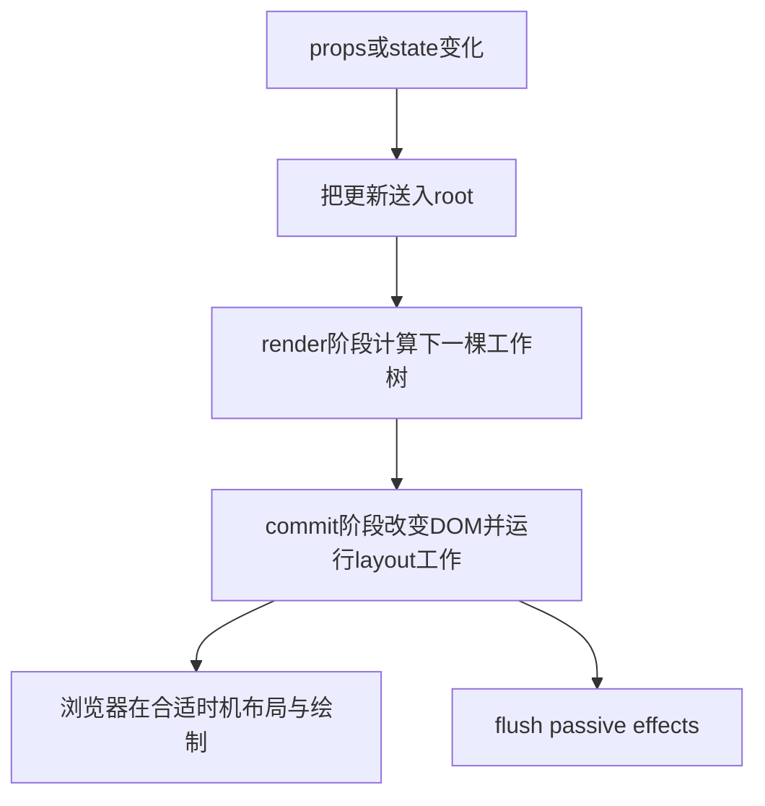

# React：从 JSX、Fiber、Hooks 推导多应用生命周期

[返回总学习入口](../README.md) · [构建与运行时加载](03-Vite与Webpack如何决定应用加载.md) · [Vue 的另一种实现](04-Vue从编译响应式到应用卸载.md)

先不引入任何微前端框架。页面上只有两个 DOM 容器，宿主想把同一份 React 播放器放进去，分别更新、关闭，再重新打开。需要弄清楚：一份组件代码为什么能产生两份状态？移除节点为什么不等于卸载？重复 React 为什么有时可共存、有时立刻报 Hook 错？

本章沿“源代码 → 元素描述 → Fiber 工作 → 提交 → 副作用 → 退出”的链条回答这些问题，再从答案推导通用微前端契约。最后才把这些契约交给 MicroApp 检验。

**版本基线：** PC／移动主应用声明 React `^18.2.0`；当前 [pnpm-lock](../../pnpm-lock.yaml) 与已安装的 React／ReactDOM 均为 **18.3.1**。下文源码固定到 React `v18.3.1`，API 依据 [18.3.1 官方归档](https://18.react.dev/)。当前 react.dev 默认展示 React 19 系列，不能把新增选项直接抄进本仓库。旧 demo 还有 React 17，渲染入口与开发检查要单独核对。

## 1. JSX 到底生成了什么

考虑这段源代码：

```jsx
function Reader({ chapterId }) {
  return <Player chapterId={chapterId} />
}
```

JSX 是编译输入，不是浏览器原生语法，也不会在转换时创建 DOM。经典 transform 可把它改为 `React.createElement(Player, {chapterId})`；自动 transform 通常从 `react/jsx-runtime` 引入对应函数。开发 transform 还可能用 jsx-dev-runtime。转换方式由编译插件决定，不由 `<Player>` 这个标签自己决定。[官方 JSX transform 说明](https://legacy.reactjs.org/blog/2020/09/22/introducing-the-new-jsx-transform.html)

先把自动 transform 的细节缩掉，理解这个**示意结果**：

```js
const element = {
  type: Player,                // 函数引用，此时不等于已执行 Player()
  key: null,
  props: { chapterId: 'c1' },
  // 实际 ReactElement 还有内部标记、ref、owner 等字段。
}
```

React 接收到描述后，才在自己的渲染流程中调用函数组件。直接手动 `Player()` 跳过的是 React 建立当前 Fiber／Hook dispatcher 的过程，不只是换一种调用语法。组件不是任意时机都能调用的普通 UI 工厂。

读 [ReactElement.js](https://github.com/facebook/react/blob/v18.3.1/packages/react/src/ReactElement.js) 的 `createElement` 与内部 `ReactElement`：它们组装描述，保存 type／key／props；再看下一节的 root 如何把描述送入 reconciler。**编译器解决“代码变成什么”，渲染器解决“描述怎样成为 UI”**。

对微前端的第一个结论是：远端暴露一个 React 组件，和远端暴露独立应用的 mount／unmount，是两种不同接入契约。前者把组件交给宿主 React 树处理，双方通常需要协调 React 模块和 Context；后者让远端拥有自己的 root，宿主不需要理解它内部的组件树。

## 2. 从 createRoot 走到 Fiber

一个空页面可创建多个 root：

```jsx
const rootA = createRoot(containerA)
const rootB = createRoot(containerB)
rootA.render(<Player instanceId="reader-a" />)
rootB.render(<Player instanceId="reader-b" />)
```

这已经能产生两个独立 React 树，不需要 Proxy 或微前端框架。root 负责的是某个容器内的渲染与调度状态，并不自动提供独立的 JS 全局、CSS、URL、网络权限或线程。

固定源码路径是：

```text
ReactDOMRoot.createRoot(container)
  → createContainer(...)：建立内部 FiberRoot
  → markContainerAsRoot(...)：记录容器归属
  → listenToAllSupportedEvents(...)：安装事件入口
  → 返回公开 root 对象

root.render(element)
  → updateContainer(element, internalRoot, ...)
  → 安排该 root 的更新工作
  → reconciler 计算并提交需要的变化
```

前三个入口见 [ReactDOMRoot.js](https://github.com/facebook/react/blob/v18.3.1/packages/react-dom/src/client/ReactDOMRoot.js)，后续调度见 [ReactFiberWorkLoop.new.js](https://github.com/facebook/react/blob/v18.3.1/packages/react-reconciler/src/ReactFiberWorkLoop.new.js)。这里的 `.new.js` 是该固定版本仓库中的内部实现分支命名，不是让业务 import 的路径，也不是 React 19 的新 API。

### Fiber 保存了什么

ReactElement 是本次想要的 UI 描述；Fiber 是渲染器持续维护的工作节点。读 [ReactFiber.new.js](https://github.com/facebook/react/blob/v18.3.1/packages/react-reconciler/src/ReactFiber.new.js) 的字段与 `createWorkInProgress`，重点看这些关联：

| 字段或关系 | 用来回答的问题 |
| --- | --- |
| `type / key` | 这份描述与旧节点是否代表同一个组件位置？ |
| `return / child / sibling` | 工作树如何遍历，逻辑父子关系是什么？ |
| `pendingProps / memoizedProps` | 当前需要计算什么，上次完成了什么？ |
| `memoizedState / updateQueue` | 此组件已持有的状态、Hook 链和更新信息在哪里？ |
| `flags / subtreeFlags` | 提交阶段需要处理哪些变化与副作用？ |
| `lanes / childLanes` | 此节点或子树有哪些优先级的待处理工作？ |
| `alternate` | 当前树与另一份工作中节点如何关联？ |

可以把 current 看成已提交的一侧，把 work-in-progress 看成正在计算的一侧。更新时不必重新分配所有节点，`createWorkInProgress` 会创建或复用 alternate，并复制必要状态。它们是内部缓冲关系，**不是两套已经同时显示在页面的 DOM**。

宿主读取容器里有几个 DOM 节点，只看到当前提交结果。React 此时也可能有尚未提交的工作，因此“root.render 已调用”不能当成“用户已经看见本次界面”。

## 3. render、commit 与浏览器 paint 是三层时钟

先看一条更新轨迹：



图中 E、F 没画固定先后：`useEffect` 并不保证每次都严格在 paint 之后。通常非交互更新可先让浏览器绘制；交互、layout 触发更新等情况又可能提早刷新 passive 工作。准确合同应围绕 commit 与 effect 的用途建立，而不是记住“一定过一个宏任务”。[React 18 useEffect 时序边界](https://18.react.dev/reference/react/useEffect)

### 3.1 render 阶段为什么要求纯计算

在允许并发工作的路径中，React 可以在工作单元之间让出、继续或舍弃尚未提交的 render。源码 `workLoopConcurrent` 在循环中检查 `shouldYield`；同步路径另有 `workLoopSync`。因此组件函数本次被调用，不保证这次结果一定提交。

如果在函数体里注册事件、发业务写请求、创建播放器连接，就可能为一份最后没有提交的 UI 留下外部动作。把这些动作放在能成对退出的 effect 或明确用户事件中，是由执行模型推出来的要求，不是代码风格偏好。

并发不是多线程：React 不能抢占你的 `while(true)`，不能把一次很长的组件函数自动切成任意细粒度，也不会让同页面两个 root 拥有独立 CPU。调度在框架工作单元之间协作进行；当前 JS 调用栈不返回，宿主与另一应用一样会被阻塞。[React 18 并发模型说明](https://react.dev/blog/2022/03/29/react-v18)

### 3.2 commit 阶段处理哪些事情

沿固定源码 `commitRootImpl` 看这些阶段，而不需要先背所有 flags：

1. before-mutation 工作读取更新前的必要状态。
2. mutation 工作将本次变化写到 DOM，并处理相关卸载／ref／layout 清理分支。
3. 完成后的树切换为 `root.current`。
4. layout 工作调用需要读取提交后 DOM 的逻辑，包括相应 layout effect。
5. passive 工作由 `flushPassiveEffectsImpl` 等路径刷新，包含 passive cleanup 与 setup。

这些提交工作本身仍会消耗主线程。`useLayoutEffect` 中长计算会延迟绘制；`useEffect` 中死循环也不会因“被动副作用”这个名字而变成后台工作。[固定提交源码](https://github.com/facebook/react/blob/v18.3.1/packages/react-reconciler/src/ReactFiberWorkLoop.new.js)

### 3.3 宿主应该怎样判断完成

```js
const result = root.render(element) // undefined
await result                      // 不能据此证明本次commit或业务数据完成
```

应分别定义：更新已提交、组件树已提交、关键业务已就绪。需要知道首个提交时，可由树内的 layout 探针报告本次 generation；宿主按 generation 去重并结算。需要知道播放器可用，则由实际播放器或数据流程报告。渲染错误的拒绝、退出前未就绪的取消也要纳入协议，不能只等待一个成功回调。

`flushSync` 是少数与外部同步 API 协调时的工具，不应成为所有微应用 mount 的默认包装。它改变调度成本，也不让网络、播放器或未来 effect 自动业务就绪。

## 4. 两个 Player 为什么有两份 state

状态不是保存在函数对象本身，也不因为相同函数名就全局共享。React 把状态关联到当前 root 中的组件位置与身份。

`reconcileSingleElement` 会比较 sibling 范围里的 key，再核对类型是否兼容；可复用时通过 `useFiber` 延续状态，不能复用时删除旧节点并创建新节点。列表还有对应的多节点匹配算法。读 [ReactChildFiber.new.js](https://github.com/facebook/react/blob/v18.3.1/packages/react-reconciler/src/ReactChildFiber.new.js)，再对照 [状态保留与重置](https://18.react.dev/learn/preserving-and-resetting-state)。

| 更新方式 | 通常意味着什么 |
| --- | --- |
| 同一 root、同位置、同类型与 key，只更新 chapterId | 延续组件身份，状态一般保留；相应 props／effect 更新 |
| 将 key 从 c1 换为 c2 | 告诉 React 此位置是另一身份，旧状态清理，新状态初始化 |
| 把 Player 改成另一组件类型 | 原子树退出，新类型建立自己的状态 |
| root.unmount 后再 createRoot | 旧 root 的树已结束；新 root 不继承旧 Hooks 状态 |
| 每次 render 内部临时定义一个 Player 函数 | 函数引用不断变化，可能使本应更新的子树变成反复重建 |

key 只在相应父节点的子列表中表达身份，不是跨页面、跨 root 的全局应用 ID。微前端 name、平台资源 ID、React key、业务请求代次分别管理不同对象，不能互相代替。

这也解释一个常见误诊：“换章节状态没清空，所以沙箱失效。”实际可能只是同一 Player 身份被复用；反过来，章节 key 每次随机变化导致重建，也不应归因于入口脚本重复加载。

## 5. Hooks 的位置、闭包与模块身份

### 5.1 useState 只是公共入口，状态由渲染器安排

固定 [ReactHooks.js](https://github.com/facebook/react/blob/v18.3.1/packages/react/src/ReactHooks.js) 中，`useState` 先通过 `resolveDispatcher` 取得当前 dispatcher，再委托它执行。dispatcher 指针保存在当前 React 模块导出的内部对象中。

渲染器的 [ReactFiberHooks.new.js](https://github.com/facebook/react/blob/v18.3.1/packages/react-reconciler/src/ReactFiberHooks.new.js) 在 `renderWithHooks` 中设置当前 Fiber，选择 mount／update dispatcher，再调用组件函数。`mountWorkInProgressHook` 将有状态 Hook 记录接到 Fiber 的 `memoizedState` 链，update 则按同样顺序访问／克隆相应记录。

```text
一次Player渲染：
  Hook 1 = useState(chapter)
  Hook 2 = useState(volume)
  Hook 3 = useEffect(connection)

下一次必须按相同规则解释这些位置，不能因为if分支变成：
  Hook 1 = useState(volume)
  Hook 2 = useEffect(connection)
```

这是为什么不能在普通异步回调、条件分支或随意的手动组件调用中使用 Hook。注意并非每一种 Hook 在 React 18 中都挂同一条 stateful 链，例如源码明确区分 context 等情况；业务仍应遵守稳定的 Hooks 规则，而不是凭某个内部特例绕开规则。

### 5.2 每次 render 的闭包读取的是该次快照

```jsx
function Counter() {
  const [count, setCount] = useState(0)
  function once() {
    setCount(count + 1)
    setCount(count + 1)
  }
  function twice() {
    setCount(n => n + 1)
    setCount(n => n + 1)
  }
  // 返回包含两个按钮的UI；示例只展示更新语义。
}
```

前者把该次闭包看到的同一个值各加一，两次入队的目标相同；后者让队列按顺序计算两次变换。批处理减少中间提交，不会把闭包变量改成实时可变指针。[状态快照](https://18.react.dev/learn/state-as-a-snapshot)

React 18 的 createRoot 路径将自动 batching 扩展到 Promise、计时器和原生事件等来源。不要据此承诺任意相邻异步任务总被并到一个 commit；更新优先级、边界与同步刷新都会影响调度。微应用应按“已提交的结果”报告观测，不按“setState 调用了几次”猜 UI 就绪。[React 18 发布说明](https://react.dev/blog/2022/03/29/react-v18)

### 5.3 重复 React 为什么不是简单的版本号问题

假设 DOMRenderer-A 持有 React-A，渲染某组件时设置的是 A 的 dispatcher；该组件却从 React-B 调用 useState，B 会读取自己的 dispatcher，可能仍是 null／不可用于该阶段的值。即使 A/B 都印着 `18.3.1`，它们也可能是两份模块对象。模块 URL、构建 external／alias、依赖解析和 realm 都可能决定它们的身份。

| 配对方式 | 能否据此判断 |
| --- | --- |
| 组件与其 renderer 都使用同一 React-A | 满足 Hook 模块身份的基本条件，仍需检查使用规则与版本兼容 |
| 两个完全独立应用，各使用自己的 React／ReactDOM 配对 | 可以同页共存；并不因有两份 React 就必然失败 |
| 宿主 renderer-A 渲染远端组件，但远端 Hook 来自 React-B | 易出现 invalid Hook call，优先查模块身份 |
| 共享 React，但复制了定义 Context 的模块 | Provider 与 useContext 可能拿到不同 Context 对象；包名相同也不能保证相同引用 |

所以“微前端必须全站强制一份 React”与“各自打包就绝对安全”都过于粗糙。先决定远端暴露的是组件还是完整应用，再决定需要共享哪些运行时、范围与版本。Module Federation 的 singleton 或 Vite dedupe 只在各自配置与解析范围生效，不是跨 origin／realm 的全宇宙单例。[官方重复 React 解释](https://react.dev/warnings/invalid-hook-call-warning)

## 6. root 边界也会切断 Context

假设宿主树提供了用户 Context，但插件用新 root 渲染：

```jsx
hostRoot.render(<UserContext.Provider value={user}><Host /></UserContext.Provider>)
pluginRoot.render(<Plugin />)
```

即使 Plugin 的容器在宿主 DOM 的内部，它也不自动成为 Provider 的 React 子树。Context 沿 React 树传播，不沿 DOM 祖先或相同 module 单例“穿过去”。两个 root 仍可恰好导入同一个全局 store，这又是另一条共享引用路径，不能把它当作 Context 自动继承。

需要跨应用共享时，先约定数据／能力接口。若选择外部 store，应提供 subscribe 的取消函数与稳定的 snapshot 协议；React 18 的 `useSyncExternalStore` 是读取这类 store 的框架接口。它解决与 React 渲染的一致性，不替你定义身份、撤销、平台权限或版本兼容。[useSyncExternalStore](https://18.react.dev/reference/react/useSyncExternalStore)

反例：仅向远端暴露 `window.currentUser` 对象，组件读了一次并不会自动因对象属性改变而重新渲染；把它放进 effect 也没有凭空产生可靠的订阅与释放机制。

## 7. 事件、Portal 与三棵不同的树

同时区分：DOM 树、React 逻辑树、微应用拥有关系。它们可以相近，也可以因 root、Portal、宿主能力而分开。

### 7.1 根委托意味着什么

React 17 起，大部分可委托事件从 document 级入口改为 root 容器级入口，使不同树与不同版本的整合更可控。React 18 的 `listenToAllSupportedEvents` 仍有 nonDelegatedEvents、document 上 selectionchange 等特例，所以不能说“所有监听只挂根节点”。[React 17 官方事件说明](https://legacy.reactjs.org/blog/2020/10/20/react-v17.html)、[固定事件源码](https://github.com/facebook/react/blob/v18.3.1/packages/react-dom/src/events/DOMPluginEventSystem.js)

事件到达原生监听入口后，React 找对应 Fiber，积累逻辑树上的 handler，再按相应捕获／冒泡规则派发。业务的 `onClick` 并不等于给每个按钮单独装一个原生监听。

但 root 不是浏览器事件防火墙：A 的按钮仍在主 document，原生 capture／bubble 监听可以看见符合传播路径的事件；嵌套 root 也要分别分析两个系统的入口。真正独立 iframe document 中的原生事件不会自动跨到父 document；若显式使用同源跨 document Portal 或消息桥，需要另外验证 ownerDocument、焦点及事件规则，不能用“都叫 iframe”一笔带过。

### 7.2 Portal 改的是物理位置，不是逻辑父级

```jsx
function Player({ portalTarget, report }) {
  return (
    <section onClick={() => report('player-parent')}>
      {createPortal(
        <button onClick={() => report('portal-button')}>控制播放</button>,
        portalTarget,
      )}
    </section>
  )
}
```

若 portalTarget 位于 section 外，按钮原生 DOM 路径不经过该 section；React 的父级 onClick 仍可以响应，因为 Portal Fiber 仍属于原树。Context 也保持原来的逻辑来源。[createPortal](https://18.react.dev/reference/react-dom/createPortal)

由此推出三个微前端问题：

1. **样式归属**：按钮移出应用的 CSS 前缀容器后，React 仍认识它，CSS 选择器却可能不再匹配。保持 Context 不等于保持样式。
2. **退出归属**：通过原 React 树正常 unmount，Portal 内容应随该树清理；只清掉应用根 DOM，不能代替框架处理树外节点。
3. **层级与交互**：宿主应明确每实例的 overlay 容器、z-index／滚动／焦点责任，而不是让所有插件抢真实 body。仅允许传一个 portalTarget 仍不等于已解决模态框可访问性。

这不是某个微前端框架特有的问题，而是 UI 框架逻辑树与物理 DOM 可分离带来的必然架构约束。

## 8. effect 的真正合同：建立同步关系，并能解除

effect 用来把组件状态与外部系统同步。`mountEffectImpl` 把 create／deps 记录成 effect；`updateEffectImpl` 比较依赖，决定本次是否标记需要执行；提交路径运行 create，保存它返回的 cleanup，后续在变更或卸载时调用。依赖比较使用逐项 `Object.is`，不是序列化内容深比较。[Hooks 固定实现](https://github.com/facebook/react/blob/v18.3.1/packages/react-reconciler/src/ReactFiberHooks.new.js)

```text
依赖 c1：setup(c1) → 保存 cleanup(c1)
依赖变 c2：cleanup(c1) → setup(c2) → 保存 cleanup(c2)
真正卸载：cleanup(c2)
```

这里的 cleanup 会因依赖变化运行，不只因 root.unmount。日志里有 cleanup，不足以证明宿主真的卸载了应用。

### 异步 effect 的正确分工

`useEffect(async () => ...)` 返回的是 Promise，React 需要的却是 cleanup 函数或不返回，因此不能直接拿 async 函数当 effect setup。将异步工作放在 setup 内，并把释放函数同步返回：

```jsx
function Chapter({ chapterId, active, loadChapter }) {
  const [view, setView] = useState({ state: 'idle' })

  useEffect(() => {
    if (!active) return
    let valid = true
    const aborter = new AbortController()
    setView({ state: 'loading' })

    async function run() {
      try {
        const value = await loadChapter(chapterId, { signal: aborter.signal })
        if (valid) setView({ state: 'ready', value })
      } catch (error) {
        if (valid && !aborter.signal.aborted) setView({ state: 'failed', error })
      }
    }
    run()
    return () => {
      valid = false
      aborter.abort()
    }
  }, [chapterId, active, loadChapter])

  return <ChapterView view={view} />
}
```

`ChapterView` 与 `loadChapter` 由应用提供，这是同步关系示意，不是独立可运行文件。每次 effect 执行拥有自己的 valid 闭包；依赖更新先使旧闭包失效，旧结果就不能提交。Abort 是尽力取消资源，valid 是禁止旧提交，两者作用不同。`loadChapter` 若每次渲染都是新函数，会反复重新建立 effect，应由接口设计保证需要的引用稳定，而不是删掉依赖规避检查。

如果微前端宿主只是把 DOM 移走或 display:none，React 未必发生任何 props 更新或 unmount，上述 cleanup 也不会因此自动运行。需要暂停时，应通过明确的 active 更新或应用 pause 接口把意图送到组件，不从“肉眼看不见”推断同步关系已结束。

## 9. StrictMode、Fast Refresh 和真实重挂不能混成一件事

### 9.1 开发检查为什么故意多走一次

React 18 开发构建的 StrictMode 会额外调用某些应该纯净的 render 逻辑；首次提交的 effect 也会经历额外 setup／cleanup 验证。`commitDoubleInvokeEffectsInDEV` 能看到先清理 layout／passive，再重新建立的检查路径。[StrictMode 18 文档](https://18.react.dev/reference/react/StrictMode)、[固定检查源码](https://github.com/facebook/react/blob/v18.3.1/packages/react-reconciler/src/ReactFiberWorkLoop.new.js)

因此必须区分两项计数：组件函数／effect 执行次数，以及宿主调用 mount／unmount 的次数。前者增加不能直接证明宿主重复创建应用；检查通过的目标也不是硬把 setup 限成只执行一次，而是重复建立／解除后实际仅保留一份当前资源。

反例：用模块级 `alreadyStarted=true` 跳过第二次 effect setup，第一次检查 cleanup 已关闭连接，第二次被跳过，页面看似不再“双请求”，却可能已经没有连接。另一个实例还会共享这个模块变量。应修对称 cleanup 和资源作用域，不能靠全局开关掩盖。

### 9.2 Fast Refresh 为什么会掩盖生产重挂问题

Vite React 插件的热更新与 React Refresh 会记录组件 family／signature，合适的更新可以保持 state，不合适的更新会重新挂载。固定 [ReactFreshRuntime.js](https://github.com/facebook/react/blob/v18.3.1/packages/react-refresh/src/ReactFreshRuntime.js) 的 `canPreserveStateBetween`、`performReactRefresh` 将更新分为保留与 stale family；这些额外开发规则不同于生产仅按组件身份协调。

所以“保存源码后页面正常”没有验证：卸载后同一 ESM URL 不重新求值、旧 root 已失效、新 mount 是否创建新 root、订阅是否重新成对注册。生产验收必须真的 mount → update → unmount → mount，不能靠 HMR 代替。

## 10. 推导一个框架适配器，而不是先背微前端 API

现在定义最小契约：容器由宿主提供；React root 由本实例拥有；更新延续同一 root；退出调用 root.unmount；重开创建新 root。根外的能力、订阅、播放器与 overlay 仍各有拥有者。

下面是**提交型适配器**：mount／update 的返回只表示已将元素提交给 React 调度，不表示 commit／业务 ready 已完成。它刻意不通过一个假的已完成 Promise 混淆三种时刻。

```jsx
import { createRoot } from 'react-dom/client'
import { Player } from './Player.jsx'

export function createPlayerApplication({ container, instanceId, services }) {
  let root = null
  let props = null

  function render() {
    root.render(<Player {...props} instanceId={instanceId} services={services} />)
  }

  return {
    mount(initialProps) {
      if (root) throw new Error(`实例已挂载: ${instanceId}`)
      props = initialProps
      root = createRoot(container, { identifierPrefix: `${instanceId}-` })
      render()
    },
    update(nextProps) {
      if (!root) throw new Error(`实例尚未挂载: ${instanceId}`)
      props = { ...props, ...nextProps }
      render()
    },
    unmount() {
      if (!root) return
      const previous = root
      root = null
      props = null
      previous.unmount()
    },
  }
}
```

工厂按实例调用一次；module 可以只加载一次。`instanceId` 不应被另一个活跃适配器复用；container 不应同时被两个 root 占有。`identifierPrefix` 用于协调 useId，不替代业务 name，也不会自动给你手写的 id 加前缀。React 18 createRoot 的稳定公开错误选项包括 onRecoverableError；不能把 React 19 的 onCaughtError／onUncaughtError 直接当成 18 的稳定接口。

真实应用还应在树内配置相应错误边界与业务状态回调，给宿主提供明确的提交／失败／ready 信号；通知按本次实例／工作代次处理。错误边界不能捕获任意异步事件错误，网络与能力调用的拒绝仍需自己的错误通道。这个最小适配器没有宣称覆盖完整取消或错误恢复协议。

### 最容易写错的版本

```jsx
// 反例：模块只求值一次，却把只可使用一次生命周期的root放在顶层。
const root = createRoot(document.querySelector('#root'))
export const mount = () => root.render(<Player />)
export const unmount = () => root.unmount()
```

第一次退出后，root 的内部指针已经置空。再次 import 相同 URL 可能复用模块记录，再次 mount 仍使用已经卸载的 root，出现 Cannot update an unmounted root。给加载器加随机 query 虽可能重新执行模块，也扩大模块与依赖副本、缓存和副作用问题；根因应先修 root 的生命周期所有权。[ReactDOMRoot.unmount 源码](https://github.com/facebook/react/blob/v18.3.1/packages/react-dom/src/client/ReactDOMRoot.js)

## 11. SSR 与 hydration 改变的前提

createRoot 适用于由客户端建立的树；hydrateRoot 用于接管**由匹配 React 服务端渲染生成**的既有 HTML。hydration 需要客户端预期树与服务端 HTML 协调，事件与状态随后接上；不是对任意下载 HTML 都有效的“更快挂载”。[React 18 hydrateRoot](https://18.react.dev/reference/react-dom/client/hydrateRoot)

对微前端，这意味着要另外约定：哪个服务端生成哪个容器片段、资产和版本如何匹配、首屏数据如何传递、useId 前缀如何对应、宿主是否会在 hydration 前移动／改写 DOM。若宿主随意清空容器，再调用 hydrateRoot，已经破坏接管前提。反过来，对单纯空插槽启动的 CSR 子应用，没有必要为了“高级”强加 hydration。

## 12. 用不依赖微前端框架的实验验证推导

本地可用的实验资产是已安装 React／ReactDOM 18.3.1 的 development UMD；由讲义服务白名单提供时，应记录真实文件版本与摘要，不能悄悄从 CDN 换成另一版。裸 HTML 中按顺序加载同一套 React 与 ReactDOM，可用 createElement 代替 JSX，以暂时移除构建变量。正式项目的 ESM import／JSX 插件是上一章要验证的另一层。

以下是**实验设计与判定条件**，实际执行范围以总验证记录为准；本章不会把写出实验当成已经运行。

| 实验 | 固定输入／操作 | 应观察什么 | 反证如何解释 |
| --- | --- | --- | --- |
| 双 root | A/B 各 createRoot，组件类型相同，分别加计数 | A 状态变化不改 B；两者可共享框架代码 | 若共享模块 store 变化，先区分组件 state 与外部引用 |
| Context 边界 | A 有 Provider，B 为单独 root，B 读同一个 Context 对象 | B 得到默认值，除非自己提供 Provider | DOM 嵌套没有使 B 进入 A 的逻辑树 |
| Portal | A Portal 到独立 overlay，button 和 A 逻辑父都记日志 | React 父回调可触发；实际 DOM 不在 A 普通 section 内 | 用宿主原生事件路径与 React 路径对照，不把两者合成一棵树 |
| StrictMode | 每次 effect setup 增资源数、cleanup 减资源数 | 开发日志可多轮；稳定后 1 份，卸载后 0 份 | 只统计 setup 次数会误判；全局 once 可能反而隐藏失效连接 |
| 重挂 | root.unmount，再 root.render；随后新 createRoot | 旧 root 更新失败，新 root 可运行 | 证明 root 生命周期，不能推论全部外部资源均已释放 |
| 模块重复 | renderer 使用 React-A，组件 Hook 使用另一份 React-B | 触发身份不匹配风险，并与独立配对双应用对照 | 仅版本字符串相等不能证明两份 exports 相同 |

这些实验首先建立“React 自己保证什么”。后续引入任何微前端框架，都只能在明确额外机制和证据后增加保证。

## 13. 源码走读：一次只追一条因果链

| 你需要解释的现象 | 固定 v18.3.1 入口 | 跟到哪里即可回答当前问题 |
| --- | --- | --- |
| JSX 为什么不是 DOM | `ReactElement.createElement` | 保存 type／key／props，组件尚未因此执行 |
| render 为什么不等于完成 | `ReactDOMRoot.render → updateContainer` | 更新排队与工作循环，区分公开返回值与提交 |
| state 为何保留或重置 | `reconcileSingleElement → useFiber / createFiberFromElement` | key、类型与父位置；再看 Hook state 延续 |
| Hook 顺序为何重要 | `renderWithHooks → mount/updateWorkInProgressHook` | 当前 Fiber、dispatcher、链表推进顺序 |
| effect 如何进入清理 | `mount/updateEffectImpl → commitHookEffectListUnmount/Mount` | create、deps、destroy，以及何时执行 |
| Portal 事件为何跨物理祖先 | `dispatchEventForPluginEventSystem → accumulateSinglePhaseListeners` | HostPortal／HostRoot 与 Fiber.return 路径 |
| StrictMode 为什么多执行 | `commitDoubleInvokeEffectsInDEV` | 开发特性条件与卸载／重建检查，不将其当宿主重复 mount |
| Refresh 为什么保留 state | `performReactRefresh → canPreserveStateBetween` | family／signature 的开发路径，明确它不是生产重挂 |

effect 的提交函数位于 [ReactFiberCommitWork.new.js](https://github.com/facebook/react/blob/v18.3.1/packages/react-reconciler/src/ReactFiberCommitWork.new.js)；其他文件链接在上文。本地安装包通常是合并后的构建文件，不应把源码仓库内部文件名当成应用可 import 的公开模块。

## 14. 现在才推导微前端要求

无需选择框架，前面的机制已经要求宿主／子应用协议至少回答：

- **加载**：模块记录可复用，应用实例必须可重复创建；不把顶层求值当每次 mount。
- **依赖**：远端是组件还是应用；谁拥有 renderer，React／Context／store 在什么范围共享，版本与 identity 怎样确认。
- **容器**：root 与 Portal／overlay 分别归谁；外部代码何时有权清空节点。
- **时序**：提交、关键业务 ready、失败、取消分别如何报告；不 await 一个 undefined 冒充完成。
- **退出**：先让框架解除逻辑树，再回收宿主资源与容器；隐藏需要额外的 pause／active 合同。
- **故障范围**：root 分离并不隔离主线程、DOM、CSS、网络权限或共享对象，需要其它架构决定。

到 MicroApp 实现篇再逐项问：它如何让脚本暴露生命周期？何时调用 root 的卸载钩子？移动 DOM 会不会自动触发 React cleanup？ESM 和 realm 选择怎样影响模块身份？哪些资源只由业务持有？这样读实现，才是在验证架构，而不只是记框架开关。

## 15. 自测：给出推理，而不只给改法

<details>
<summary>同一份播放器在两个root中使用Context，为什么B看不见A的Provider？</summary>

先确认组件读取的是同一个 Context 对象，再看逻辑树。即使 Context 相同、DOM 容器嵌套，B 的 root 仍没有 A Provider 祖先。需要显式传值／能力、B 自己的 Provider，或选择真正属于 A 树的 Portal／组件接入；不能把“去重 React”当成 Context 跨 root 的答案。

</details>

<details>
<summary>为什么await mount()之后插件仍没有数据，甚至DOM还没出现？</summary>

检查 mount 的合同。若只是调用 root.render 并返回，await 的只是同步函数返回值；即使首个 commit 已发生，数据请求仍可能未结束。分开提交与业务 ready，通过本次 generation 的信号结算，并加入失败和取消路径。加一个固定延时不能建立合同。

</details>

<details>
<summary>React和ReactDOM版本相同，为何只有远端组件调用useState时报错？</summary>

先排除 Hook 调用位置与版本不兼容，再验证远端 Hook 所用 React exports 是否与 renderer 内部引用同一模块对象。相同版本可以来自两个 URL／bundle／realm；renderer 设置 A dispatcher，组件调用 B dispatcher，就会断裂。完整独立配对的两个应用是对照，不可据此要求全页面只有一份 React。

</details>

<details>
<summary>隐藏播放器后轮询继续，应该删除React的全局计时器吗？</summary>

先看隐藏是否只是 DOM／CSS 行为。若组件未卸载、active 未更新，effect 的同步关系尚未结束。把暂停意图送到拥有轮询的组件／服务，用对应 cleanup 或 pause 停止自己的资源；不能一刀切删除共享页面的计时器，也不能由此声称 React 卸载失效。

</details>

<details>
<summary>Portal弹层能读取A的Context，却失去了A的前缀样式，是否矛盾？</summary>

不矛盾。Context 与合成事件沿逻辑树，CSS 选择器匹配物理 DOM。检查 portalTarget、最终节点位置与匹配规则，再决定每实例 overlay 根或样式策略。不要为了样式把逻辑树改成另一个 root，却忘了 Context 和卸载语义也随之变化。

</details>

完整来源、版本与本地核对记录见 [React 研究依据](../research/react-evidence.md)。
