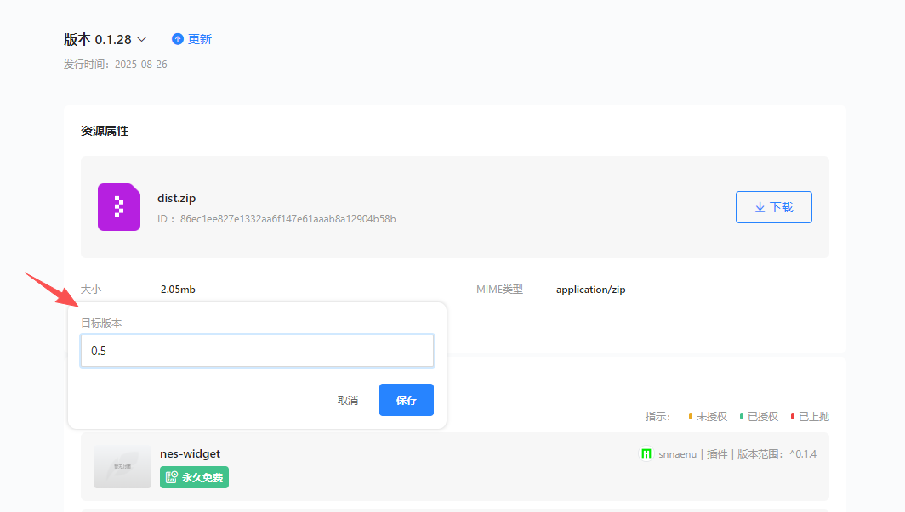

# 运行时版本说明

Freelog 平台运行时会随 **业务 API** 与 **框架能力** 的演进发布多个版本。主题、插件在发布资源时需要声明自己依赖的**运行时版本**，节点访问时的运行时版本以主题配置的版本为准，插件版本若与主题不同将无法运行。

当前平台对外提供 **0.4**、**0.5** 两个运行时版本，**0.4**目前只支持旧的主题插件运行，不再维护，请使用最新的**0.5**版本。

## 什么是运行时版本

|   概念   | 说明 |
| ----- | --- |
| **运行时版本** | 主题/插件运行的宿主版本，平台节点服务会根据主题配置的运行时版本加载不同的运行时 |
| **作用** | 节点访问时，根据主题上配置的版本，加载对应版本的运行时 |
| **与 npm 库** | 本地开发安装的 `freelog-runtime` 库应与所选运行时版本一致,0.5对应"freelog-runtime@^5.0.7"，0.4对应"freelog-runtime@^4.1.9"；API 差异见 [0.4 到 0.5 迁移指南](./migrate.md) |

运行时版本在**不兼容变更**时才会递增（例如 API 更名、参数/返回值不兼容）。仅优化、兼容式改动通常不强制升版本。

## 当前可用版本

| 版本 | 说明 |
| --- | --- |
| **0.4** | 历史默认版本，不再维护；未显式填写运行时版本时，平台按 **0.4** 处理 |
| **0.5** | 当前维护版本；API 命名与能力有调整，新增部分授权相关接口 |

从 0.4 升级到 0.5 的 API 对照见：[0.4 到 0.5 迁移指南](./migrate.md)。

## 默认版本：0.4

在发布资源时，若**未填写或未选择**「目标版本（运行时版本）」，平台会**默认使用 0.4**。

因此：

- 老项目未改配置时，仍落在 0.4，行为与历史一致。
- 新项目若要用 0.5 的 API，**必须在发布时明确填写目标版本 0.5**，不能依赖默认值。

## 主题与插件的版本必须相同

主题通过依赖树加载插件。同一节点下，**主题与其依赖的插件必须使用相同的运行时版本**。

```
✅ 主题 0.5 + 插件 A 0.5 + 插件 B 0.5
❌ 主题 0.5 + 插件 A 0.4   ← 版本不一致，运行可能异常
❌ 主题 0.4 + 插件 A 0.5
```

操作建议：

1. 确定节点要使用的运行时版本（建议新开发统一 **0.5**）。
2. 主题上传 zip 时选择该版本（见下文 [发布时如何选择](#发布时如何选择运行时版本)）。
3. 每个插件资源上传时也选择**相同**版本。
4. 在主题资源里「添加依赖」前，确认依赖的插件版本与主题一致；若插件仍是 0.4，需先为插件发行 0.5 版本或继续整站使用 0.4。

## 发布时如何选择运行时版本

上传主题/插件 zip 时，在「**选择目标版本（运行时版本）**」一步指定 0.4 或 0.5。

详细截图与上传流程见：[如何发布主题和插件](./release.md) → **3.2 选择目标版本（运行时版本）**。



## 节点启用主题后如何生效

1. 用户访问节点域名时，平台节点服务会查询当前节点启用**主题**及其**运行时版本**。
2. 平台节点服务 按该版本加载对应的运行时能力与 API 模块。
3. 主题再通过依赖树加载插件；插件资源版本需与主题一致，否则可能出现接口不匹配或加载失败。

主题签约、启用、切换版本（资源版本号 semver）与运行时版本是两件事：

- **资源版本**：同一主题/插件多次发版的业务迭代（见 [如何启用主题/切换版本](./use-theme.md)）。
- **运行时版本**：自身框架变化和平台展品数据获取等API的兼容档位（本文说明的 0.4 / 0.5）。

## 开发侧对照

| 步骤 | 建议 |
| --- | --- |
| 本地 `freelog-runtime` | 安装与目标运行时版本匹配的文档与类型；0.5 开发请参考当前仓库 `packages/docs` 与 [迁移指南](./migrate.md) |
| 新主题/插件 | 优先选择 **0.5**，依赖插件一并升到 0.5 |
| 维护老项目 | 可继续 0.4，或按迁移指南升到 0.5 后重新上传并选择 0.5 |
| 发布 | 务必在 [如何发布主题和插件](./release.md) → **3.2 选择目标版本（运行时版本）** 中选对版本，避免误用默认 0.4 |

## 常见问题

### 不选版本会怎样？

按 **0.4** 处理。若代码已按 0.5 API 编写，会出现运行时与代码不一致的问题。

### 只把主题改成 0.5，插件还是 0.4 可以吗？

**不可以。** 主题与插件运行时版本必须一致。

### 0.4 和 0.5 主要差在哪？

主要是 `freelogApp` 部分 API 更名、参数及新增授权相关接口。详见 [0.4 到 0.5 迁移指南](./migrate.md)。

### 运行时版本和 Vite / Node 版本有关吗？

**无关。** 运行时版本只表示与 Freelog 平台节点服务 的兼容关系；Node、Vite 等按各自项目与 [指南首页](./index.md) 要求即可。

## 相关文档

- [如何发布主题和插件](./release.md)（含运行时版本选择步骤）
- [0.4 到 0.5 迁移指南](./migrate.md)
- [如何启用主题/切换版本](./use-theme.md)
- [参考 API](../api/widget)
