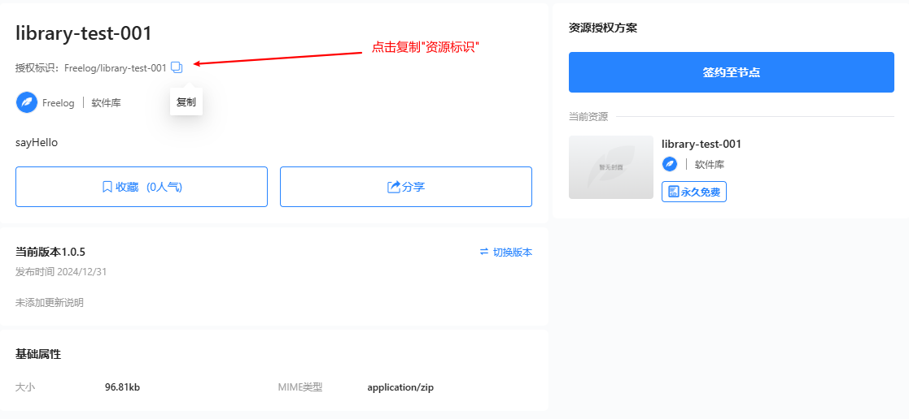

> 环境要求: `freelog-runtime-v2@1.0.0`以上, 主题和插件项目中才需要安装此环境包; 若你是库开发者, 在开发库项目时嵌套了本平台的库, 则不需要安装此环境包;

## 使用freelog市场中的库

本指南, 主要介绍主题/插件/库开发者如何使用在资源市场中的库;

比如你在开发主题时, 你在资源市场中看中了一个`"资源标识"`为 `"Freelog/library-test-001"`的库, 你打算在你的代码中使用这个库

### step1: 添加关系

在"资源管理"页面中, 点击"我的资源"找到主题, 点击"更新", 点击"更多设置", 点击"添加依赖", 并添加此库作为新依赖, 点击"发行"; 并到"节点管理">"主题管理"中, 点击 "编辑"对应主题并进行一次**版本切换**动作, 以触发新依赖树的构建;

> tip: 我们通过在平台中给资源添加依赖的方式来管理库的版本问题, 而非在代码里指定依赖及其要加载的库的版本;

### step2: 编辑代码

到资源详情页中，复制“资源标识”




在主题/插件的代码中使用

```js

// 1. 获取实例
const instance = window.FreelogLibrary

// 2. 调用实例方法getLibraryEntryUrls获取js和css的地址对象, 参数为你要使用的库的"资源标识"
const getUrlsPa = await instance.getLibraryEntryUrls("Freelog/library-test-001")

// 3. 调用实例方法loadLibraryJs加载js入口文件获取库, 第一个参数是js地址, 第二个参数是meta.json数据
const resPa = await instance.loadLibraryJs(getUrlsPa.jsEntryUrl, getUrlsPa.metaJson)

// 使用库去做点什么
console.log(resPa)
```

> tip: 我们通过在平台中给资源添加依赖的方式来管理库的版本问题, 而非在代码里指定依赖及其要加载的库的版本;

## FreelogLibrary实例方法及属性说明

### getLibraryEntryUrls

是一个返回Promise的函数, 用于获取入口文件的地址

```typescript
function getLibraryEntryUrls(libraryResourceName: string): Promise<{
    jsEntryUrl: string,
    cssEntryUrl: string,
    metaJson: any,
    baseUrl: string,
    version: string
}>
```

参数说明: 参数为你要使用的库的"资源标识";

### loadLibraryJs

是一个返回Promise的函数, 用于加载js文件

```js
function loadLibraryJs(jsUrl: string, metaJson: any): Promise<any>
```

参数说明

```plaintext
第一个参数: 为getLibraryEntryUrls返回的jsEntryUrl, 或者metaJson里的js地址;
第二个参数: 为getLibraryEntryUrls返回的metaJson;
```

### loadLibraryCss

是一个无返回值的函数, 用于加载css文件

```typescript
function loadLibraryCss(cssUrl: string): void
```

参数说明

```plaintext
第一个参数: css文件地址, 为getLibraryEntryUrls返回的cssEntryUrl, 或者metaJson里的css地址;
```

### dependencyTrees

是一个返回依赖树集的属性
